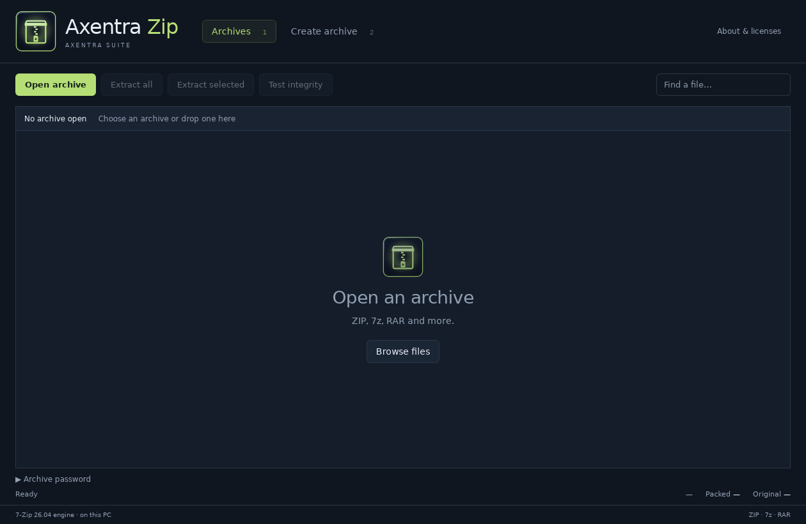

# Axentra Archive on Linux

Verified 2026-10-17 on Zorin OS 18.1 (Ubuntu 24.04), x86_64. Source version **0.1.4**; **development preview**, not a published stable Linux release.

## Run

Open **Axentra Archive** from the application menu, or run:

```bash
~/.local/share/axentra/apps/archive/AxentraZip
```

The preview is installed for the desktop user, with a separate folder for each app. Data and profiles live outside the application folder. Installation does not enable startup or change default applications.

## Available

Create ZIP/7z archives, extract and test archives, encrypted archive workflows, native file pickers, safe temporary output and no-clobber finalization. The installed preview bundles the official 7-Zip 26.04 Linux engine and its license notices.

## Verification

14 Rust tests passed; 2 interactive tests skipped. Native WebKitGTK rendering and API calls passed.

## Remaining work and requirements

RAR creation needs a separately installed and licensed Linux RAR writer. No RAR writer is bundled. File associations are offered by the desktop entry but were not made the default.

## Screenshot



Empty archive view; no personal file opened.
