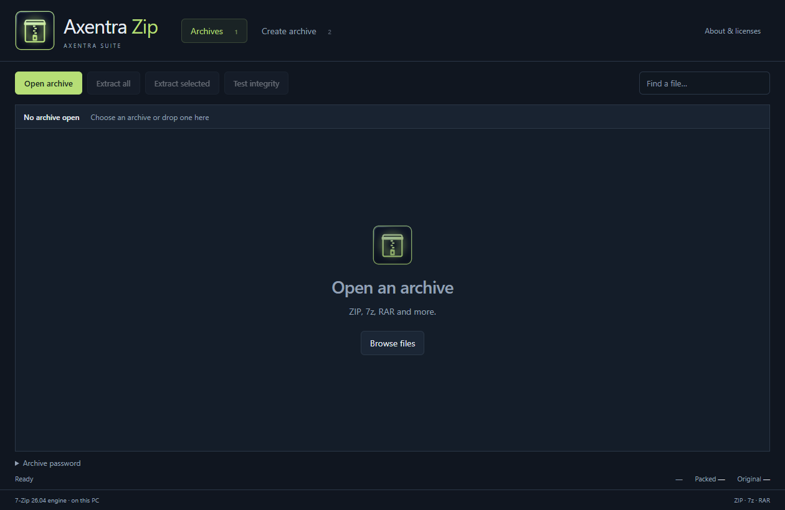

# Archive

**Linux preview (0.1.4, verified 2026-10-17):** [Zorin installation, tests, screenshots and feature limits](LINUX.md).

<!-- current-suite-state -->
## Current local status — 2026-10-16

0.1.4. Public release: **None**. UI and binary are named Axentra Zip; Command shows Axentra Archive. Create ZIP/7z and extract/test archives. RAR creation requires the user's separately licensed WinRAR; no RAR writer is bundled.

Updated Windows installation target: `C:\Program Files\Axentra\Archive`. Installers request administrator rights; existing user data remains in its application data directory.

This status supersedes older installation-path and preparation notes below. Historical release checksums apply only to their original artifacts.

<!-- /current-suite-state -->

## Latest documented preview

Archive / Zip 0.1.4 empty state.
