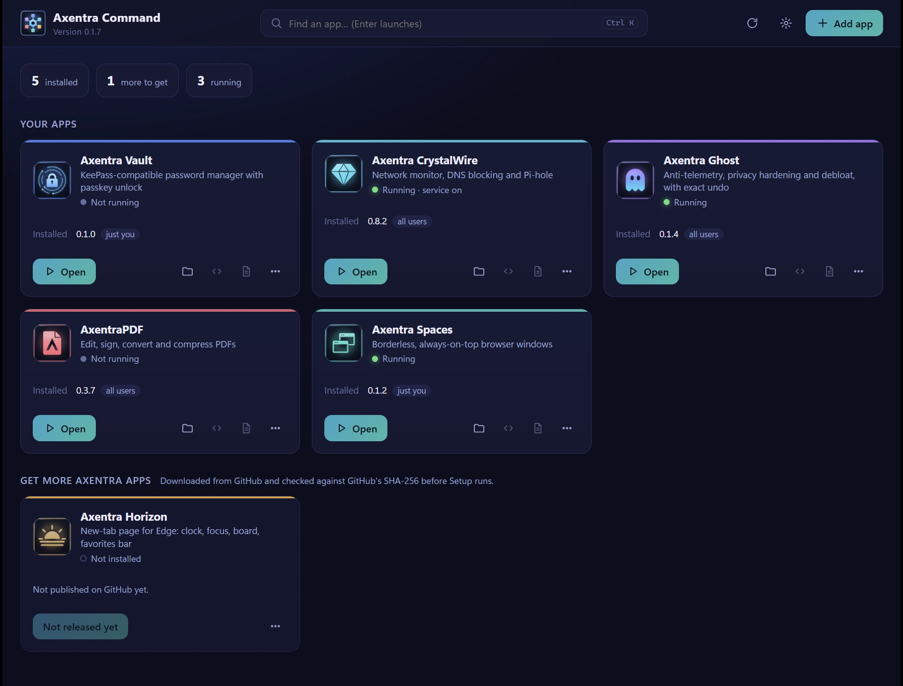

# Axentra Command

<!-- local-release-preparation -->
## Prepared version: 0.1.9

This is a local rebuild of an already published version; the published assets and checksums remain unchanged.
The previously documented version was **0.1.9**.
See [release notes, build status and SHA-256 hashes](releases/0.1.9-rebuild.md) and [changelog](CHANGELOG.md).

- Shawn confirmed the final product name is Axentra Command.
- Source and published documentation both remain at 0.1.9; the only subsequent commit updates TRAY-HOST documentation for AxentraPDF 0.3.8.
- Current 0.1.9 behavior includes self-update, background update checks, tray update alerts and a testing channel; these are existing features, not a new version bump.
- Rebuilt locally with the app's build script; the installer SHA-256 exactly matches GitHub's published asset digest. Preserved the published 0.1.9 release notes and original asset checksum.

The existing published installer and installation instructions below remain valid. The rebuilt `AxentraCommand-0.1.9-Setup.exe` is kept locally with its own checksum. A different rebuilt binary must not replace the published file under the same tag without an explicit release/version decision.

Pending: command-v0.1.9 is already published and the rebuilt installer matches it exactly; no duplicate draft is needed or created.; Code signing and VirusTotal scans of the rebuild remain pending.; Draft release assets remain local at Shawn's request. Pushing and publishing still require approval.
<!-- /local-release-preparation -->

One place for every Axentra app. Command shows what you have installed and what's running, keeps all the suite's
tray icons in one, starts the apps you choose when you sign in, and installs the ones you don't have yet straight
from this repository's releases, checked against GitHub's SHA-256 before anything runs. Install Command first,
then pick the apps you want. There's no account, subscription, ads or tracking.

**Latest published version: 0.1.9** · [Download](https://github.com/MECMwithShawn/Axentra-Software/releases/tag/command-v0.1.9) · [Release notes](releases/0.1.9.md) ·
[Security scans](security/virustotal.md)

## Features

| Area | What you get |
|---|---|
| **Your apps** | A card for every installed Axentra app with its version, who it's installed for (just you or all users), whether it's running, and its background service if it has one. Open the app or its folder in one click |
| **Get more apps** | Apps you don't have yet appear as cards with a **Get** button. Command downloads the installer from this repository's [Releases](https://github.com/MECMwithShawn/Axentra-Software/releases), checks it against the SHA-256 GitHub publishes for that file and only then starts Setup. A file that doesn't match is deleted, and a file without a published checksum is never run |
| **Updates** | Checks in the background from the tray, including updates to Command itself. Tray alerts and Update buttons show newer versions; Settings offers a testing channel for pre-releases |
| **One tray icon** | Axentra apps hide their own notification-area icons while Command is running, and their menus move into Command's: each app gets a submenu with its own actions (for example *Lock vault*, *Show / hide windows*, *Security Center*). If Command closes, the apps' own icons come back. Can be turned off |
| **Alerts in one place** | Apps can report items that need you (for example CrystalWire's review queue). They show as a red or amber dot on Command's tray icon and as a note on the board |
| **Start with Command** | Choose which apps start when you sign in. Command starts them quietly in the tray (or normally, if an app has no tray mode) and skips any that are already running |
| **Quick launch** | Type in the search box (`Ctrl+K`) and press Enter to open the first match |
| **Your own entries** | Add any other program with **Add app**, or edit an entry. Entries are small JSON files you can also write by hand |

## Apps it knows about

Vault, CrystalWire, Ghost, AxentraPDF, Spaces and the Horizon extension. Apps added to the suite later appear in
Command automatically, without a Command update.

## System requirements

- Windows 10 (version 1809 or later) or Windows 11, 64-bit
- Microsoft Edge WebView2 Runtime. It's built into Windows 11 and current Windows 10.
- About 10 MB of disk space

## Installation

Download `AxentraCommand-0.1.9-Setup.exe` from the [release page](https://github.com/MECMwithShawn/Axentra-Software/releases/tag/command-v0.1.9) and check its SHA-256 against the
[release notes](releases/0.1.9.md). Setup installs for your user only, so no administrator rights are needed. It
adds a Start menu shortcut, an optional desktop shortcut and an option to start in the tray when you sign in.
Apps you install from Command use their own Setup, and some of those (for example CrystalWire and Ghost) ask for
administrator rights because they install for all users.

Command isn't code-signed yet, so Windows SmartScreen may say *Windows protected your PC*. Click **More info → Run
anyway**, after checking the checksum.

Installed files and data:

| What | Where |
|---|---|
| Program | `%LOCALAPPDATA%\Programs\Axentra Command` |
| Settings and your own app entries | `%APPDATA%\Axentra\Command` |
| Downloaded installers | `%LOCALAPPDATA%\Axentra\Command\Downloads` |
| Window data (WebView2) | `%LOCALAPPDATA%\Axentra\Command\WebView2` |

**Updating:** run the newer installer. It closes Command, upgrades it in place and keeps your settings.

**Uninstalling:** go to *Settings → Apps → Installed apps → Axentra Command*. This removes the program and its
startup entry. The other Axentra apps stay installed and simply show their own tray icons again.

## Privacy

Command has no servers, accounts, analytics or ads. It talks to GitHub only:

- `api.github.com` to see which versions are published here (about once every 15 minutes while it's open)
- `raw.githubusercontent.com` to read the list of available apps (about once an hour)
- `github.com` to download an installer, and only when you click **Get** or **Update**

Everything else (which apps you have, what's running, your settings) stays on your PC.

## Built with

Rust with Microsoft Edge WebView2 (tao and wry). The installer is made with Inno Setup. The icon is from the
[Axentra Glass + Precision icon kit](../Icon-Kit/).
