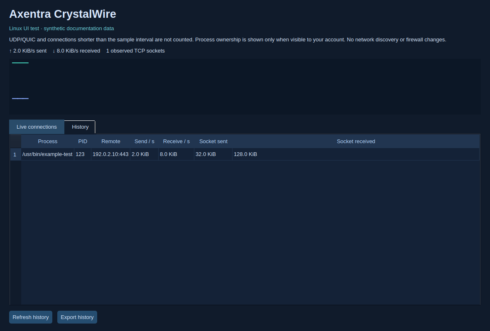

# Axentra CrystalWire on Linux

Verified 2026-10-17 on Zorin OS 18.1 (Ubuntu 24.04), x86_64. Source version **0.8.11**; **development preview**, not a published stable Linux release.

## Run

Open **Axentra CrystalWire** from the application menu, or run:

```bash
~/.local/share/axentra/apps/crystalwire/CrystalWire
```

The preview is installed for the desktop user, with a separate folder for each app. Data and profiles live outside the application folder. Installation does not enable startup or change default applications.

## Available

Native Qt interface, sampled TCP connections and per-process byte deltas from kernel TCP_INFO, private local SQLite history, charts, JSON export, tray and single-instance IPC. No elevated privileges are required.

## Verification

6 collector tests passed, including real loopback TCP transfer accounting. The installed Qt UI loaded synthetic documentation data successfully.

## Remaining work and requirements

Development preview: UDP/QUIC and connections that finish between samples are not counted. Process attribution is limited to owners visible to the current user. This is not a complete packet capture or a firewall. Windows ETW/WFP, DNS attribution, network map, Pi-hole/router and Security Center integrations still need Linux equivalents. Screenshot counters and endpoints are synthetic.

## Screenshot



Synthetic counters and endpoints; not a capture of a personal network.
