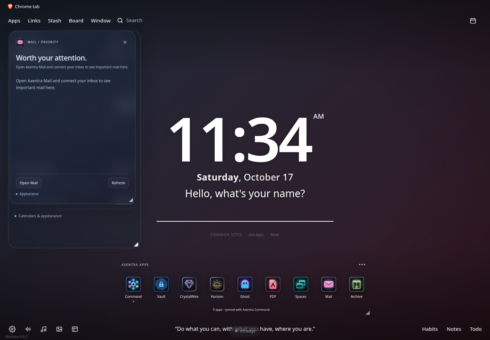

# Axentra Horizon on Linux

Built 2026-11-17 for Zorin OS 18.1 (Ubuntu 24.04), x86_64. Version **0.6.19**; **pre-release** for Brave on Linux.

## Install

Download `axentra-horizon_0.6.19-2_amd64.deb` from the [release page](https://github.com/MECMwithShawn/Axentra-Software/releases/tag/horizon-v0.6.19), check its SHA-256 against the
[release notes](releases/0.6.19.md), then:

```bash
sha256sum axentra-horizon_0.6.19-2_amd64.deb
sudo apt install ./axentra-horizon_0.6.19-2_amd64.deb
```

Restart Brave completely, then open a new tab and choose **Keep it** if Brave asks about the new-tab page. The
package installs to `/opt/axentra/horizon` and registers the extension with Brave as an external extension, so
Brave installs and updates it in your normal profile. It also installs native-messaging hosts for system
resources, Axentra Command and Axentra Mail, each allowed only for Horizon's extension ID.

## Available

New-tab page with clock, backgrounds, shortcuts and favorites, music player, system resources and the Axentra
Command app panel. **Calendar** combines Horizon reminders, subscribed calendars and, when Axentra Mail is
installed, a local feed of package deliveries (with carrier tracking links) and appointments found in your mail
(booking confirmations and reminders). The Mail feed is read on this computer from Mail's database, read-only;
nothing is sent anywhere. Turn it on under Calendar › Calendars & appearance and click Connect.

## Verification

- The Mail feed helper has 15 automated tests (deliveries, tracking links, appointment dates and times, time zones,
  reminders, cancellations, reschedules, marketing and payment mail that must be ignored).
- The calendar's event parsing was checked in a browser with a generated feed, and the installed package was run on
  the build machine: Brave loaded 0.6.19 and the helper returned that machine's deliveries and appointments.

## Remaining work and requirements

- Appointments are read with fixed patterns. A business that writes its dates unusually can be missed, and a
  booking without a clock time is skipped. Appointments with no end time are shown as one hour.
- The package depends on Brave and several system tools used by the resources panel (FFmpeg, fwupd and others).
- Use Connect in Horizon to grant the optional native-messaging permission. Other Chromium browsers have host
  manifests but were not tested end to end. Windows driver and security information is not available on Linux.
- Not code-signed; VirusTotal scan pending (see [security](security/virustotal.md)).

## Screenshot



Earlier 0.6.1 preview in a disposable Brave profile; no personal browser data.
