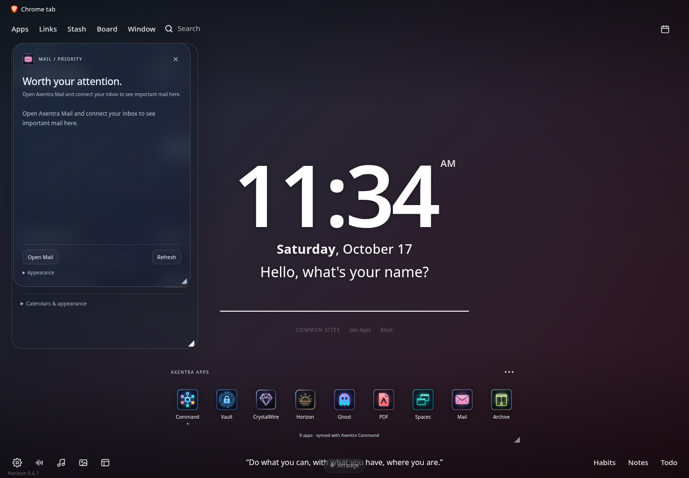

# Axentra Horizon on Linux

Verified 2026-10-17 on Zorin OS 18.1 (Ubuntu 24.04), x86_64. Source version **0.6.1**; **development preview**, not a published stable Linux release.

## Run

Open **Axentra Horizon** from the application menu, or run:

```bash
~/.local/share/axentra/apps/horizon/AxentraHorizon
```

The preview is installed for the desktop user, with a separate folder for each app. Data and profiles live outside the application folder. Installation does not enable startup or change default applications.

## Available

Browser new-tab extension in a dedicated Brave profile, Linux system-resource native host and Command integration. The launcher loads the unpacked extension without changing the normal Brave profile. Native host manifests allow only the installed extension ID.

## Verification

Native messaging protocol tests passed. Brave loaded the extension, both Linux native hosts responded, and Command reported all nine apps installed with no page errors.

## Remaining work and requirements

Use Connect in Horizon to grant its optional native-messaging permission. The automated test granted that permission only to a disposable test copy. Other Chromium browsers have host-install support but were not end-to-end tested. Music download/transcode requires yt-dlp and ffmpeg, which were not installed on the desktop. Windows driver/security telemetry is not available on Linux.

## Screenshot



Disposable Brave profile; no personal browser data.
