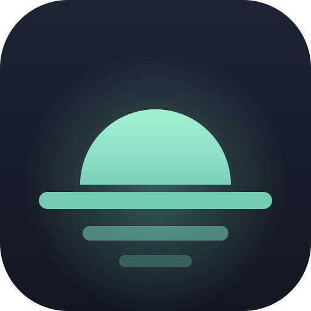

# Axentra Horizon

A calm, beautiful new tab for Microsoft Edge and Google Chrome: Bing and Windows Spotlight backgrounds, your
day's focus, todos, notes, habits, birthday and date reminders, a tab stash, a focus timer and soundscapes.
No account, no subscription, no ads and no tracking.

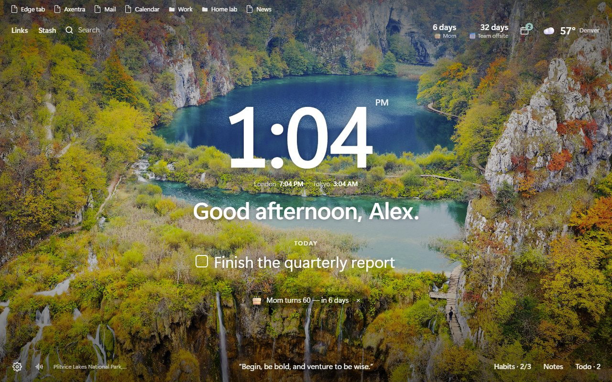

**Latest version: 0.3.4** · [Download](https://github.com/MECMwithShawn/Axentra-Software/releases/tag/horizon-v0.3.4) ·
[Release notes](releases/0.3.4.md) · [Privacy](PRIVACY.md) · [Security scans](security/virustotal.md)

## Features

| Area | What you get |
|---|---|
| **Backgrounds** | Bing's daily image (in 4K where your screen supports it), Windows Spotlight, or Unsplash photography; favorite any photo, upload your own, or use a gradient; change once a day or with every tab; location and photographer credited |
| **Dashboard** | Large clock (12/24 h), greeting or mantra, today's main focus, daily quote, world clocks, search with your default engine, quick links |
| **Weather** | Current conditions and a 6-day forecast; your chosen city, your device location, or an approximate location when Windows Location services are off |
| **Reminders** | Birthdays (“Mom turns 60”), anniversaries (“10th anniversary”), bills and renewals, events and reminders; repeat yearly, monthly or weekly; desktop notifications on the day and/or up to a month before; countdowns on the dashboard; import and export `.ics` calendars (e.g. Google Calendar's Birthdays) |
| **Habits** | Daily habits or chosen weekdays, one-click check-ins, streaks, best streak, 30-day completion, a heatmap you can fill in, and an optional daily reminder |
| **Tab stash** | Park all of a window's tabs (or the ones you pick) and restore them later; from the new tab, the toolbar button, `Alt+Shift+S` on any page, or right-click → Stash this tab |
| **Productivity** | Todo lists (Today, Inbox, your own) with drag-to-reorder; notes with autosave; focus timer (pomodoro) with notifications; breathing exercises; zen mode |
| **Soundscapes** | Rain, ocean, wind, stream, fireplace, café and white/pink/brown noise, generated live (no audio files) |
| **Favorites bar** | Your Edge favorites (or Chrome bookmarks) at the top of the new tab, with folders, Other and Mobile favorites; optionally on **every website** too, solid or see-through glass, always visible or sliding down from the top edge, with per-site choices and `Alt+Shift+F` to show or hide it |
| **Local pages** | Links to local HTML files (`C:\sites\index.html`) and servers on your network (`nas.local`, `192.168.1.20:8080`), with a live up/down indicator |
| **Everything else** | Show or hide every widget, fonts and clock sizes, background dimming, keyboard shortcuts (`?`), backup and restore, settings that sync between your devices |

## Screenshots

| | |
|---|---|
|  Dashboard | 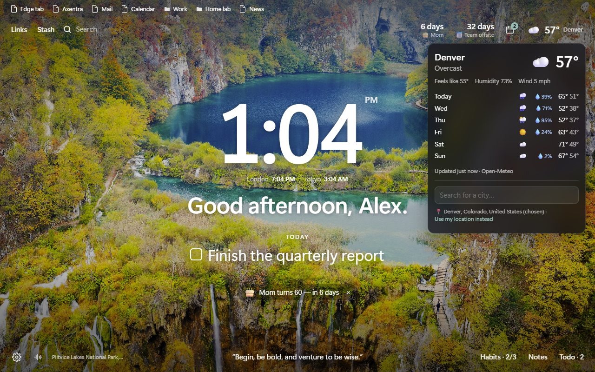 Weather and city search |
| 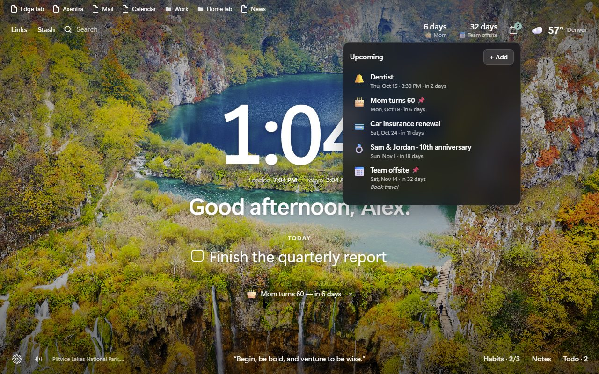 Upcoming dates and reminders | 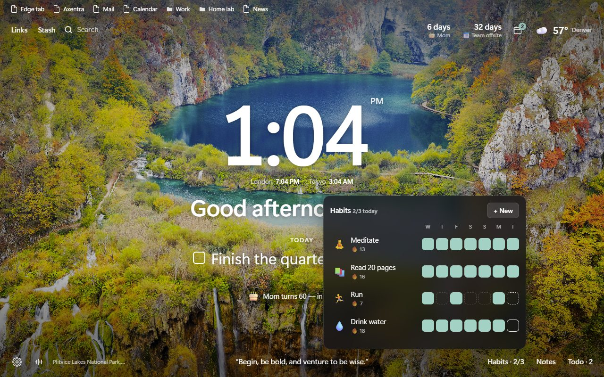 Habits |
| 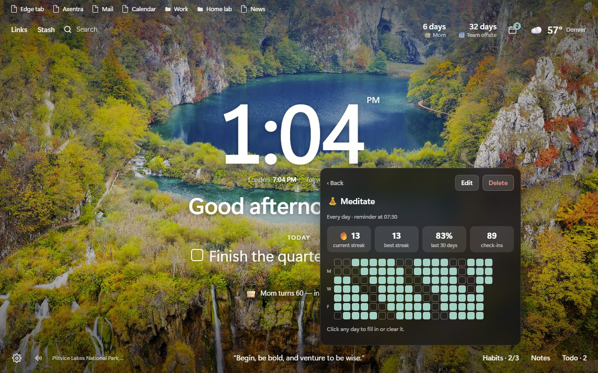 Habit streaks and heatmap | 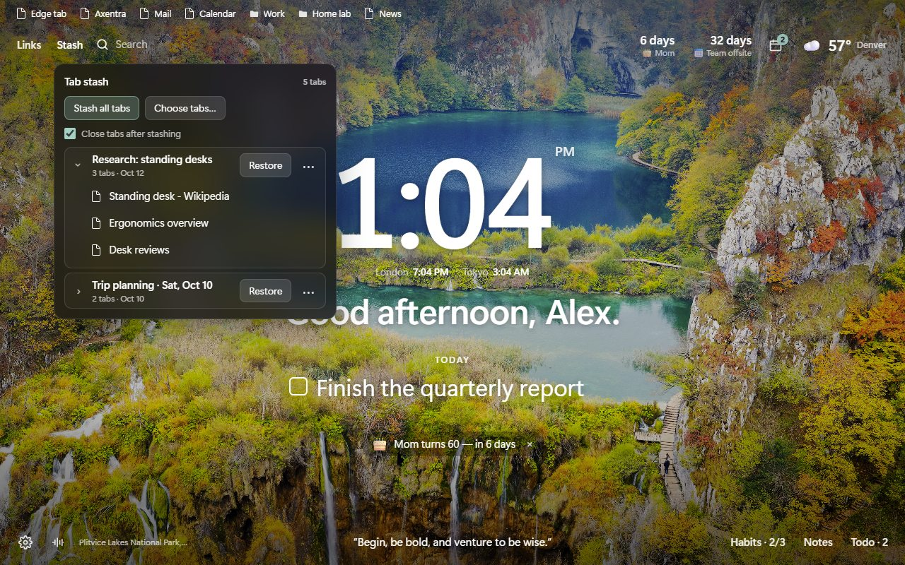 Tab stash |
| 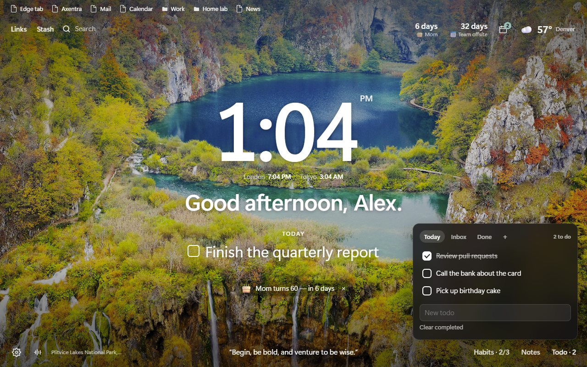 Todo lists | 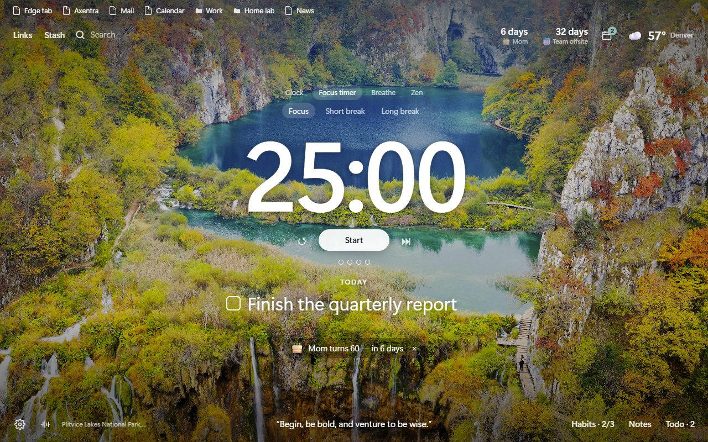 Focus timer |
| 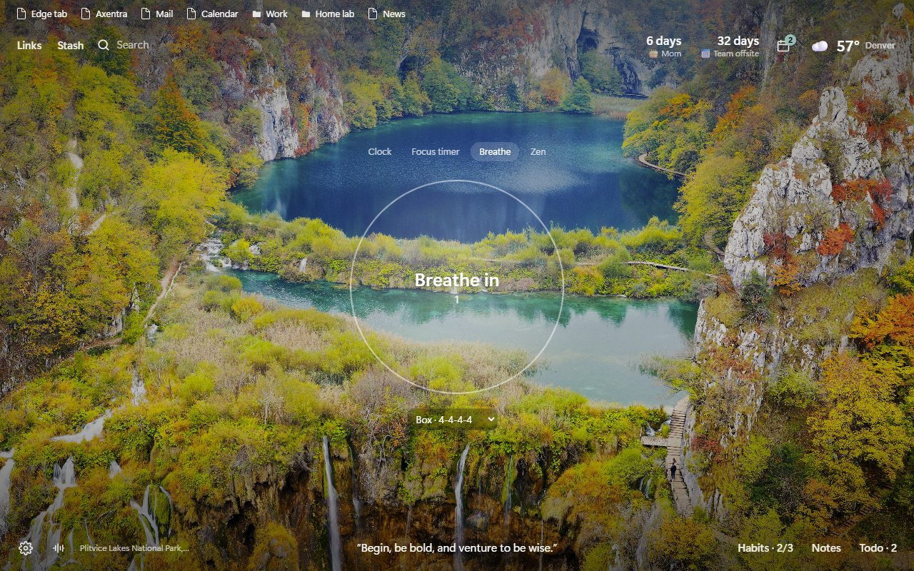 Breathing exercise | 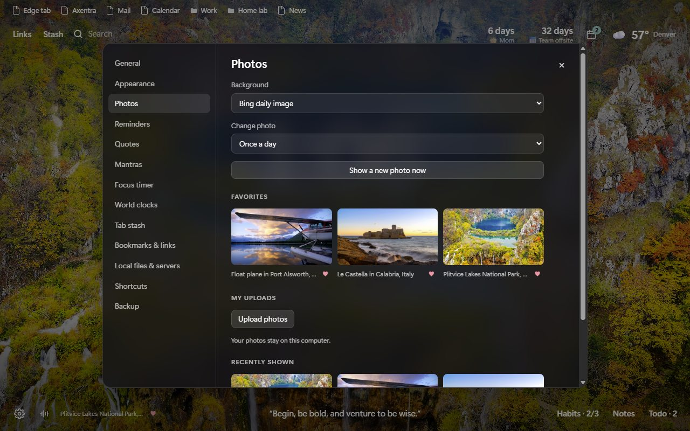 Photo settings and favorites |
| 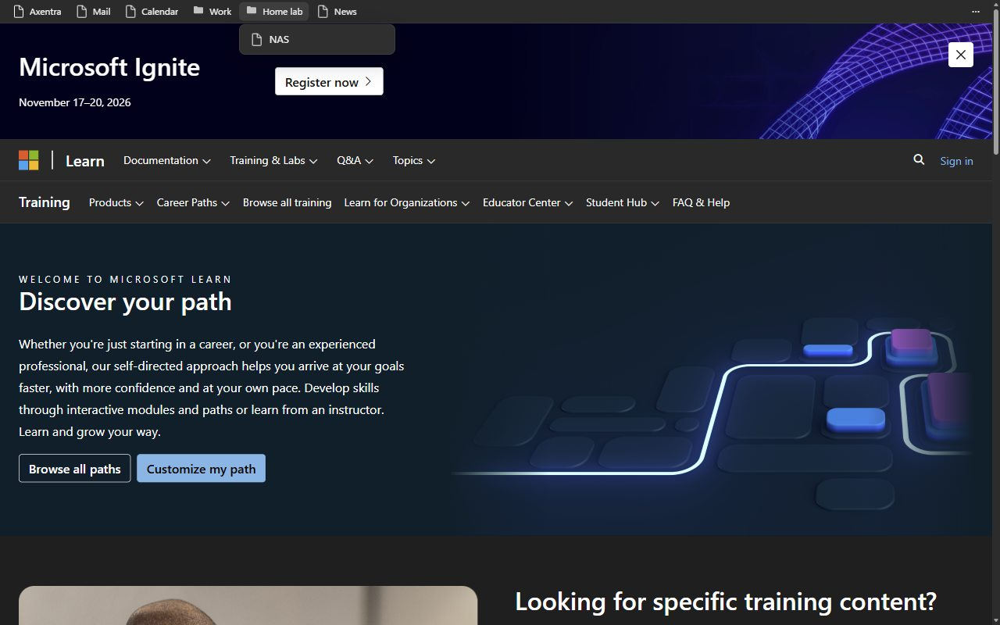 Favorites bar on any website (optional) | |

## System requirements

- Microsoft Edge or Google Chrome, version 120 or later, on Windows, macOS or Linux
- An internet connection for backgrounds and weather (everything else works offline)

## Installation

Download `AxentraHorizon-0.3.4.zip` from the
[release page](https://github.com/MECMwithShawn/Axentra-Software/releases/tag/horizon-v0.3.4) and verify it
against the SHA-256 in the [release notes](releases/0.3.4.md). Then:

1. Extract the zip to a folder you'll keep.
2. Open `edge://extensions` (or `chrome://extensions`), turn on **Developer mode**, click **Load unpacked** and
   choose the folder.
3. Open a new tab. If the browser asks whether to keep the extension's new tab page, choose **Keep changes**.
4. Optional: on the extension's **Details** page, turn on **Allow access to file URLs** so links to local HTML
   files open.

To update, replace the folder's contents with the new version; the next new tab reloads the extension by
itself so new permissions take effect.

### If Edge turns Horizon off

Edge distrusts extensions installed outside its store:

- At startup it may show **“Turn off extensions in developer mode”**. Close it with **×**; don't choose *Turn off*.
- It may ask **“Change back to Microsoft's new tab page?”**. Choose **Keep changes**.
- Don't move or rename the folder Horizon was loaded from; Edge would treat it as a new extension with empty storage.

The permanent fix is the Microsoft Edge Add-ons store version (planned; see [store/](store/)), which Edge never flags.

## Permissions

| Permission | Why |
|---|---|
| Replace the new tab page | This is the extension |
| Storage, unlimited storage | Your settings, todos, notes, habits, reminders and the cached background |
| Read and change favorites (bookmarks) | Showing your favorites bar. Horizon only reads them |
| Tabs | Tab stash (reading the titles and addresses of the tabs you stash) |
| Alarms, notifications | Reminders, habit reminders and the focus timer, even with no new tab open |
| Location | Local weather. Optional: you can pick a city instead |
| Search | Searching with your browser's default search engine |
| Context menus | The “Stash this tab” right-click item |
| Scripting | Adding the favorites bar to websites, and removing it when you turn it off |
| Favicons | Site icons next to links |
| Site access: bing.com, Microsoft's Spotlight service, picsum.photos, open-meteo.com, get.geojs.io, bigdatacloud.net | Backgrounds, weather and place names |
| Site access: localhost, 127.0.0.1, local files | Opening and checking your own locally hosted pages |
| Read and change data on all websites | Drawing your favorites bar at the top of websites (on by default; turn it off in *Settings → Bookmarks & links* or per site from the bar's ⋯ menu). Horizon draws the bar and never reads page content |
| Optional site access to other hosts | Only for network servers you allow in *Settings → Local files & servers* |

## Roadmap

- **Microsoft Edge Add-ons store release.** The listing, logo, screenshots and permission justifications are ready in
  [store/](store/). Once published, install from the store for automatic updates and no developer-mode warnings.

## Do I need an account?

No. There's no sign-up or sign-in. Settings, links, reminders and habits sync between your computers through the
Microsoft (or Google) account you're already signed into the browser with.

## Privacy

Horizon has no servers and no analytics. Settings, links, reminders and habits sync through your browser
account; everything else stays on your computer. See [PRIVACY.md](PRIVACY.md) for the details.

## Credits

Background images are © their photographers and agencies and are credited on screen: Bing daily images and
Windows Spotlight images are provided by Microsoft; Unsplash photographs via [Lorem Picsum](https://picsum.photos).
Weather data by [Open-Meteo](https://open-meteo.com). Horizon displays these images; it does not redistribute them.

## Source code

The release zip is the complete, unminified source of the extension.
