# Axentra Horizon

A calm, beautiful new tab for Microsoft Edge and Google Chrome: Bing and Windows Spotlight backgrounds, your
day's focus, a daily quote or Bible verse, todos, notes, habits, birthday and date reminders, a tab stash, floating
windows and a Board of mini browsers for YouTube, Spotify and more, a focus timer and soundscapes.
No account, no subscription, no ads and no tracking.

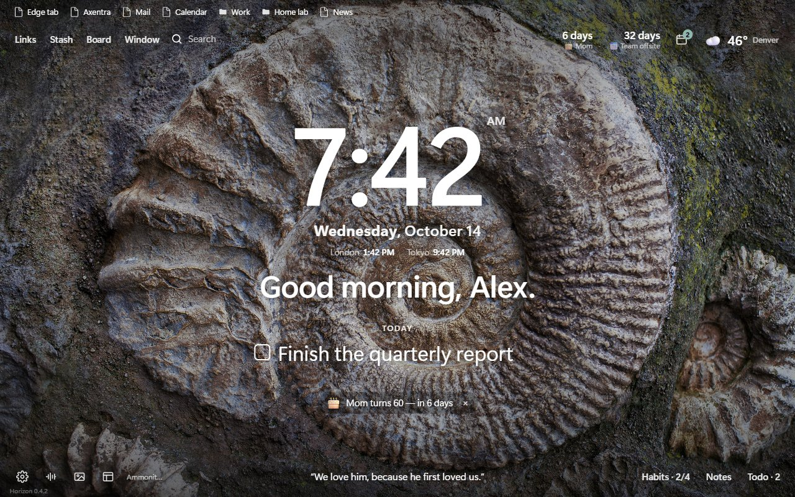

**Latest version: 0.4.2** · [Download](https://github.com/MECMwithShawn/Axentra-Software/releases/tag/horizon-v0.4.2) ·
[Release notes](releases/0.4.2.md) · [Privacy](PRIVACY.md) · [Security scans](security/virustotal.md)

## Features

| Area | What you get |
|---|---|
| **Backgrounds** | Bing's daily image (in 4K where your screen supports it), Windows Spotlight, or Unsplash photography; favorite any photo, upload your own, or use a gradient; change once a day or with every tab; location and photographer credited. The photo button gives one-click **New photo**, **Favorite** and **Keep this** (the photo stays until you unpin it) |
| **Clock and dashboard** | Large clock (12/24 h) with the day and date beneath it (“**Wednesday**, October 14”; four formats in the Classic layout, while the other layouts show the date in their own style), greeting or mantra, today's main focus, daily quote, world clocks, search with your default engine, quick links |
| **Layouts** | Seven ways to arrange the page: **Classic**, **Editorial**, **Glass card**, **Horizon band**, **Tiles**, **Ring** and **Dashboard**. Pick one from the **Layout** button at the bottom left: hover a layout to preview it on your page, click to keep it (or press `Y` to flip through). Every layout keeps your greeting, clock, focus, verse and reminders working (layouts start once Horizon knows your name, which the first new tab asks for; until then the page stays Classic); some add a weather card, your next dates, live tiles (tasks open, habits done today) or a dock of shortcuts. Write your own tagline or hide it |
| **Daily Bible verse** | Instead of (or mixed with) quotes: a verse a day in KJV (built in), WEB, ASV or BBE; ESV with your free api.esv.org key; NKJV, NIV, NLT or NASB open on Bible Gateway |
| **Floating windows** | Open YouTube, Spotify or almost any site in borderless windows that float over the new tab, several at once, picture-in-picture style: drag, resize, maximize, or pop one out on top of every app (`Shift+W`). Outlook, Gmail, Google Calendar and Teams open in Axentra Spaces instead (see below) |
| **Board** | A pinned tab of “mini browsers” in a grid (one to six tiles, several saved boards): music and video keep playing while you browse. Embed-friendly sites only, or *Load almost any site* |
| **Axentra Spaces** | Optional: send windows to [Axentra Spaces](../../Spaces/), the Axentra desktop app for real borderless, always-on-top browser windows anywhere on your desktop |
| **Weather** | Current conditions and a 6-day forecast; your chosen city, your device location, or an approximate location when Windows Location services are off |
| **Reminders** | Birthdays (“Mom turns 60”), anniversaries (“10th anniversary”), bills and renewals, events and reminders; repeat yearly, monthly or weekly; desktop notifications on the day and/or up to a month before; countdowns on the dashboard; import and export `.ics` calendars (e.g. Google Calendar's Birthdays) |
| **Habits** | Daily habits or chosen weekdays, one-click check-ins, streaks, best streak, 30-day completion, a heatmap you can fill in, and an optional daily reminder |
| **Tab stash** | Park all of a window's tabs (or the ones you pick) and restore them later; from the new tab, the toolbar button, `Alt+Shift+S` on any page, or right-click → Stash this tab |
| **Productivity** | Todo lists (Today, Inbox, your own) with drag-to-reorder; notes with autosave; focus timer (pomodoro) with notifications; breathing exercises; zen mode |
| **Soundscapes** | Rain, ocean, wind, stream, fireplace, café and white/pink/brown noise, generated live (no audio files) |
| **Favorites bar** | Your Edge favorites (or Chrome bookmarks) at the top of the new tab, with folders, Other and Mobile favorites; optionally on **every website** too, solid or see-through glass, always visible or sliding down from the top edge, with per-site choices and `Alt+Shift+F` to show or hide it. Right-click a favorite to open, edit or delete it (with undo); add the current page from the bar's ⋯ menu |
| **Local pages** | Links to local HTML files (`C:\sites\index.html`) and servers on your network (`nas.local`, `192.168.1.20:8080`), with a live up/down indicator |
| **Backup & restore** | Automatic daily backups to your OneDrive or Google Drive folder (keeps 30, includes your uploaded photos); restore any of them from a dated list, on this PC or a new one |
| **Everything else** | Show or hide every widget, fonts and clock sizes, background dimming, keyboard shortcuts (`?`), settings that sync between your devices, and a faint version number in the bottom-left corner so you can tell an update has loaded |

## Screenshots

| | |
|---|---|
|  Classic layout (the default) |  Weather and city search |
|  Upcoming dates and reminders |  Habits |
|  Habit streaks and heatmap |  Tab stash |
|  Todo lists |  Focus timer |
|  Breathing exercise |  Photo settings and favorites |
|  Favorites bar on any website | 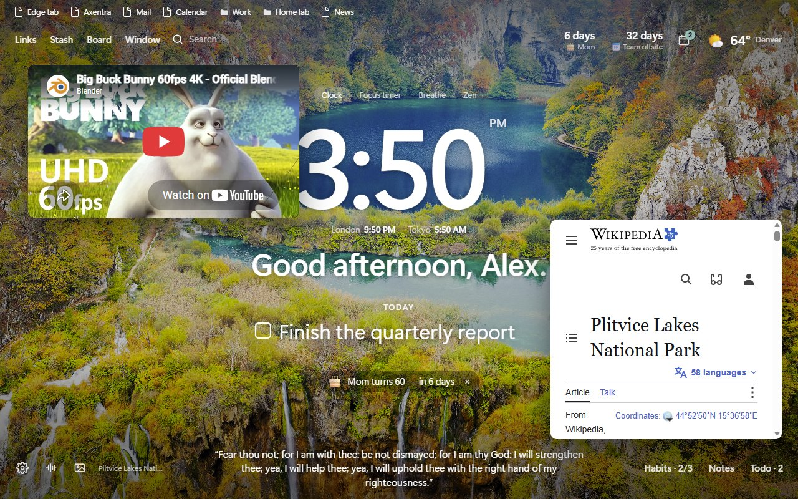 Floating windows over the new tab |
| 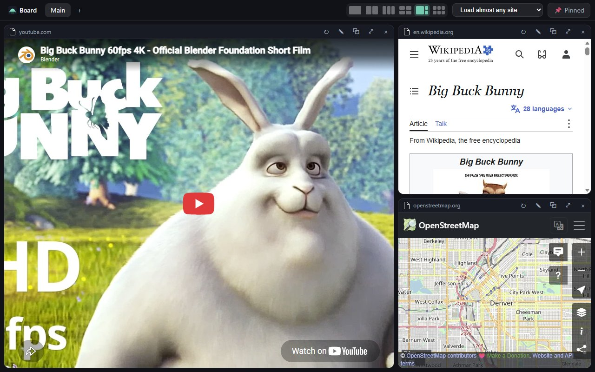 The Board: mini browsers in a pinned tab | 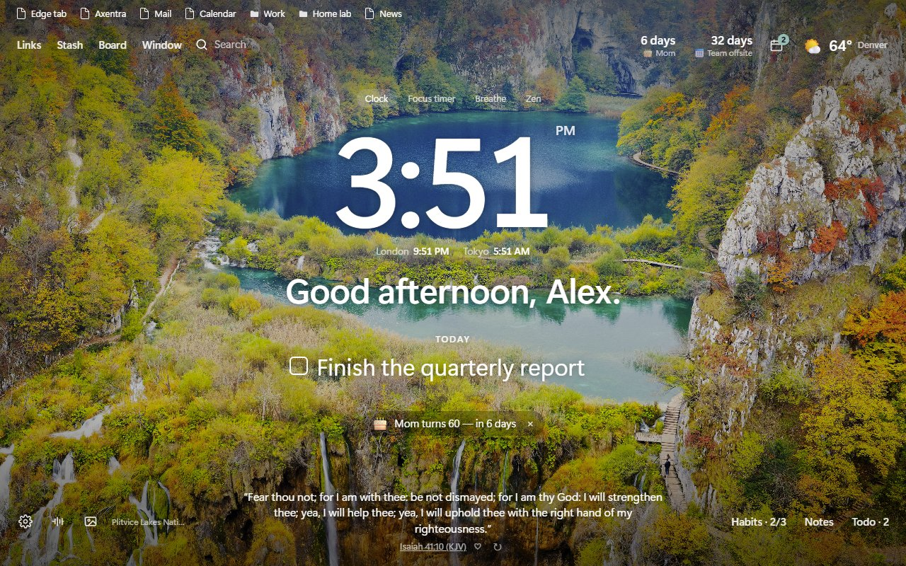 Daily Bible verse |
| 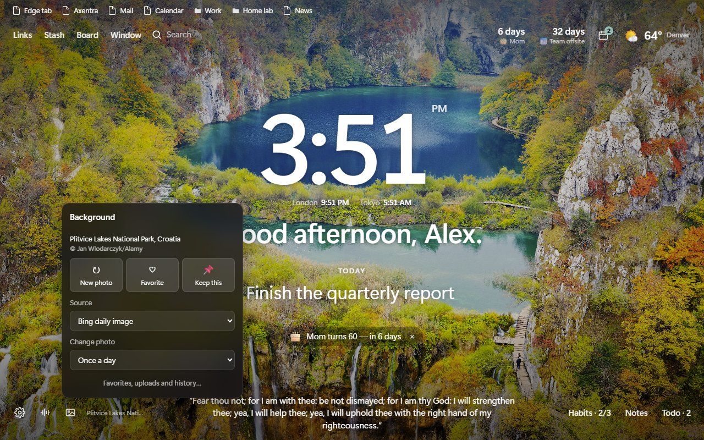 New photo, favorite or keep it | 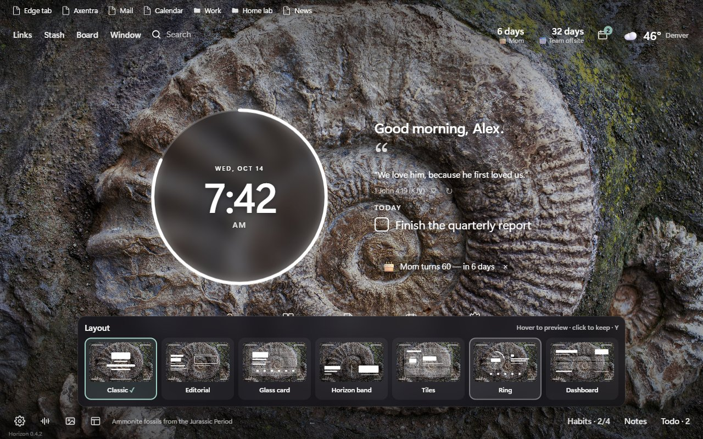 Layout picker: hover to preview (here, Ring) |

### Layouts

| | |
|---|---|
| 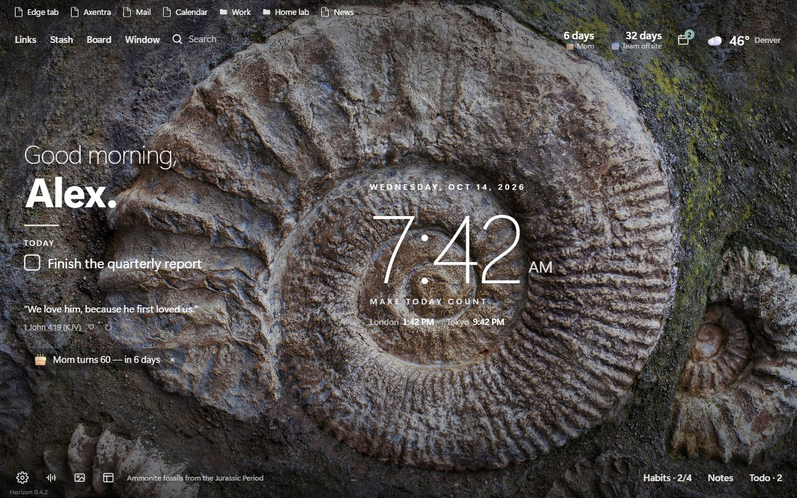 **Editorial**: greeting on the left, a big light clock | 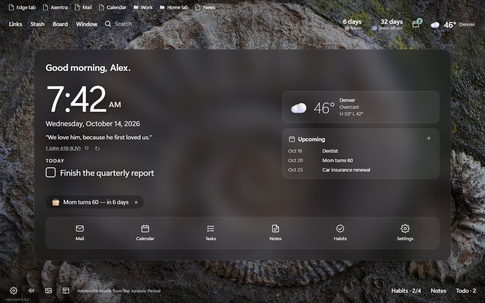 **Glass card**: clock, weather and upcoming dates on one card, with a dock |
| 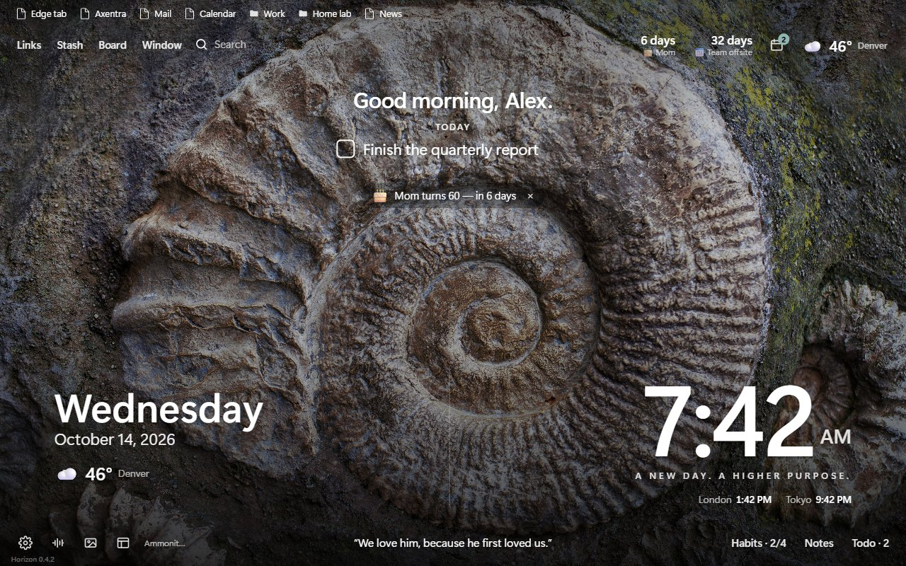 **Horizon band**: day and time across the bottom | 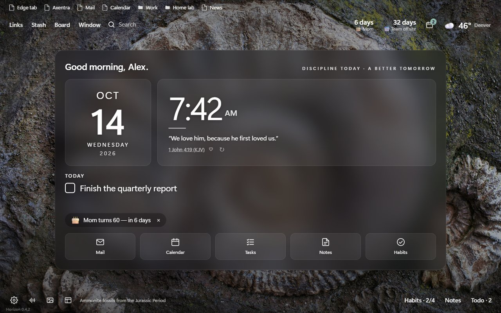 **Tiles**: a date tile beside the clock, with a dock |
| 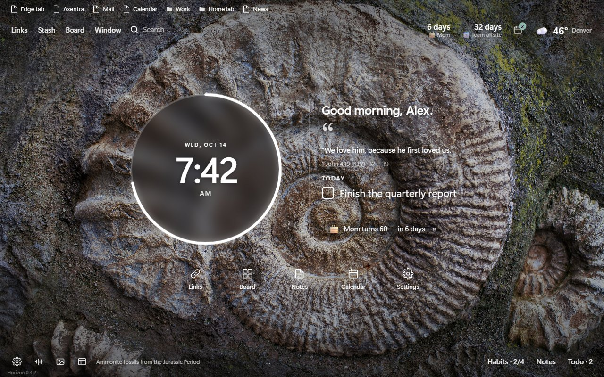 **Ring**: a clock ring that counts the seconds | 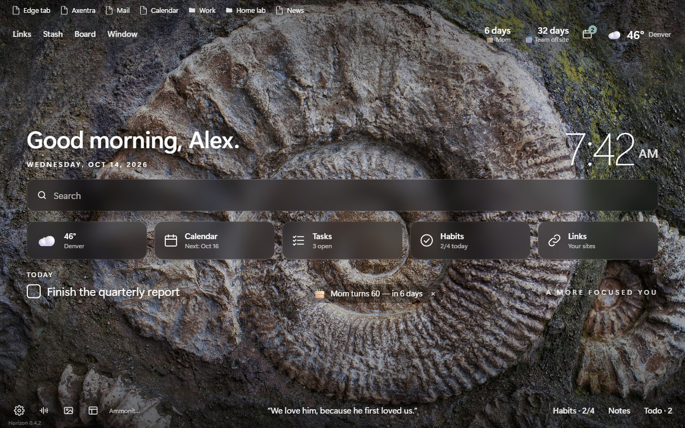 **Dashboard**: greeting, search and live tiles |
| 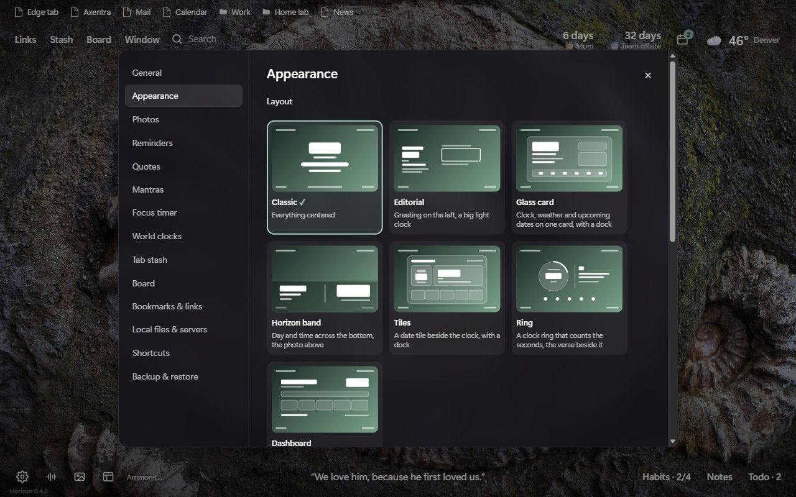 The same choice in *Settings → Appearance* |  **Classic**: everything centered (the default) |

## System requirements

- Microsoft Edge or Google Chrome, version 120 or later, on Windows, macOS or Linux
- An internet connection for backgrounds and weather (everything else works offline)

## Installation

Download `AxentraHorizon-0.4.2.zip` from the
[release page](https://github.com/MECMwithShawn/Axentra-Software/releases/tag/horizon-v0.4.2) and verify it
against the SHA-256 in the [release notes](releases/0.4.2.md). Then:

1. Extract the zip to a folder you'll keep.
2. Open `edge://extensions` (or `chrome://extensions`), turn on **Developer mode**, click **Load unpacked** and
   choose the folder.
3. Open a new tab. If the browser asks whether to keep the extension's new tab page, choose **Keep changes**.
4. Optional: on the extension's **Details** page, turn on **Allow access to file URLs** so links to local HTML
   files open.

To update, replace the folder's contents with the new version; the next new tab reloads the extension by
itself so new permissions take effect.

### If Edge turns Horizon off

Edge distrusts extensions installed outside its store:

- At startup it may show **“Turn off extensions in developer mode”**. Close it with **×**; don't choose *Turn off*.
- It may ask **“Change back to Microsoft's new tab page?”**. Choose **Keep changes**.
- Don't move or rename the folder Horizon was loaded from; Edge would treat it as a new extension with empty storage.

The permanent fix is the Microsoft Edge Add-ons store version (planned; see [store/](store/)), which Edge never flags.

## Permissions

| Permission | Why |
|---|---|
| Replace the new tab page | This is the extension |
| Storage, unlimited storage | Your settings, todos, notes, habits, reminders and the cached background |
| Read and change favorites (bookmarks) | Showing your favorites bar, and editing, deleting or adding favorites when you choose to from the bar |
| Tabs | Tab stash (saving the titles and addresses of the tabs you stash); finding Horizon's own Board tab so the Board's frame rules apply only to that tab; adding the favorites bar to tabs that are already open |
| Alarms, notifications | Reminders, habit reminders and the focus timer, even with no new tab open |
| Location | Local weather. Optional: you can pick a city instead |
| Search | Searching with your browser's default search engine |
| Context menus | The “Stash this tab” right-click item |
| Scripting | Adding the favorites bar to websites, and removing it when you turn it off |
| Favicons | Site icons next to links |
| Site access: bing.com, Microsoft's Spotlight service, picsum.photos (and its image server fastly.picsum.photos), open-meteo.com, get.geojs.io, bigdatacloud.net | Backgrounds, weather and place names |
| Site access: localhost, 127.0.0.1, local files | Opening and checking your own locally hosted pages |
| Read and change data on all websites | Drawing your favorites bar at the top of websites (on by default; turn it off in *Settings → Bookmarks & links* or per site from the bar's ⋯ menu), checking your network servers, reading the page title of a link you add without a name, fetching the daily verse, and loading the sites you put in floating windows or on the Board. Horizon never reads the pages you browse |
| Network request rules (declarativeNetRequestWithHostAccess) | Only for frames inside Horizon's own pages (the Board tab and floating windows): with *Load almost any site* on, it removes the headers that stop a site from being shown in a frame; whatever that setting, it gives YouTube players there a fixed referrer (this repository's address) so videos play. Your normal browsing is never changed |

## Floating windows, the Board and Axentra Spaces

- **Window** (top left, or `Shift+W`) opens a site in a borderless window on the new tab. Hover the top edge for its
  controls; ⧉ pops it out above every app (Edge's picture-in-picture for pages). The windows live in the new tab,
  so they close with it.
- **Board** (`G`) opens a pinned tab with a grid of sites that keeps playing while you use other tabs.
- **[Axentra Spaces](../../Spaces/)** (Windows desktop app) gives you real, borderless, always-on-top browser windows
  anywhere on the desktop, independent of the browser. Turn on *Settings → Board → Open new windows in Axentra
  Spaces* and the Window button sends sites there. The first time, Edge asks to open Axentra Spaces: tick
  *Always allow*.

Some sites can't run inside a page at all. Outlook, Gmail, Google Calendar and Teams save an offline copy of
themselves once you've used them in Edge, and Edge then loads them from that copy with their "don't show me inside
another page" rule intact, which Horizon can't remove. Horizon recognises these and opens them in Axentra Spaces; a
window or Board tile you'd already saved for one shows an *Open in Axentra Spaces* button. Banks and some sign-in
pages refuse frames too; open those in a tab or in Axentra Spaces.

## Roadmap

- **Microsoft Edge Add-ons store release.** The listing, logo, screenshots and permission justifications are ready in
  [store/](store/). Once published, install from the store for automatic updates and no developer-mode warnings.

## Backups

Settings, links, reminders and habits sync through your browser account. Todos, notes, tab stashes, photo favorites
and uploaded photos live only on the computer, so turn on automatic backups:

1. **Settings → Backup & restore → Choose backup folder.**
2. Pick your **OneDrive** folder (“OneDrive - Personal” in the picker) or Google Drive's **My Drive**. Horizon recognises
   it and creates an *Axentra Horizon Backups* folder inside.
3. Every day the first new tab saves `horizon-backup-YYYY-MM-DD.json` there (the last 30 are kept) and the drive's app
   uploads it. To restore, on this or another computer, choose the same folder and pick a backup from the list.

Browsers don't let extensions search your disk, so Horizon recognises the cloud drive from the folder you pick. After
a browser restart Edge may ask once to allow folder access again; Horizon shows an *Allow backups* button.

## Do I need an account?

No. There's no sign-up or sign-in. Settings, links, reminders and habits sync between your computers through the
Microsoft (or Google) account you're already signed into the browser with.

## Privacy

Horizon has no servers and no analytics. Settings, links, reminders and habits sync through your browser
account; everything else stays on your computer. See [PRIVACY.md](PRIVACY.md) for the details.

## Credits

Background images are © their photographers and agencies and are credited on screen: Bing daily images and
Windows Spotlight images are provided by Microsoft; Unsplash photographs via [Lorem Picsum](https://picsum.photos).
Weather data by [Open-Meteo](https://open-meteo.com). Horizon displays these images; it does not redistribute them.

## Source code

The release zip is the complete, unminified source of the extension.
