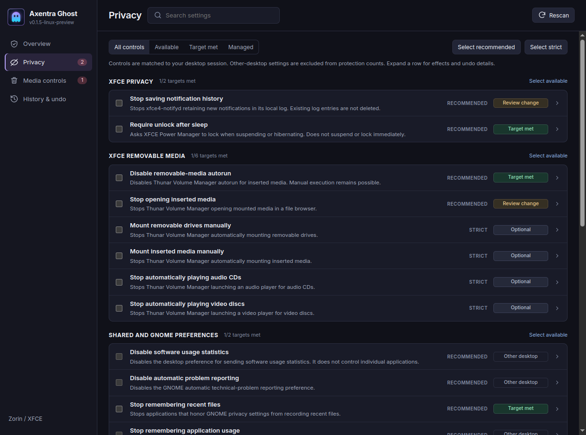
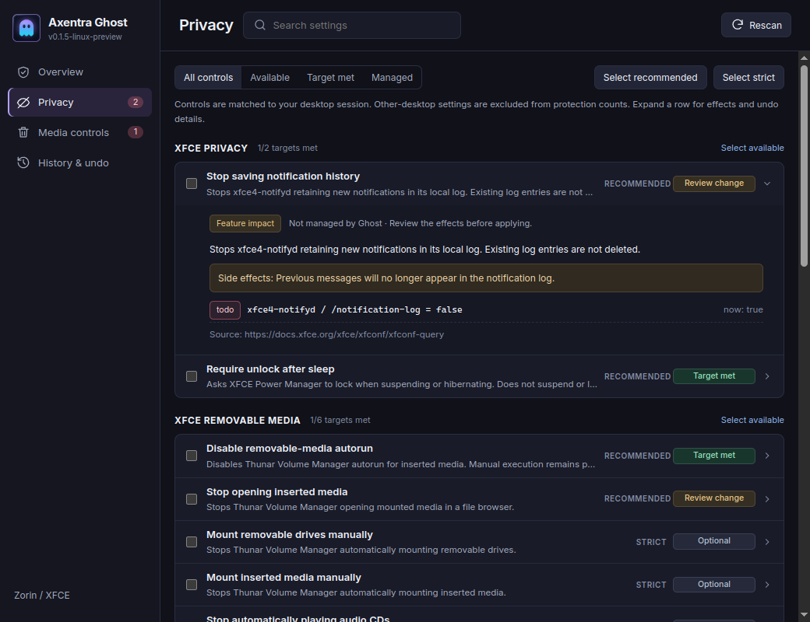

# Axentra Ghost on Linux

**0.1.5 Linux development preview** — updated 2026-10-18; live settings tests performed 2026-10-17 on Zorin OS 18.1 / Ubuntu 24.04, x86_64, in the **XFCE (`zorin-os-lite`) session**. This is the QtWebEngine suite app, separate from the experimental standalone GTK package. No public stable Linux installer is published.

## Run

Open **Axentra Ghost** from the application menu, or run:

```bash
~/.local/share/axentra/apps/ghost/AxentraGhost
```

The app is installed for the desktop user. Settings and undo records live outside its installation folder. Source and build instructions remain with the private application source.

## Controls and privacy levels

The catalog has **27 entries**: 18 GNOME/GTK preferences, eight native XFCE preferences and one NetworkManager connectivity-check property. Controls are matched to the current session. Other-desktop settings are labeled **Other desktop**, excluded from active protection counts and skipped when applying profiles. Previously managed settings can still be undone after switching desktops.

| Area | Controls and limits |
|---|---|
| Native XFCE privacy | Notification-history recording and locking after suspend/hibernate. Existing notification history is retained. Locking requires a working locker. |
| Native XFCE media | Thunar Volume Manager autorun, automatic folder opening, automatic drive/media mounting and audio/video autoplay. Only existing XFConf properties are offered. |
| Shared GTK preferences | Recent-file history and middle-click selection paste. Individual applications may ignore these preferences. Normal Ctrl+V paste remains available. |
| GNOME preferences | Reporting, app history, identity/name display, location, lock-screen notifications, locking, search providers, camera/microphone, banners and media handling. GNOME-only settings are not presented as active XFCE protection. |
| NetworkManager | Optional system-wide connectivity probes. Without a configured endpoint, the control shows **Not configured** and offers no mutation. Disabling configured probes can affect public Wi-Fi login-page detection and online-status reporting. These probes are not usage analytics. |

**Recommended** selects available controls intended for routine privacy use, with side effects shown before applying. **Strict** adds more disruptive restrictions. Individual selection provides custom choices. Selection does not apply anything until the change preview is confirmed. On XFCE, GNOME camera/microphone preferences are other-desktop entries; a saved preference is not a hardware block or a network-blocking test.

## Interface and undo

Compact rows use aligned profile/status columns, a neutral slate palette and violet selection accents. Expanded details contain feature impact, current values and management/undo information. Keyboard expansion and visible focus are supported.

- **Target met:** the relevant preference matches its target; this does not establish that all telemetry is blocked.
- **Review change:** an available recommended preference can be changed.
- **Optional:** an additional restriction is available; leaving a feature available is not evidence of tracking.
- **Other desktop / Unsupported / Unknown / Not configured:** no active protection is inferred.

The private write-ahead journal retains prior values and interrupted operations. GNOME undo restores the prior user override, including an originally unset override. XFCE undo restores the saved **effective preference value**. NetworkManager undo is designed to restore its prior boolean property, but a configured endpoint was not available for live validation. Opt-in drift checks run while the suite app is running.

## Verification

- **18 GNOME/GTK preferences:** live apply, readback and undo passed. Explicit prior-value restoration and applicable unset-override cases were checked. This verifies storage behavior, not XFCE compliance with GNOME-only preferences.
- **Eight native XFCE preferences:** live apply, readback and undo passed.
- **All original settings were restored** after the tests. Disposable journals were used; the live application journal was not used for the test changes.
- **17 suite engine/API tests** passed, including session filtering, undo after changing desktops, corrupt state and local API access checks.
- Interface rendered at **1240px and 1040px**, with no JavaScript errors or horizontal row overflow; expanded details were checked.
- NetworkManager reported no available connectivity-check endpoint and an empty check URI. An initial enable attempt was ignored; availability detection was corrected. Actual mutation and undo with a configured endpoint remain unverified.

See the [sanitized verification summary](verification/linux-0.1.5.json) and [preview change notes](releases/0.1.5-linux-preview.md).

## Remaining validation

Physical camera/microphone access, suspend/resume lock behavior, removable-media insertion and packet-level blocking were not tested. Screen-lock preferences retain the existing idle timeout and lock delay. Windows registry controls, package debloat, system-wide firewall controls and DNS-to-process attribution are outside this Linux preview. Settings-level tests do not establish Windows feature parity.

## Screenshots



Native XFCE controls are listed first; GNOME-only entries are labeled Other desktop. This capture uses a disposable app profile while reading desktop preference state; test changes had been restored.



Expanded impact and management details at a narrower window size.
