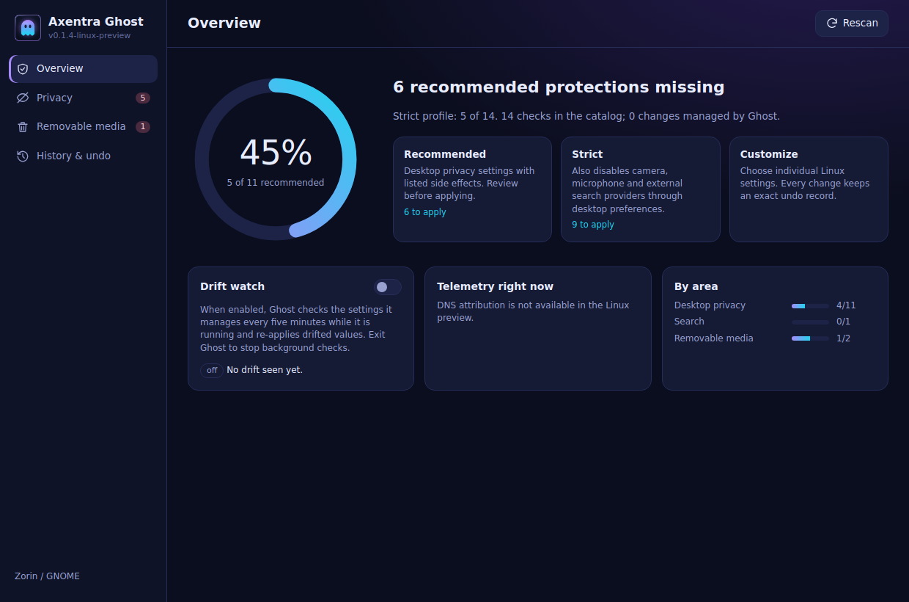

# Axentra Ghost on Linux

Verified 2026-10-17 on Zorin OS 18.1 (Ubuntu 24.04), x86_64. Source version **0.1.4**; **development preview**, not a published stable Linux release.

## Run

Open **Axentra Ghost** from the application menu, or run:

```bash
~/.local/share/axentra/apps/ghost/AxentraGhost
```

The preview is installed for the desktop user, with a separate folder for each app. Data and profiles live outside the application folder. Installation does not enable startup or change default applications.

## Available

14 GNOME privacy/settings controls, exact prior-value undo, private write-ahead journal, fail-closed handling of corrupt state, drift checks while running, native QtWebEngine window and tray. Its local API uses an ephemeral loopback port, session cookie and origin checks.

## Verification

13 engine/HTTP tests passed. A separate real GNOME apply-and-exact-undo test passed using an isolated dconf profile. Native UI loaded all 14 controls with no script errors.

## Remaining work and requirements

This Linux catalog covers GNOME settings. Windows registry tweaks, package debloat, system-wide firewall controls and DNS-to-process attribution are not available. No settings were applied to the real desktop during installation; the integration test used a disposable configuration.

## Screenshot



Linux GNOME catalog; no real desktop setting changed.
