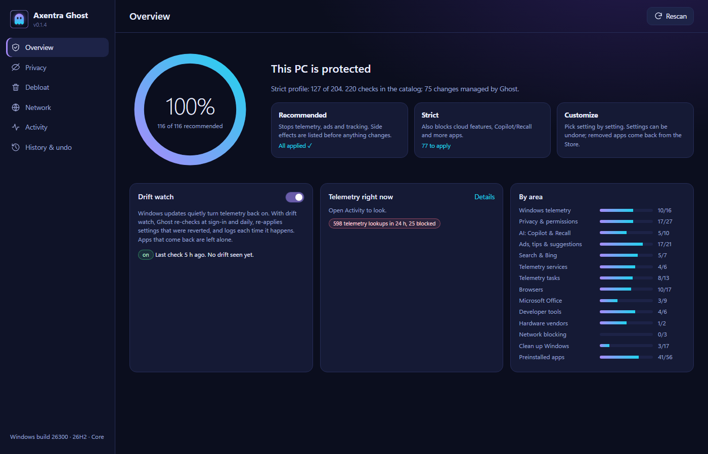
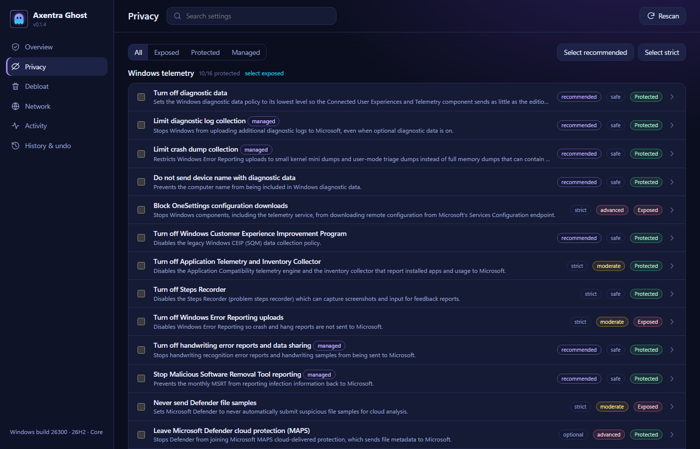
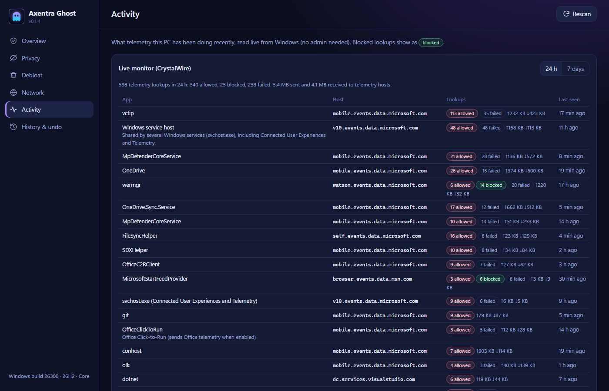
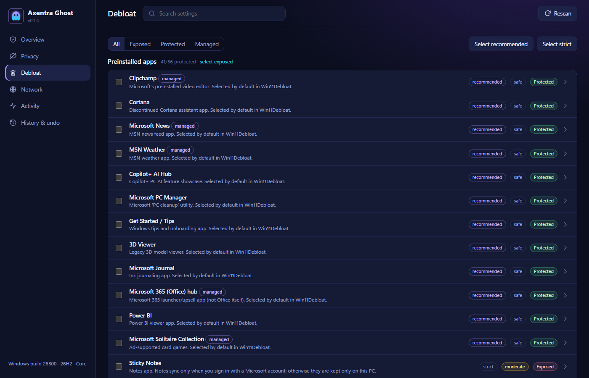
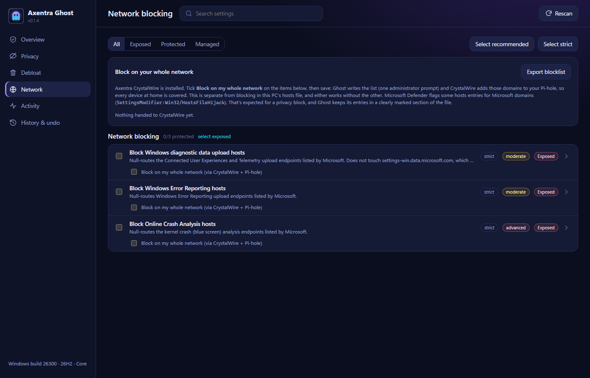
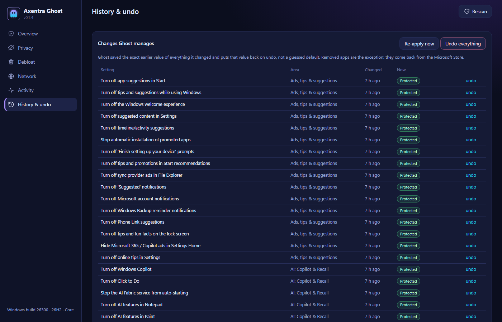

<!-- current-suite-state -->
## Current local status — 2026-10-16

0.1.4 local rebuild. Public release: **0.1.4**. Windows privacy controls with exact undo and drift monitoring. The local installer uses the shared suite root; published installer hashes still describe the original release.

Updated Windows installation target: `C:\Program Files\Axentra\Ghost`. Installers request administrator rights; existing user data remains in its application data directory.

This status supersedes older installation-path and preparation notes below. Historical release checksums apply only to their original artifacts.

<!-- /current-suite-state -->

# Axentra Ghost

<!-- local-release-preparation -->
## Prepared version: 0.1.4

This is a local rebuild of an already published version; the published assets and checksums remain unchanged.
The previously documented version was **0.1.4**.
See [release notes, build status and SHA-256 hashes](releases/0.1.4-rebuild.md) and [changelog](CHANGELOG.md).

- Verified the real source version is still 0.1.4 and the freshly packaged installer matches GitHub's published asset SHA-256 exactly.
- Documented current source behavior: URL hashes open named pages; the Network card distinguishes no Pi-hole from an empty blocklist and shows optional CrystalWire sync notes neutrally.
- Current 0.1.4 includes the suite icon and Start with Command background launch; the existing Live Monitor and tray integration remain documented.
- Clarified undo documentation: removed apps must be reinstalled from the Microsoft Store; undo does not reinstall them.

Use the existing published 0.1.4 installer and installation instructions below. The local rebuild has the same SHA-256 as the published asset. No Windows privacy setting, service, task, hosts file or installed app was changed while building.

Pending: ghost-v0.1.4 is already published and the rebuilt installer matches it exactly; no duplicate draft is needed or created.; Code signing is still pending. Existing scan records remain applicable to the identical published binary; no new scan was submitted.; Draft release assets remain local at Shawn's request. Pushing and publishing still require approval.
<!-- /local-release-preparation -->

Stop Windows from phoning home, remove the apps you never asked for, and keep it that way. Ghost checks 220
privacy, telemetry and clean-up settings, explains each one in plain English, and changes only what you pick. Saved system-setting changes can be undone exactly; removed apps must be reinstalled from the Microsoft Store. When a Windows update quietly turns telemetry back on, Ghost notices and turns it off
again. There's no account, subscription, ads or tracking.

**Latest published version: 0.1.4** · [Download](https://github.com/MECMwithShawn/Axentra-Software/releases/tag/ghost-v0.1.4) ·
[Release notes](releases/0.1.4.md) · [Security scans](security/virustotal.md)

## Features

| Area | What you get |
|---|---|
| **Privacy scan** | 220 checks in 14 areas: Windows telemetry, privacy and app permissions, Copilot and Recall, ads and tips, Bing in search, telemetry services and scheduled tasks, Edge, Chrome, Firefox and Brave, Microsoft Office, developer tools, hardware vendors, network blocking, Windows clean-up and preinstalled apps. Scanning needs no administrator rights |
| **Profiles** | *Recommended* stops telemetry, ads and tracking without breaking anything you'd use. *Strict* goes further (cloud features, Copilot, Recall, more apps). Or pick setting by setting. Side effects are listed before anything changes |
| **Exact undo** | Before changing anything, Ghost saves the value that was there, not a guessed default, and puts it back on undo. Removed apps must be reinstalled from the Microsoft Store |
| **Drift watch** | Windows updates often turn settings back on. Ghost re-checks at sign-in and daily, re-applies what was reverted, and logs each time it happens. Apps you reinstall on purpose are left alone |
| **Live monitor** | With [Axentra CrystalWire](../CrystalWire/) installed, see which program contacted which telemetry server in the last 24 hours or 7 days, and whether it was blocked |
| **Network-wide blocking** | Pick telemetry groups to block for every device at home. CrystalWire adds them to your Pi-hole and removes only what it added. Without CrystalWire, Ghost can block them in this PC's hosts file or export a blocklist |
| **Honest about limits** | Settings Windows itself protects (for example the Widgets policy) are shown as *Blocked by Windows* with another way to get the same result. Ghost never works around Windows' own protections |
| **Tray** | A tray icon with status, rescan and re-apply. With Axentra Command running, it lives in Command's tray instead |

## Screenshots

| | |
|---|---|
|  Every setting, explained, with its risk and current state |  Live monitor: which app contacted which telemetry server |
|  Preinstalled apps and Windows clean-up |  Hosts-file and network-wide (Pi-hole) blocking |
|  Everything Ghost changed, with undo |  The overview after applying *Recommended* |

## System requirements

- Windows 10 (version 1809 or later) or Windows 11, 64-bit
- Microsoft Edge WebView2 Runtime (built into Windows 11 and current Windows 10)
- Administrator approval to apply changes; scanning and the live monitor work without it
- Optional: [Axentra CrystalWire](../CrystalWire/) for the live monitor and Pi-hole blocking

## Installation

Download `AxentraGhost-0.1.4-Setup.exe` from the
[release page](https://github.com/MECMwithShawn/Axentra-Software/releases/tag/ghost-v0.1.4) and check its SHA-256
against the [release notes](releases/0.1.4.md). Setup installs for all users (it asks for administrator approval) and
offers a desktop shortcut and *Start with Windows (in the tray)*.

Ghost isn't code-signed yet, so Windows SmartScreen may say *Windows protected your PC*. Click **More info → Run
anyway**, after checking the checksum.

**Before your first change:** leave *Create a restore point first* ticked. Windows allows one restore point per 24
hours, so Ghost tells you when it skipped one.

Installed files and data:

| What | Where |
|---|---|
| Program | `C:\Program Files\Axentra Ghost` |
| Undo records and log (administrator-only) | `C:\ProgramData\Axentra\Ghost` |
| Your preferences | `%APPDATA%\Axentra\Ghost` |
| Window data | `%LOCALAPPDATA%\Axentra\Ghost` |

**Updating:** run the newer installer; your undo records stay.

**Uninstalling:** first open *History & undo → Undo everything* if you want Windows back the way it was. Uninstalling
removes the program and the drift-watch task but keeps the settings Ghost applied.

## Privacy

Ghost has no servers, accounts, analytics or ads, and Axentra never receives any data from it. Everything it reads
and records stays on your PC. It connects to nothing on the internet; the live monitor reads CrystalWire's database
on this PC, and Pi-hole changes are made by CrystalWire on your own network.

## Credits

The settings catalog was researched from Microsoft's documentation and two MIT-licensed projects,
[Win11Debloat](https://github.com/Raphire/Win11Debloat) by Raphire and
[WinUtil](https://github.com/ChrisTitusTech/winutil) by Chris Titus Tech. Facts such as registry paths and package
names were taken from them and re-expressed in Ghost's own catalog; no code was copied.

## Built with

Rust with Microsoft Edge WebView2. The installer is made with Inno Setup.
