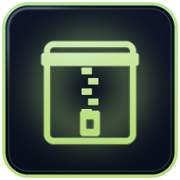

# Axentra Archive icon — revision 1.4

Archive is the ninth app in the kit. It uses the existing lime archive glyph with
accent `#B6DE76`, preserved from the installed Archive / Zip 0.1.4 Windows icon.
The same ICO is embedded by Command, and its 32/256 px pixels match the website.
The product is named Archive; older binaries, paths and its Command ID use `Zip` / `zip`.



## Master and provenance

The canonical raster master is [`raster/archive.ico`](raster/archive.ico), copied
unchanged from the application's `icons/zip-glass-v1.ico`. The original procedural
or vector source was not available at its recorded source location during this sync.
No replacement artwork was drawn, and the kit does not claim a recovered SVG master.

Original ICO SHA-256:

```text
cfa134e5117eef9d10648174684c38bb8495988f67206721a67d809c8edfe0e6
```

[`assets/archive.ico`](assets/archive.ico) is byte-identical to that master. It has
eight independently stored frames: 16, 20, 24, 32, 40, 48, 64 and 256 px, with BGRA
DIBs below 256 px and a PNG at 256 px.

## PNGs and reproduction

Run `python scripts/export.py out` and `python scripts/verify.py --rendered out`
after installing the prerequisites in [README.md](README.md). The final step runs
`raster/render.cjs` with the same pinned Sharp dependency as the SVG exporter.

| Output | Source |
|---|---|
| 16, 24, 32, 48, 64, 256 px PNGs | Exact RGBA pixels from the matching ICO frame; PNG compression may differ |
| 128 px PNG | Downsampled native 256 px frame with Lanczos3 |
| 512 px PNG | Upscaled native 256 px frame with Lanczos3; a compatibility preview, not additional original detail |
| Contact-sheet 160 px tile | Downsampled native 256 px frame |
| Contact-sheet 32/16 px samples | Native frames magnified with nearest-neighbor sampling |

All 82 complete-family outputs, including the expanded contact sheet, are covered
by the committed SHA-256 baseline and reproducible in the recorded environment.
The previous eight apps and all PDF document icons remain unchanged.

## Integration

Command's source consumer is `assets/archive.ico`; the kit's dry-run copier now
includes that file. For Archive packaging, use `assets/archive.ico` as the Windows
ICON resource and preserve the installed `icons/zip-glass-v1.ico` reference used by
shortcuts. The recorded application source path is `axentra-zip`, but that checkout
was unavailable, so no unverified application-project sync mapping is added.

The motion component uses `archive-256.png`, its own ninth orbit position and a
centered final tile on phones. This kit update does not rebuild applications,
publish installers or redeploy the website, which already includes Archive.
