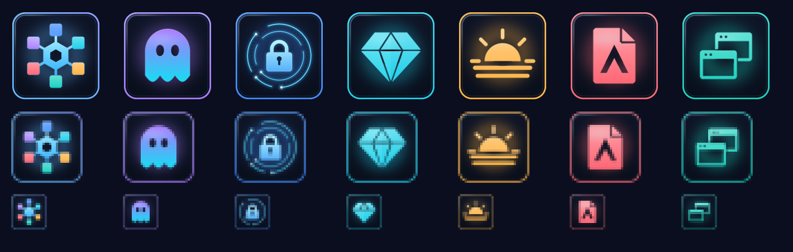

# Axentra icon kit — Glass + Precision, v1.1

This is the canonical, self-contained source kit for the Axentra app icons adopted on
October 14, 2026. It includes all seven production icons: Command, Ghost, Vault,
CrystalWire, Horizon, PDF and Spaces. Use this kit to reproduce the existing icons or
give a new app the same glass tile, geometry, lighting and optical-size treatment.

Revision 1.1 brings Vault closer to its original circuit-halo identity: a smaller icy-blue
lock, thin cyan rings and restrained glow inside the existing suite tile. See the
[Vault design notes](VAULT.md) and [revision history](CHANGELOG.md). The other six app
icons retain their original bytes.



The editable masters are **procedural Rust geometry**, not SVGs or an image-generation
prompt. The renderer uses only Rust's standard library. No fonts, image libraries,
API keys, downloads or sibling app repositories are needed to generate app icons.

## Use the existing icons

Ready-to-use files are in [`assets/`](assets/):

- PNGs: 16, 24, 32, 48, 64, 128, 256 and 512 px per app.
- Windows ICOs: eight independently rendered frames at 16, 20, 24, 32, 40, 48, 64 and 256 px.
- `preview.png`: all seven apps in renderer order, at 160 px and magnified 32/16 px.

**PDF documents keep the separate [glass PDF file icon](document-icons/README.md).**
`assets/pdf.ico` identifies the application; it must not replace the document icon.

## Reproduce the current set

From this `Icon-Kit` directory, with Rust/Cargo and Python 3 available:

```powershell
python scripts/verify.py
cargo run --manifest-path renderer/Cargo.toml --release --locked --offline -- out
python scripts/verify.py --rendered out
```

The first check verifies the committed source and assets against `manifest.json`.
The second command creates a fresh export. The final check requires every regenerated
PNG and ICO, including the contact sheet, to match the approved files **byte for byte**.
Nothing writes to an application, installer, shortcut or registry during generation.

The verified baseline used Rust 1.99.0 on `x86_64-pc-windows-msvc`; full compiler details
are recorded in [`build-info.json`](build-info.json). The crate has no external dependencies.
Rust floating-point transcendental functions can differ across targets/toolchains:
always run the checksum comparison before calling another environment byte-identical.
Use the checked-in assets when exact bytes are needed without regenerating them.

## Create a matching icon for another app

1. Read the [design specification](DESIGN.md).
2. Follow [Adding an app](ADDING-AN-APP.md), including the compilable example.
3. Export all icons and confirm existing apps did not change.
4. Follow the [integration and release guide](INTEGRATION.md).

For another developer or coding assistant, [the handoff brief](HANDOFF.md) provides a
ready-to-use starting request. Start with this kit; the older generic prompt at the
repository root is historical and does not describe the current production renderer.

## Contents

| Path | Purpose |
|---|---|
| `renderer/src/suite.rs` | Authoritative geometry, palette, shared tile and sampling |
| `renderer/src/main.rs` | Deterministic PNG/ICO encoder and contact-sheet exporter |
| `renderer/Cargo.toml`, `Cargo.lock` | Standalone Rust crate, no dependencies |
| `assets/` | Approved production PNG/ICO exports and contact sheet |
| `manifest.json`, `build-info.json` | SHA-256 baseline and build provenance |
| `document-icons/` | Preserved PDF document ICOs and their legacy SVG design sources |
| `references/` | Original concept, current production preview, Vault reference, PDF installer preview |
| `scripts/verify.py` | Standard-library integrity and regeneration checks |
| `scripts/sync_assets.py` | Portable, dry-run-by-default copier for the current app projects |
| `scripts/verify_binary.py` | Compare a Windows executable's embedded icon against an ICO |

## Source ownership

Make future icon changes here first. Command and Ghost embed copies of `suite.rs` in
their builds; the other apps consume the exported assets. The sync script updates these
copies explicitly. Application repositories can contain unreleased work, so review the
copy plan and coordinate rebuilds before installing. The public kit contains no local
machine paths, installers, application data or development logs.

AI-generated concept artwork in `references/approved-concept.png` informed the design.
It records the initial family direction, before Vault's circuit-halo revision; it is a
visual reference only. The actual shipping designs are defined by the renderer
and `assets/`, so exact reproduction never depends on regenerating that concept.
