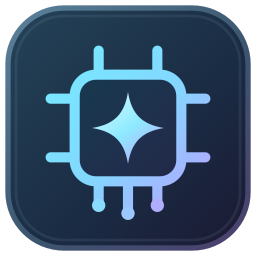
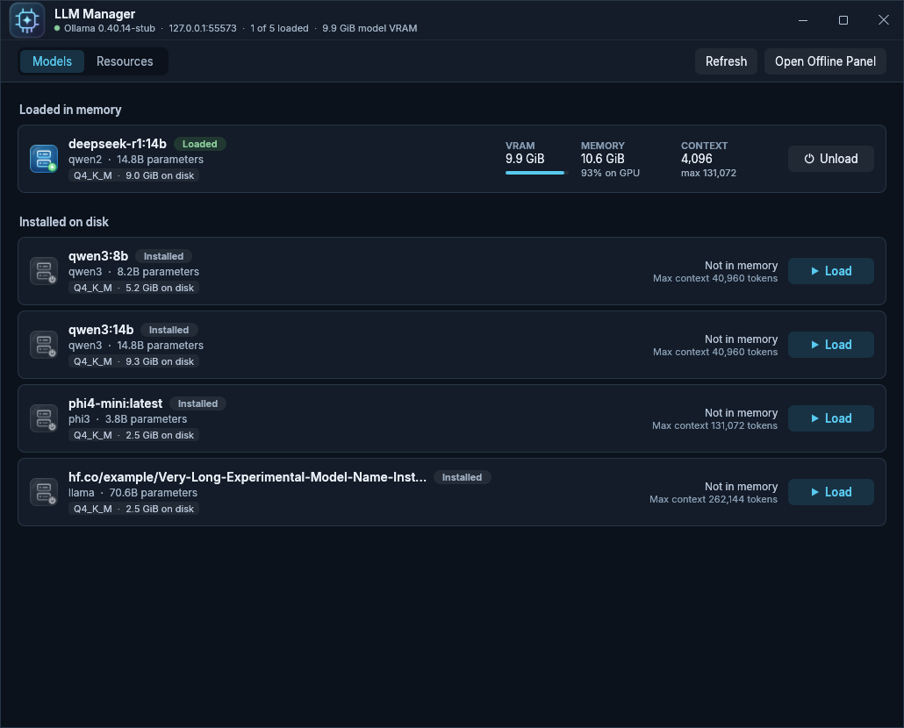
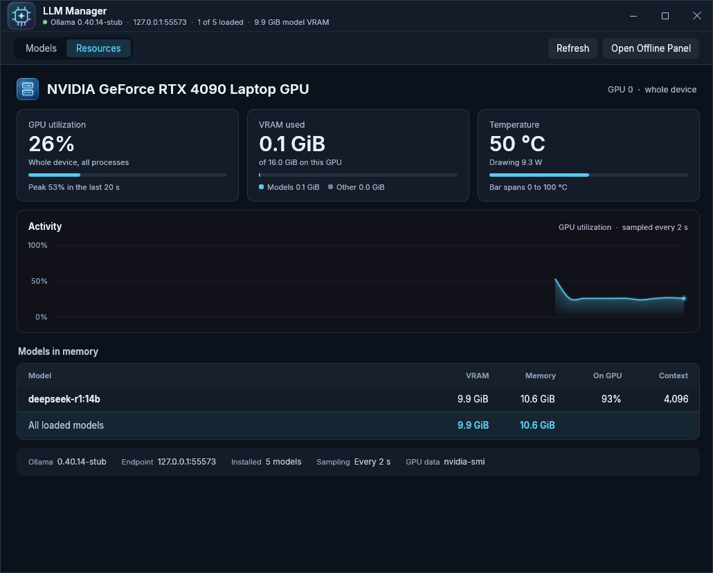

# Axentra LLM Manager



See which Ollama models are installed and which are in memory, load or unload one, and watch what the GPU is doing. A native Rust app for Linux.

**0.1.0 is a development preview for Linux.** It is built and installed on Zorin OS 18.1. No binary release is published and the build is unsigned. There is no Windows build.





The model list in these screenshots comes from the bundled test stub. The GPU readings are live from the machine that took them.

## What it does

- **Models** lists what Ollama has in memory and what is installed on disk. A loaded model shows the VRAM it holds, the total memory Ollama allocated for it, how much of it runs on the GPU, and its context window. An installed model shows its size on disk and its maximum context.
- **Load** asks Ollama to keep a model in memory for five minutes. Ollama manages memory itself and may release another idle model to make room. **Unload** asks Ollama to release the model once its active requests finish.
- **Resources** shows whole-device GPU utilization, VRAM, temperature and power draw, a chart of recent utilization, and a table of the models in memory.
- A change shows as pending until a fresh sample from Ollama confirms it. A refused request shows Ollama's own error.

The app samples every two seconds while it is open. **Loaded** always means the model is in memory, whether or not it is busy.

## What it talks to

- **Ollama** on `127.0.0.1:11434`, over plain HTTP on the loopback interface. The app sends nothing anywhere else. Models that Ollama marks as remote or cloud are left out of the list and cannot be loaded from here.
- **`nvidia-smi`** for GPU readings. Without an NVIDIA driver the Models view still works and Resources says the GPU is unavailable.
- **Open Offline Panel** opens a separate local chat app at `127.0.0.1:8766`. That app is not part of this repository, so the button only helps if you run it yourself.

## Source and builds

The complete [Rust source](source/), [locked dependencies](source/Cargo.lock) and [license](source/LICENSE) are included. The app uses eframe and egui 0.36.2. It was built with Rust 1.99; it uses the 2024 edition, so an older toolchain may not compile it.

From `LLM-Manager/source`:

```sh
cargo test --locked
cargo build --release --locked
```

To build and install it for your own user, without sudo:

```sh
./packaging/install-local.sh
```

The script installs the executable and icon under `~/.local/share/axentra/llm-manager`, adds a launcher to the application menu, and adds an entry for Axentra Command. Run it again after changing the source.

The [source README](source/README.md) covers the layout, the test stub and the artwork.

## Look, icon and Command

The interface follows the same author's Lab Manager: its palette, card and pill shapes, glass state tiles and compact rows. The window has no system header. The app draws its own title strip with minimize, maximize and close buttons.

The processor icon is embedded in the build and decoded once. The same image is the native window icon and the mark in the header, and the launcher uses an installed copy of the same file. The window's application ID is `axentra-llm-manager`, which matches the launcher, so the desktop groups them together.

The portable [Command manifest](source/axentra.app.json) uses paths under the home folder. The install script writes a per-user copy with absolute paths. Command's built-in catalog does not list this app yet.

## Validation

- 5 Rust tests pass. They cover reading the model inventory and loaded models, the load and unload requests, an error reply from Ollama, GPU output with missing values, and the loopback-only address rule.
- The app was run on a private X display against the bundled stub at 1030 × 830 and 760 × 550. Checked there: load, unload, a refused load, no GPU, Ollama not running, a truncated long model name with its tooltip, scrolling, keyboard focus and activation, and the close button.
- The native window icon was read back from the X server and matches the bundled PNG on every pixel.
- The install script was run into an empty data folder. It produced the executable, icon, launcher and Command entry, and the launcher passed `desktop-file-validate`.

Not validated: moving, maximizing and resizing the header-less window were not tested separately on Wayland by the builder, because the test display has no window manager. Only NVIDIA GPUs are read. Machines with more than one GPU were not tested.
