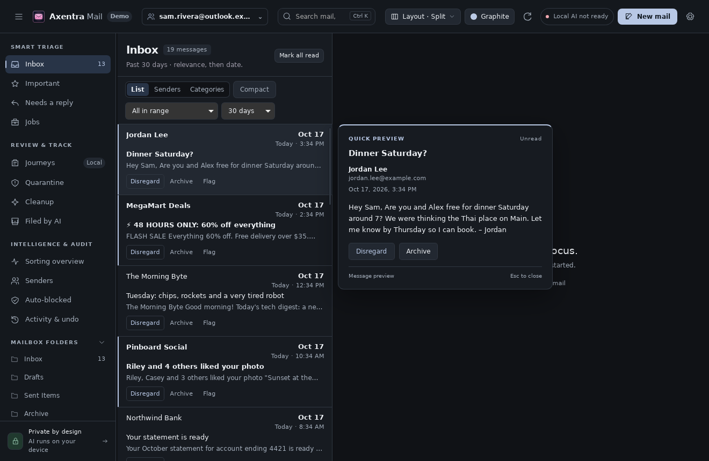

# Axentra Mail on Linux

Verified 2026-10-17 on Zorin OS 18.1 (Ubuntu 24.04), x86_64. Source version **0.1.20**; **development preview**, not a published stable Linux release.

## Run

Open **Axentra Mail** from the application menu, or run:

```bash
~/.local/share/axentra/apps/mail/AxentraMail
```

The preview is installed for the desktop user, with a separate folder for each app. Data and profiles live outside the application folder. Installation does not enable startup or change default applications.

## Available

Native WebKitGTK UI, account/cache paths under XDG data, Unix single-instance IPC, AES-256-GCM protected tokens using a key held by Secret Service, and a ClamAV attachment scanning adapter.

## Verification

109 Rust tests passed; 2 opt-in tests skipped in the regular run. The isolated Secret Service integration test passed separately, including missing-key fail-closed behavior. Native demo UI and POST changes passed.

## Remaining work and requirements

Real Microsoft/Google account sign-in, sending and live sync still need account testing. No user account was connected by this port. ClamAV and Ollama are optional external dependencies; unavailable scanning is reported rather than treated as a clean result. Windows DPAPI tokens cannot be copied to Linux; sign in again. Horizon currently reads only the primary Outlook cache.

## Screenshot



Demo mailbox; no real mail.
