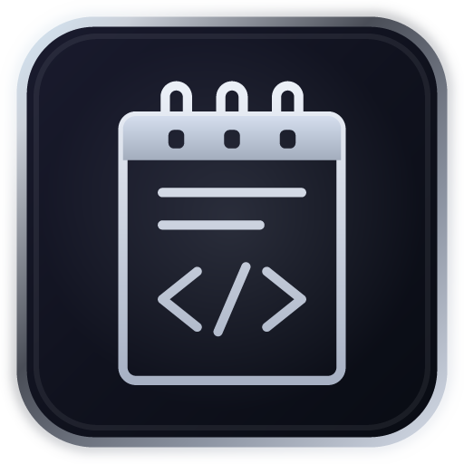
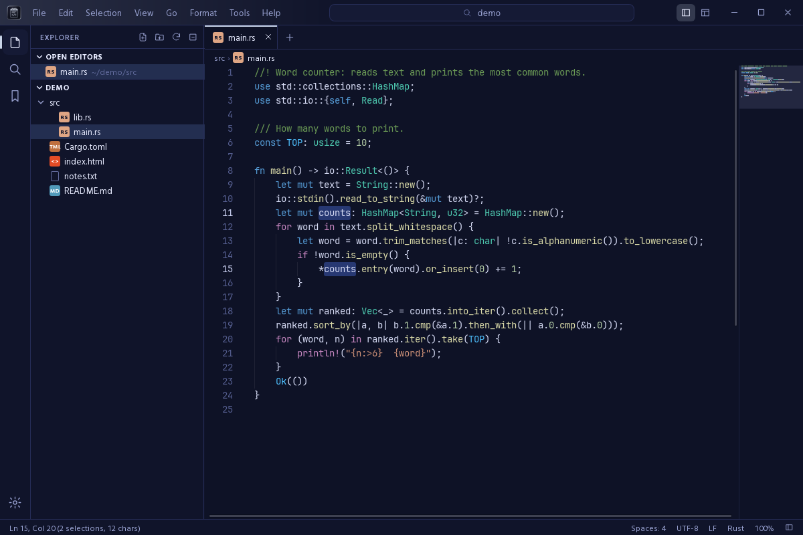
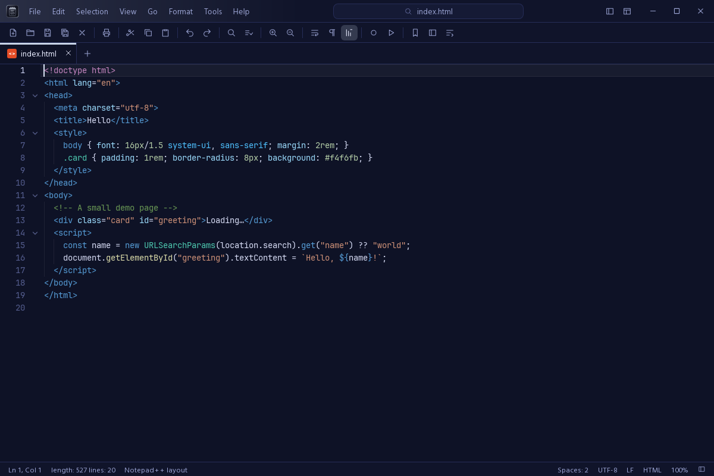
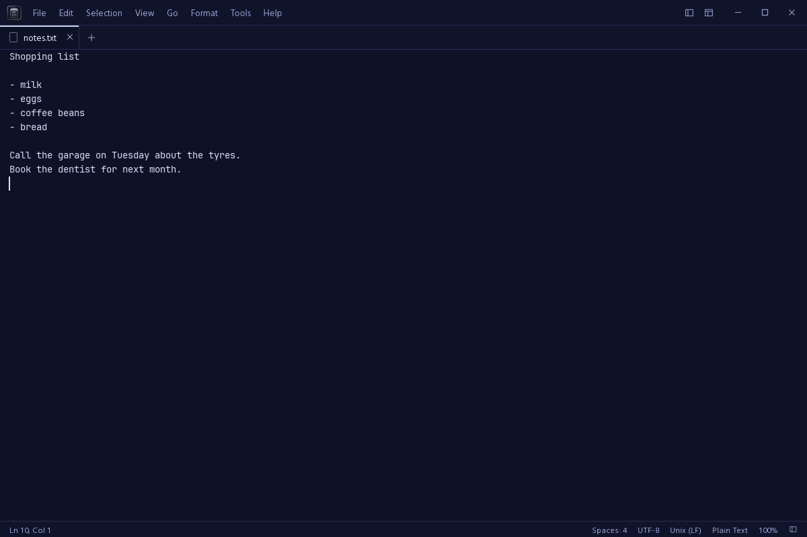

**Linux preview (0.1.5, built 2026-10-30):** [Zorin installation, tests and limits](LINUX.md).

# Axentra Notepad

A text and code editor for Linux that works the way Windows Notepad, Notepad++ and Visual Studio Code do. Pick the
layout you're used to: plain Notepad, Notepad++ with its toolbar and margins, or the VS Code workbench with an
explorer, search and minimap. It's a native Rust app (tao and wry on the system WebKitGTK webview) with tabs that
survive restarts, syntax highlighting for 46 languages, multiple cursors, find and replace across folders, and 25
text encodings. There's no account, telemetry or network access.

> "Notepad" and "Visual Studio Code" are trademarks of Microsoft Corporation, and "Notepad++" is the name of Don Ho's
> project. Axentra Notepad is an independent editor that follows their layouts and keyboard shortcuts; it contains
> none of their code or artwork and isn't affiliated with or endorsed by them.



**Latest version: 0.1.5 (Linux preview)** · No published download yet; build it from [source](source/) ·
[Changelog](CHANGELOG.md) · [Linux page](LINUX.md)

## Features

| Area | What you get |
|---|---|
| **Layouts** | *Notepad*: just the text, word wrap on, no line numbers, Notepad's font size and line spacing. *Notepad++*: toolbar, line numbers, fold margin, bookmarks and a length/lines status field. *Code*: activity bar, explorer, search, breadcrumbs and minimap. Every part can also be switched on or off on its own from View, and there are dark and light themes. Ctrl+scroll wheel zooms the text in 10% steps, like Windows Notepad |
| **Tabs and sessions** | Tabs with drag-to-reorder, middle-click close and Reopen Closed Tab. Open tabs come back after a restart; closing the window with unsaved changes asks Save / Don't Save / Cancel (or, if you prefer, keeps them for next time like Windows 11 Notepad). Closing the last tab returns to a start page with *New Note* and *New Code File…*. Files changed by other programs reload automatically, or ask if you have unsaved edits |
| **Highlighting** | 46 languages detected from the file name, extension or shebang, including C/C++, C#, Java, Kotlin, Go, Rust, JavaScript/TypeScript, Python, PHP, Ruby, shell, PowerShell, SQL, HTML with embedded CSS and JS, Markdown with highlighted fenced code, JSON, YAML, TOML and INI. CSV/TSV get rainbow columns and logs get coloured levels |
| **Editing** | Multiple cursors (Alt+click or Ctrl+click, Ctrl+D, Ctrl+Shift+L, Ctrl+Alt+Up/Down), column selection (Alt+drag or Column Selection Mode), auto-closing brackets and quotes, auto-indent, smart Home, toggle line and block comments, line operations (move, copy, duplicate, delete, join, sort, reverse, shuffle, remove duplicate or empty lines, trim), case changes, Base64/URL/HTML conversions, JSON format and minify, insert date/time (F5), overtype and read-only mode |
| **Find** | VS Code's find widget with match case, whole word, regular expressions (`$1`, `\U…\E` and `\n` in replacements), find in selection and select all matches. *Find in Files* searches a folder (honouring `.gitignore`) or the open tabs, with a replace preview and *Replace All* that keeps each file's encoding and line endings |
| **Navigation** | Ctrl+P quick open, Ctrl+Shift+P command palette, Ctrl+G go to line:column, bookmarks (Ctrl+F2, F2, Shift+F2), folding by brackets, indentation, Markdown headings and `#region`, and bracket matching |
| **Files** | Encodings detected from the byte order mark or content; reopen or save in UTF-8 (with or without a BOM), UTF-16 LE/BE and 21 legacy code pages, with a clear message (not `?`) when a character doesn't fit. LF, CRLF and CR line endings, atomic saves that keep permissions, an explorer that can create, rename and trash files, and *Reveal in File Manager* / *Open in Terminal* |
| **Macros** | Notepad++-style recording and playback (Ctrl+Shift+R, Ctrl+Alt+R), run N times or to the end of the file |
| **Axentra Command** | Installs its Command manifest, so it appears on the Command board with its icon, version and running state |





## System requirements

- Linux x86_64 with WebKitGTK 4.1 and GTK 3, such as Zorin OS 18 or Ubuntu 24.04.
- About 6 MB of disk space.

## Install

There's no published package yet. To build and install it from the source folder:

```bash
cd source
cargo test
python3 packaging/linux/package.py --output dist
sudo apt install ./dist/axentra-notepad_0.1.5-1_amd64.deb
```

Open **Axentra Notepad** from the application menu or Axentra Command, or run `axentra-notepad file.txt`
(`axentra-notepad .` opens a folder). See the [Linux page](LINUX.md) for what was tested and the current limits.
