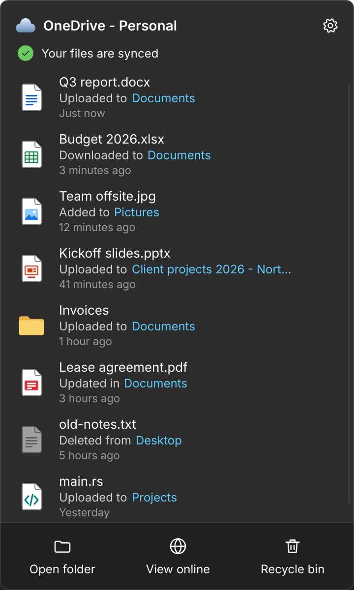

# Axentra OneDrive on Linux

Verified 2026-10-21 on Zorin OS 18.1 (Ubuntu 24.04), x86_64, GNOME on Wayland (125% scaling) and X11. Source version **0.1.0**; **development preview**, not a published release.

## Run

Open **Axentra OneDrive** from the application menu, or run:

```bash
~/.local/share/axentra/apps/onedrive/AxentraOneDrive
```

The sync service runs as the systemd user unit `axentra-onedrive.service`, and the `axentra-onedrive` command controls it from a terminal. The tray icon runs as `axentra-onedrive-tray.service`, tied to the desktop session; it restarts after a crash or a kill, and stays stopped after **Quit**. Settings are in `~/.config/axentra/onedrive`, sign-in and sync state in `~/.local/share/axentra/onedrive`, and downloaded copies in `~/.cache/axentra/onedrive`. Unlike the other previews, installation enables the service and the tray at sign-in, as the Windows client does.

## Available

Files On-Demand through FUSE, two-way sync with Microsoft Graph's delta feed, chunked uploads, hash-checked downloads, Windows conflict naming, pin and free up space, sharing links, version history and restore, pause, bandwidth limits, desktop notifications, a StatusNotifierItem tray icon, the activity panel, Settings with a choice of three app icon colours, and GNOME Files badges and menu. The first scan of a large drive shows how many items it has listed and resumes after a restart instead of starting over.

## Verification

172 Rust tests passed: 81 end-to-end tests on a real FUSE mount against a Graph mock (on-demand download, uploads including chunked large files, rename identity, conflicts, deletes in both directions, pin and free, save-by-rename history, delta paging and expiry, token refresh, throttling, invalid names, sharing, version restore, resuming an interrupted first scan, starting before the network is up, stopping while a folder is still open, cloud thumbnails that leave files online-only, and the races a sync client meets: edits, overwrites and renames during transfers, moves out of a folder that is then deleted, pause or sign-out mid-transfer with uploads resuming, replies lost after an upload went through, and "Always keep" changes while downloads run), plus unit tests including QuickXorHash against a bit-level model and where the panel opens on each monitor. Clippy reported no warnings.

On the desktop: signed in to a real personal account with its own app registration; the mount listed the account's files and downloaded on demand. The tray registered with the AppIndicator host, its menu paused and resumed the service over D-Bus, and the panel opened with the GPU renderer, just above the tray icon at the bottom right of the laptop screen, out of the taskbar and with the keyboard focus; it closed on a second tray click, on Escape and when another window took the focus, which then went back to the previous window. The service restarts in under a second, and after a boot without a network it shows "You're offline" until the network is up. Switching the icon colour replaced the installed desktop icon, and switching back restored it. The installer upgraded an earlier test install without re-downloading. An online-only photo got OneDrive's 256 px thumbnail through `GetThumbnail` in under a second without being downloaded, and a second sync service was refused the running one's bus name. The tray service came back within seconds after the tray app was killed (both SIGKILL and SIGTERM), and a second launch still handed over to it.

## Remaining work and requirements

Needs your own Microsoft Entra app registration (free); none is bundled. Conflicts and deletes are verified against the Graph mock; uploads have also run against the real account. GNOME Files badges were tested in a harness rather than a restarted Files window. Thumbnailers and the file chooser portal get OneDrive's thumbnails instead of downloading, and every on-demand download logs the program that asked for it. GNOME Files and Eye of GNOME still download `.png` files and unknown file types, which they open to check the type. Wayland doesn't let the panel position itself above the tray icon. Not done: folder backup, Choose folders, Personal Vault, multiple accounts and push notifications.

## Screenshot



Rendered from the app's UI with demo data; no real account appears.
