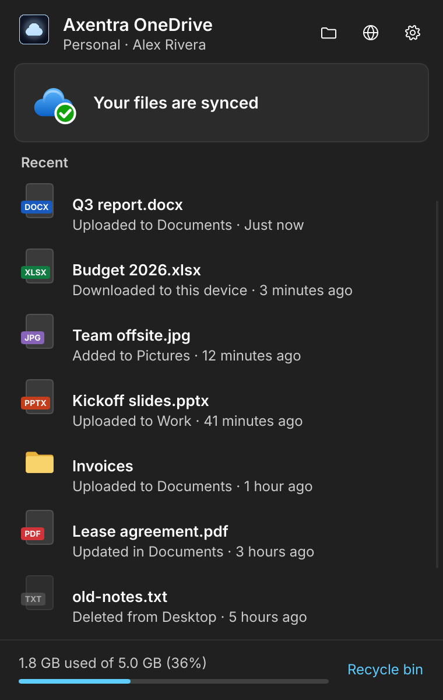
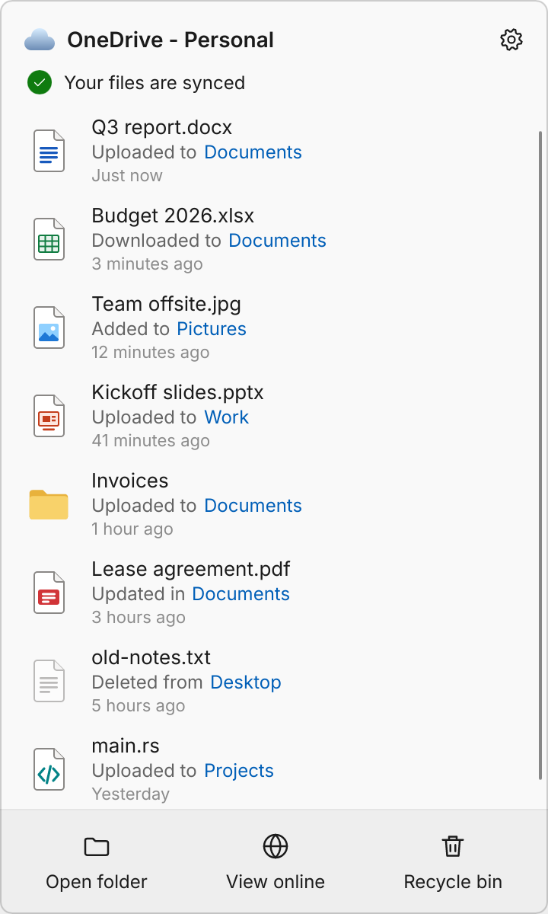
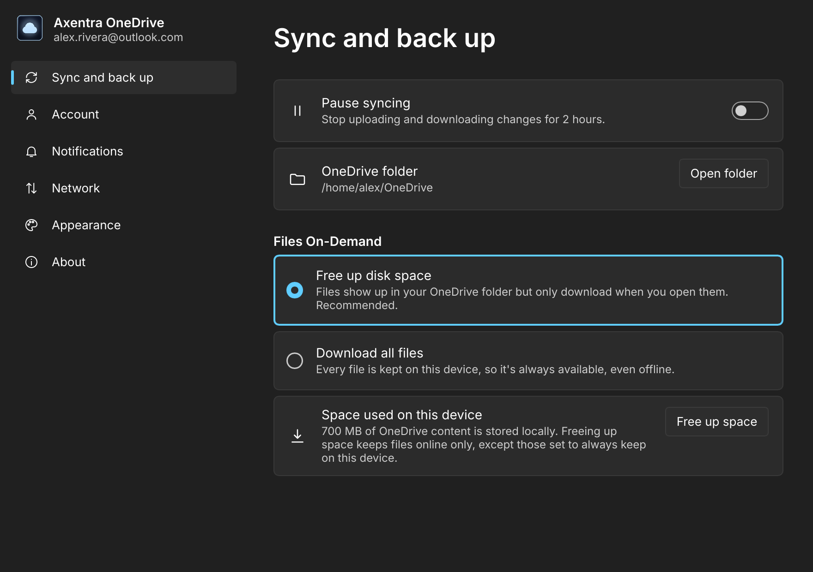
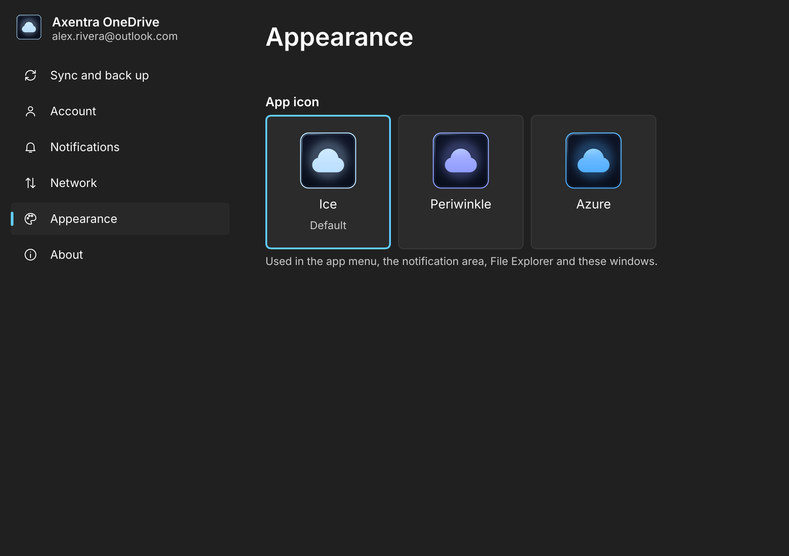
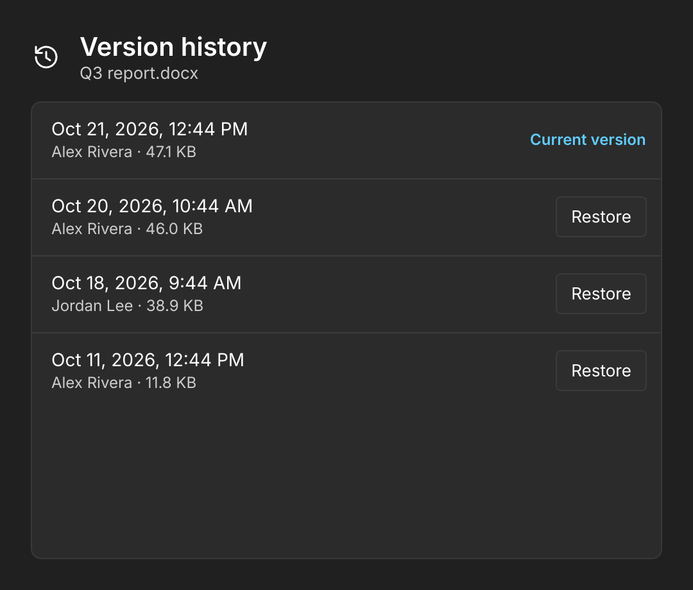

# Axentra OneDrive

Your OneDrive on Linux, working the way it does on Windows: a OneDrive folder with Files On-Demand, a tray icon with the activity panel, status badges and a right-click menu in the file manager, Windows-style conflict handling and the same Settings pages. A native Rust app for Linux.

**0.1.0 is a development preview for Linux.** It is installed and syncing a real personal OneDrive on Zorin OS 18.1, but no binary release is published and there is no Windows build (Windows has OneDrive built in). Sign-in uses your own free Microsoft Entra app registration; see [Setting it up](#setting-it-up).

## What matches the Windows client

| Windows OneDrive | Axentra OneDrive |
|---|---|
| OneDrive folder in Explorer | `~/OneDrive`, a FUSE filesystem |
| Files On-Demand: online-only files take no space | Files are listed instantly and download when opened; online-only files use 0 bytes on disk |
| Status column: cloud, green check, solid green check, sync arrows, red X | The same badges in GNOME Files, from extended attributes |
| Always keep on this device / Free up space | Right-click menu, `axentra-onedrive pin` / `free`, or an extended attribute |
| Share, View online, Version history with Restore | Right-click OneDrive submenu; history opens its own window |
| Tray icon: synced, syncing, paused, problem | The same states, drawn for any panel |
| Activity panel: status, recent files, storage, Recycle bin | Same layout in Fluent light and dark |
| Pause syncing for 2, 8 or 24 hours | Panel, tray menu, Settings or `axentra-onedrive pause` |
| Conflicts keep both copies as `File-PCNAME.ext` | Same naming, with a notification |
| Edited here but deleted online: your copy is kept | Same |
| Deletes go to the OneDrive recycle bin | Same |
| Names OneDrive can't store are flagged | Stay local with a red badge and the reason |
| Lock and temporary files aren't uploaded | `~$*`, `.~lock.*#`, swap and partial-download files stay local |
| Saving via "write temp, rename over" keeps version history | Same: becomes a new version of the original |

Not done yet: Personal Vault, folder backup (Desktop/Documents/Pictures), "Choose folders", files shared with you as shortcuts, more than one account, cloud thumbnails for online-only files, and instant change notifications (Axentra OneDrive checks every 30 seconds by default).

| | |
|---|---|
|  |  |
|  |  |
|  | |

Screenshots are rendered from the app's own UI with demo data; no real account appears.

## Source and builds

The complete [Rust source](source/), [locked dependencies](source/Cargo.lock), [license](source/LICENSE) (MIT), [dependency notices](source/THIRD-PARTY-NOTICES.txt) and [developer documentation](source/README.md) are included.

It talks to OneDrive only through the documented Microsoft Graph API: `login.microsoftonline.com` to sign in and `graph.microsoft.com` for files, plus the Microsoft storage URLs Graph returns for transfers. There is no telemetry. Sign-in tokens stay on your computer in a file only you can read.

## Setting it up

Requirements: Linux x86-64 (tested on Zorin OS 18.1 / Ubuntu 24.04), FUSE 3, Rust 1.80 or newer. For the file-manager badges, `python3-nautilus`; for the tray icon on GNOME, the AppIndicator extension (enabled by default on Zorin OS and Ubuntu).

1. **Register an app with Microsoft** (free, one time): in [entra.microsoft.com](https://entra.microsoft.com) → App registrations → New registration, choose *Accounts in any organizational directory and personal Microsoft accounts*, set the redirect URI platform to *Public client/native* with `http://localhost`, turn on *Allow public client flows*, and add the Microsoft Graph delegated permissions `Files.ReadWrite.All`, `User.Read` and `offline_access`. Copy the Application (client) ID.
2. **Install:** from `source/`, run `./install.sh`. It installs for you only, with no sudo, into `~/.local/share/axentra/apps/onedrive` like the rest of the suite.
3. **Connect and sign in:** `axentra-onedrive setup --client-id <id>` (add `--tenant consumers` for a personal account), then `axentra-onedrive login`.
4. **Start:** `systemctl --user start axentra-onedrive`, then open **Axentra OneDrive** from the app menu.

`~/OneDrive` must be empty or absent before the first start. Details and the command reference are in the [developer documentation](source/README.md) and [Linux notes](LINUX.md).

## Icon and Command

The app icon is the ice cloud from the [Axentra Icon Kit](../Icon-Kit/ONEDRIVE.md) (Glass + Precision 1.6), sharing the suite's glass tile, rim and halo. **Settings > Appearance** switches it to periwinkle or azure; the choice applies to the app menu, the notification area, File Explorer and the app's own windows. The other colours come from the same glyph with only the accent changed, and the [source](source/extras/icons/) includes a script that regenerates all three from the kit.

Axentra Command does not list Axentra OneDrive yet. Command's catalog describes Windows installs, and this is a Linux-only app. The Linux install includes a `VERSION` file in the standard app folder.

## Validation

- 31 Rust tests passed, including 18 end-to-end tests that mount a real FUSE filesystem and sync it against an in-memory Microsoft Graph mock.
- Signed in to a real personal OneDrive account, listed its files through the mount and downloaded files on demand with QuickXorHash verification.
- Tray, panel, D-Bus control and the systemd service were exercised on a live Zorin OS GNOME desktop. The file-manager extension was tested against a live mount in a test harness.
- The app is unsigned and has no binary release, so there is no antivirus scan. See [security status](security/README.md).

See the [changelog](CHANGELOG.md).

Axentra OneDrive is independent and is not made, endorsed or supported by Microsoft. OneDrive is a trademark of Microsoft Corporation. Built with [Slint](https://slint.dev).
