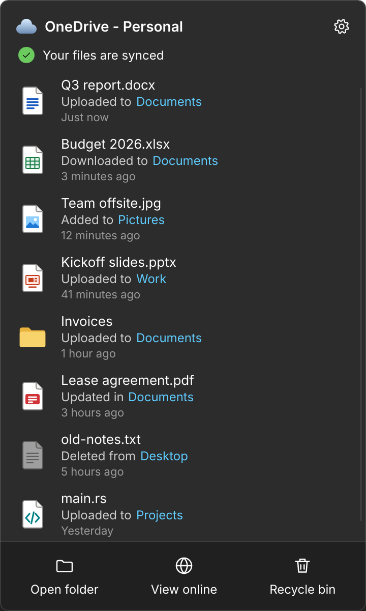
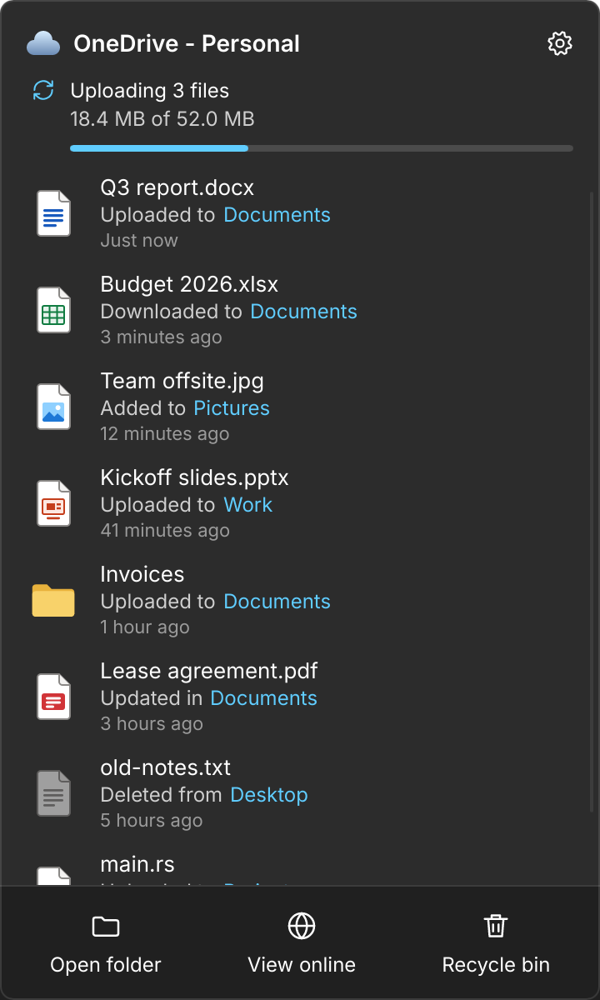
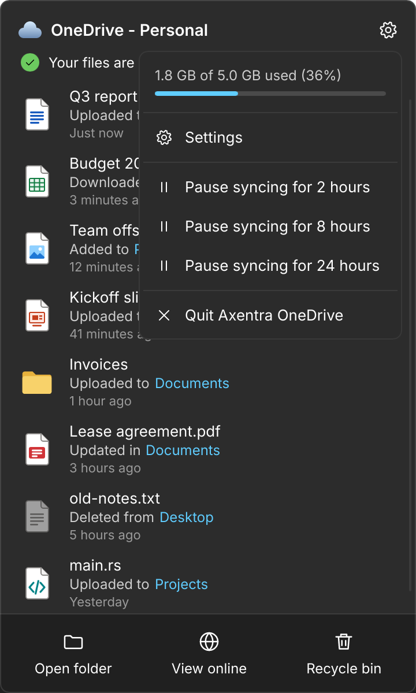
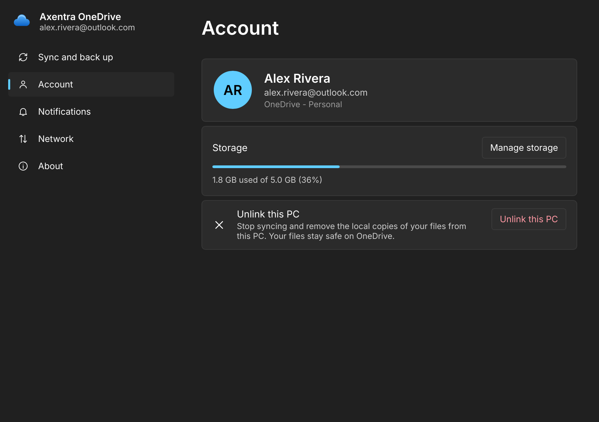

# Axentra OneDrive: OneDrive for Linux, the way it works on Windows

Axentra OneDrive is a OneDrive client for Linux, written in Rust, that mirrors how the Windows OneDrive app looks and behaves: a OneDrive folder with Files On-Demand, a tray icon with the activity panel, file badges and a right-click menu in the file manager, the Windows conflict rules, and the same Settings pages.




| | |
|---|---|
|  |  |
|  |  |

## What matches the Windows client

| Windows OneDrive | Axentra OneDrive |
|---|---|
| OneDrive folder in Explorer | `~/OneDrive`, a FUSE filesystem |
| Files On-Demand: online-only files take no space | Files are listed instantly and download when opened; `du` shows 0 bytes for online-only files |
| Status column: cloud, green check, solid green check, sync arrows, red X | The same badges in GNOME Files, from `user.axentra.onedrive.status` extended attributes |
| Always keep on this device / Free up space | Right-click menu, `axentra-onedrive pin` / `axentra-onedrive free`, or `setfattr -n user.axentra.onedrive.pinned -v 1` |
| Share, View online, Version history (with Restore) | Right-click OneDrive submenu; history opens its own window |
| Tray icon with synced / syncing / paused / problem states | StatusNotifierItem icon drawn in those states |
| Activity panel above the tray: account, status, recent files with their folders, Open folder / View online / Recycle bin | Same layout in Fluent light and dark. On X11 it opens just above the tray icon, stays out of the taskbar and closes when you click elsewhere |
| Pause syncing for 2, 8 or 24 hours | Panel menu, tray menu, Settings or `axentra-onedrive pause` |
| Conflicts keep both copies as `File-PCNAME.ext` | Same naming, with a notification |
| Edited here but deleted online: your copy is kept | Same |
| Mass-delete warning | Notification past a threshold (default 50) |
| Settings: Sync and back up, Account, Notifications, Network, About | Same pages; upload/download rate limits; Unlink this PC |
| Files deleted locally go to the OneDrive recycle bin | Same (the web app's recycle bin) |
| Names OneDrive can't store are flagged | Stay local with a red badge and an explanation |
| Lock and temp files aren't uploaded | `~$*`, `.~lock.*#`, swap and partial-download files stay local |
| Saving by "write temp, rename over" keeps version history | Same: the rename becomes a new version of the original |

Not done yet: Personal Vault, folder backup (moving Desktop/Documents/Pictures into OneDrive), "Choose folders", files shared with you that were added as shortcuts, more than one account, cloud thumbnails (online-only files show a generic icon, because thumbnailers aren't allowed to download whole folders), and instant push notifications (Axentra OneDrive checks for changes every 30 seconds by default).

## How it works

```
GNOME Files ── badges & menu ──┐                       Microsoft Graph
                               │ D-Bus                 (documented API)
tray icon / panel / settings ──┼──► axentra-onedrive daemon ◄──────────────────► OneDrive
axentra-onedrive CLI ────────────────────┘    │  sync engine (delta feed, uploads,
                                    │  conflicts, retries, rate limits)
~/OneDrive (FUSE) ◄─────────────────┘  SQLite state + content cache
```

* **`crates/graph`**: Microsoft Graph client. Browser sign-in (PKCE, loopback redirect) or device code, token refresh, the drive delta feed with paging and expiry, 4 MB simple uploads and chunked upload sessions, streamed downloads with QuickXorHash verification, sharing links, versions, and backoff on 429/5xx.
* **`crates/core`**: the daemon. A SQLite row per item (which doubles as its inode number); the FUSE layer that serves listings from it and downloads content on open without blocking other operations; the sync engine; and the D-Bus API `io.github.mecmwithshawn.AxentraOneDrive1`.
* **`crates/ui`**: the tray icon (ksni), the activity panel, Settings and Version history ([Slint](https://slint.dev), Fluent style).
* **`crates/cli`**: `axentra-onedrive`, for setup, sign-in, the daemon itself and scripting.
* **`crates/mock`**: an in-memory fake OneDrive for tests and demos.
* **`extras/`**: the Nautilus extension, badge icons, systemd unit, desktop entries.

## Setting it up

You need Rust, `fuse3`, and for the file-manager badges `python3-nautilus`. On GNOME the tray icon needs the AppIndicator extension, which Zorin OS and Ubuntu ship enabled.

1. **Register an app with Microsoft** (free, one time). Axentra OneDrive signs in through your own app registration rather than borrowing another app's identity:
   1. Go to [entra.microsoft.com](https://entra.microsoft.com) → App registrations → New registration.
   2. Name it "Axentra OneDrive". Under supported account types, choose *Accounts in any organizational directory and personal Microsoft accounts*.
   3. Set the redirect URI's platform to *Public client/native (mobile & desktop)* and the URI to `http://localhost`.
   4. Under Authentication, turn on *Allow public client flows*.
   5. Under API permissions, add the Microsoft Graph delegated permissions `Files.ReadWrite.All`, `User.Read` and `offline_access`.
   6. Copy the *Application (client) ID*.

   If Entra says personal accounts can't create registrations without a directory, join the free Microsoft 365 Developer Program or create a free Azure account and register the app there. The registration still accepts personal accounts.
2. **Install:** `./install.sh`. Like the rest of the Axentra suite it installs for you only, with no sudo, into `~/.local/share/axentra/apps/onedrive`, and puts the `axentra-onedrive` command in `~/.local/bin`. It also upgrades an install made under the project's earlier working name, Cirrus, keeping its sign-in and sync state.
3. **Connect and sign in:** `axentra-onedrive setup` (paste the client ID), then `axentra-onedrive login`.
4. **Start:** `systemctl --user start axentra-onedrive`, then open **Axentra OneDrive** from the app menu. Both start automatically from then on. Run `nautilus -q` once so Files loads the badges.

`~/OneDrive` must be empty (or not exist) before the first start, because it becomes the mount point. Use `axentra-onedrive setup --folder ~/elsewhere` to pick another folder.

## Using it

The tray icon opens the panel. Everything is also available from the terminal:

```
axentra-onedrive status              what's syncing, problems, storage
axentra-onedrive activity            recent activity
axentra-onedrive pin   <path>...     always keep on this device
axentra-onedrive unpin <path>...     stop always keeping (files stay local for now)
axentra-onedrive free  <path>...     free up space
axentra-onedrive share <path>        print a view link (--edit for an edit link)
axentra-onedrive online [path]       open on the web
axentra-onedrive versions <file>     list versions;  axentra-onedrive restore <file> <id>
axentra-onedrive pause [hours]       pause (2 by default);  axentra-onedrive resume
axentra-onedrive logout              unlink this PC
```

Settings live in `~/.config/axentra/onedrive/config.toml`; the Settings window edits the same file. State and sign-in tokens (mode 0600) are in `~/.local/share/axentra/onedrive`, and downloaded files in `~/.cache/axentra/onedrive/files`.

**About deleting from GNOME Files:** OneDrive's own recycle bin replaces the local Trash, so in your OneDrive folder Files reports that it can't move items to the Trash and offers to delete them instead. Deleted items can then be restored from the OneDrive recycle bin on the web (kept for 30 days on personal accounts), just as on Windows.

## Trying it without an account

```
cargo run -p axentra-onedrive-mock          # a fake OneDrive with sample files on 127.0.0.1:8765
```

It prints the `config.toml` lines and token file to use. Point a separate profile at it with `XDG_CONFIG_HOME`, `XDG_DATA_HOME` and `XDG_CACHE_HOME`.

## Tests

```
cargo test --workspace
```

The end-to-end tests mount a real FUSE filesystem for each test and sync it against the mock server. They cover on-demand download, uploads (including chunked large files), rename keeping item identity, conflicts, deleted-online-but-edited files, pin and free, save-by-rename version history, delta paging and expiry, token refresh, throttling, invalid names, sharing, version restore, resuming an interrupted first scan, starting before the network is up, and stopping while a folder is still open. QuickXorHash is checked against a bit-by-bit model of the algorithm.

UI screenshots render headlessly with `cargo run -p axentra-onedrive-ui -- --screenshot <view> out.png [light|dark]`. The views are `flyout`, `flyout-syncing`, `flyout-menu`, `flyout-paused`, `flyout-signed-out`, `flyout-empty`, `settings-0` to `settings-4`, `versions` and `tray`.

## Notes

Axentra OneDrive is an independent project. It talks to OneDrive only through the documented Microsoft Graph API, contains no Microsoft code or artwork (the icons are original), and isn't made, endorsed or supported by Microsoft. OneDrive is a trademark of Microsoft Corporation.
