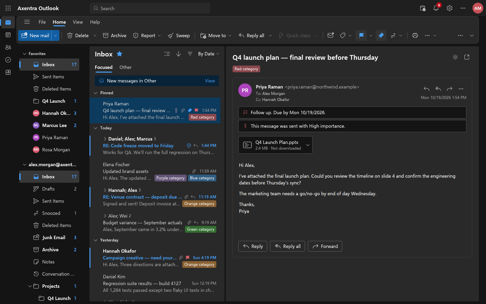
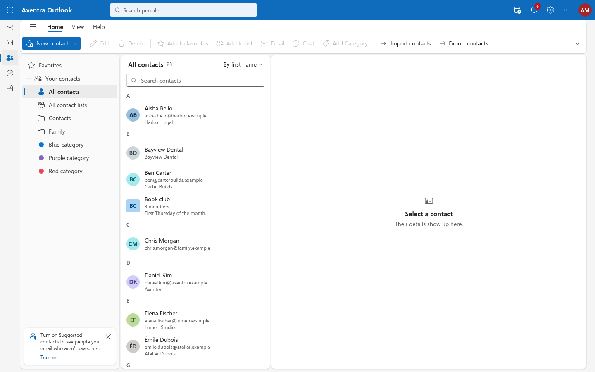
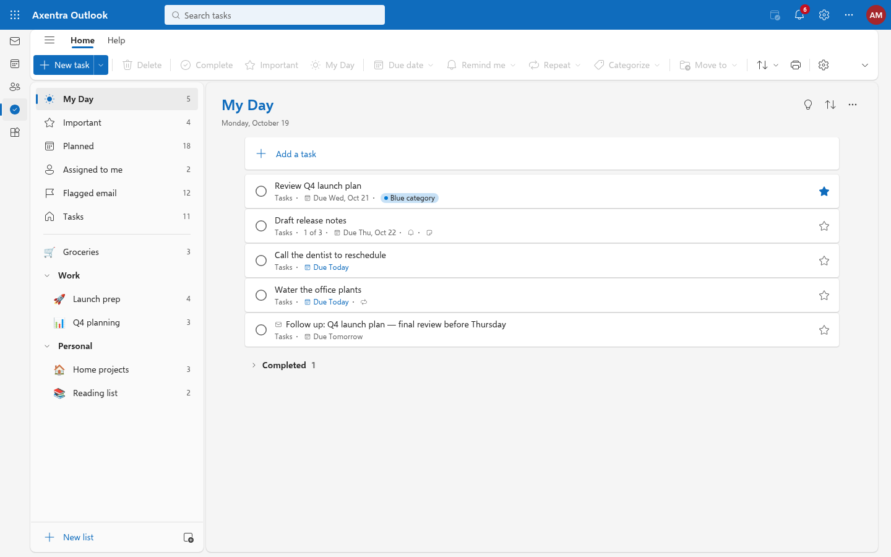
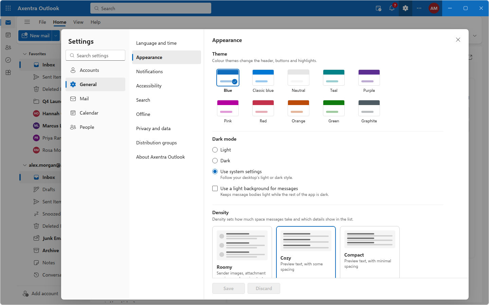
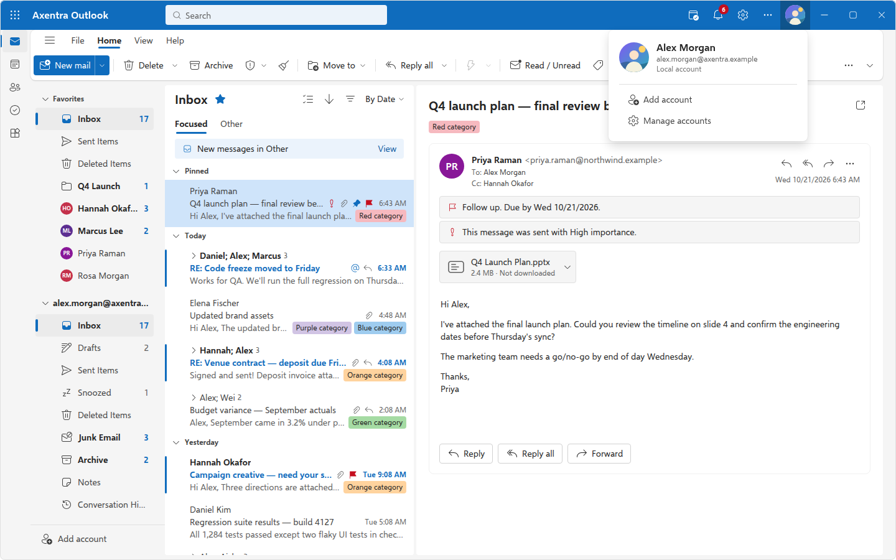

# Axentra Outlook on Linux

Built and tested 2026-10-28 on Zorin OS 18.1 (Ubuntu 24.04), x86_64. Version **0.1.5**; **pre-release**, not a stable release.

## Install and run

```bash
sudo apt install ./axentra-outlook_0.1.5-1_amd64.deb
```

Open **Axentra Outlook** from the application menu, or run `axentra-outlook`. The package installs to
`/opt/axentra/outlook` with a `VERSION` file, menu entry, icons in the hicolor theme and an Axentra Command
manifest, so Command lists it like the other suite apps. Installation does not enable startup or change default
applications.

## Available

Native WebKitGTK window (Dioxus 0.7 desktop) whose blue header is the title bar (client-side decorations, following the GNOME button layout; Settings › General › Appearance can switch back to the system title bar), resizable dialogs and movable pop-out windows that remember their size, local SQLite store under `~/.local/share/axentra-outlook`, demo
mailbox for offline use, Microsoft Graph sign-in through the system browser (authorization code + PKCE on a
`http://localhost` loopback) or a device code, the Microsoft account's own profile photo on the account avatars,
IMAP/SMTP accounts, Secret Service storage for passwords and tokens, encrypted monthly backups to the OneDrive
folder, and the full mail, calendar, people and to-do interface described in the [README](README.md).

## Verification

- 645 Rust tests passed (`cargo test --workspace`): store, recurrence, search, drafts, vCard/CSV, sync mapping
  (MIME, Graph JSON), OAuth PKCE, loopback callback, backup format/encryption/restore/retention, dialog sizing,
  account photo checks and limits, UI logic.
- The account photo was checked by the user on this Zorin machine with a debug build of the same code and their
  own Outlook.com account: the photo shows in the header, the account menu and Settings › Accounts.
- Resizing Settings and the other dialogs was checked by hand on this Zorin desktop (GNOME, X11) with a debug
  build of the same code.
- The backup feature was reviewed by three independent reviewers (encryption and secrets, restore integrity,
  schedule and UX); all 13 confirmed findings were fixed with regression tests before release.
- The release binary was packaged with `packaging/linux/package.py`; `desktop-file-validate` passed and the
  `.deb` contents and control data were inspected.
- An earlier test build of the same code ran as a desktop window on this Zorin machine (Wayland). A real
  Outlook.com account signed in through Microsoft Graph in the browser and synced mail folders, messages,
  calendars and a To Do list.

## Remaining work and requirements

- **Microsoft accounts** need your own free Entra app registration ([setup](source/docs/ACCOUNTS.md)); there is
  no built-in client ID.
- **IMAP accounts** get mail only. Calendar and contacts over CalDAV/CardDAV are not implemented. Drafts stay on
  this device until sent; they are not uploaded to the server's Drafts folder.
- **Not tested against real servers:** IMAP/SMTP providers, sending through Microsoft Graph, and large
  attachments (Graph sends over about 3.5 MB need upload sessions, which are not implemented).
- No desktop (OS) notifications yet; reminders and new-mail alerts appear inside the app.
- Account photos come from Microsoft Graph, so only Microsoft accounts show one; IMAP and Gmail accounts keep
  initials. A photo changed or removed at account.microsoft.com shows up on the next check; checks run at most
  every 6 hours.
- The merged title bar was checked by hand on this Zorin desktop (GNOME, X11): dragging, double-click maximize,
  edge resizing and the window buttons. Right-clicking the header doesn't open the window menu (Alt+Space does),
  and the window has a 1px border instead of a drop shadow.
- Dialogs resize with the mouse only; there is no keyboard resizing (GNOME keeps Alt+F7 and Alt+F8 for moving
  and resizing windows). Small confirmations and short forms keep a fixed size.
- Not yet built: app zoom, Groups and Files modules, rules / junk / quick-steps
  editors, Scheduling Assistant, rich-text task notes, task attachments.
- The `.deb` install itself was not exercised by the build process (it needs `sudo`); report anything that
  looks wrong after installing.

## Screenshots









Demo mailbox; no real mail. Captured from the same interface served by the development preview server at
1440 × 900. The account photo in the last screenshot is a drawn picture that the preview gives the local demo
account (`AXENTRA_FAKE_ACCOUNT_PHOTO=1`), not a real person; in the app, only Microsoft accounts show a photo.
