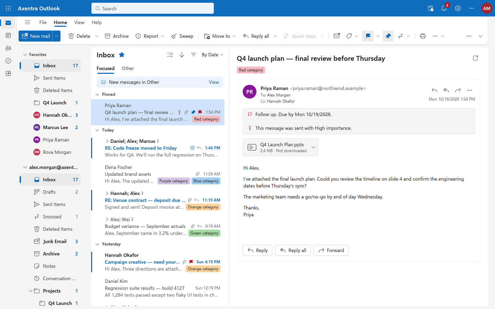
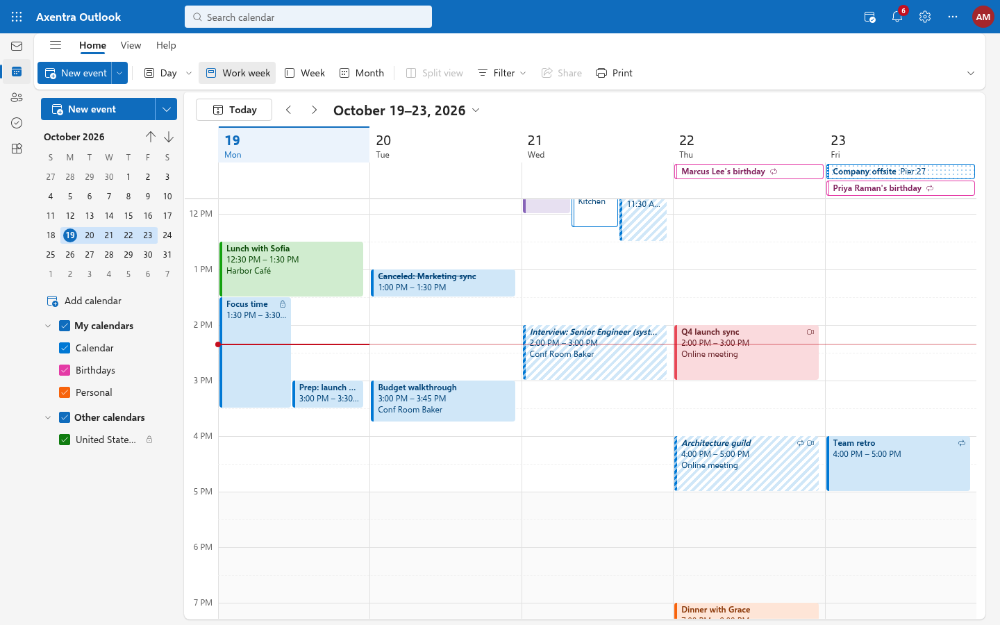

**Linux pre-release (0.1.1, built 2026-10-19):** [Zorin installation, tests, screenshots and feature limits](LINUX.md).

# Axentra Outlook

A Linux desktop client for mail, calendar, people and to-do that looks and works like the new Outlook for
Windows: the same header, app rail, Simplified ribbon, folder pane, conversation list, reading pane, calendar
views and keyboard shortcuts. It's a native Rust app (Dioxus on the system WebKitGTK webview), works offline
with a built-in demo mailbox, and connects to Microsoft 365 / Outlook.com through Microsoft Graph and to Gmail,
iCloud, Yahoo or any IMAP/SMTP server. There's no Axentra server, account, subscription or tracking.

> "Outlook" is a trademark of Microsoft Corporation. Axentra Outlook is an independent client built from
> Microsoft's public documentation; it contains no Microsoft code, logos or artwork, and isn't affiliated with
> or endorsed by Microsoft. Toolbar icons are Microsoft's MIT-licensed Fluent UI System Icons.



**Latest version: 0.1.1 (pre-release)** · [Download](https://github.com/MECMwithShawn/Axentra-Software/releases/tag/outlook-v0.1.1) ·
[Release notes](releases/0.1.1.md) · [Changelog](CHANGELOG.md) · [Security](security/virustotal.md) · [Source](source/)

## Features

| Area | What you get |
|---|---|
| **Mail** | Favorites and per-account folder tree with unread counts, create/rename/move/delete folders, Focused/Other, date groups, pinned items, conversation view, single-line columns layout when the reading pane is off, multi-select, hover actions, full right-click menu (move, categorize, flag with due dates, snooze, pin, junk/phishing, block, sweep, message details, print), drag messages to folders, Undo for delete/move/archive, search with `from:` / `subject:` / `hasattachments:` keywords |
| **Reading pane** | Right, bottom or off; sanitized HTML in a sandboxed frame with remote images blocked until you allow them; attachments; meeting invitations with Accept / Tentative / Decline; conversation stack |
| **Compose** | Inline replies and pop-out window, recipient chips with autocomplete, rich text (fonts, colours, lists, links, tables, pictures, emoji, signature), attachments, drafts saved automatically, Schedule send, Undo send, "send without a subject?" and missing-attachment checks |
| **Calendar** | Day, work week, week and month views, mini month, calendar list with colours, drag to create / move / resize, side-by-side overlaps, current-time line, quick create, peek card with RSVP and Join, full editor with recurrence, reminders |
| **People** | Contacts and contact lists, favorites, alphabetical index, full contact form, vCard and CSV import/export |
| **To Do** | My Day, Important, Planned, Assigned to me, Flagged email and Tasks, custom lists in groups, steps, due dates, reminders, repeating tasks, notes |
| **Look and feel** | Fluent 2 light and dark themes (or follow the system), colour themes, Roomy / Cozy / Compact density, Simplified or Classic ribbon with Customize, My Day pane, notifications pane, settings with search, high contrast and reduced motion |
| **Keyboard** | The new Outlook's shortcut set (Ctrl+1/2/4/5 modules, Ctrl+N, Ctrl+R, Ctrl+Shift+R, Delete, Insert, Ctrl+Q/U, F6 region cycling, `?` for the full list) |
| **Accounts** | Microsoft 365 / Outlook.com via Microsoft Graph (mail, calendar, contacts, To Do), IMAP + SMTP for Gmail (app password), iCloud, Yahoo and other providers; passwords and tokens stay in your desktop keyring (Secret Service) |
| **Backup** | Settings › Accounts › Backup: password-encrypted backups of your account setups, settings and everything that exists only on this PC, saved to your OneDrive folder (synced by Axentra OneDrive) every month and on demand, with a restore preview that merges without duplicates. Passwords and sign-in tokens are never included |
| **Axentra Command** | Installs its Command manifest, so it appears on the Command board with its icon, version and running state |



## System requirements

- Zorin OS 18 or Ubuntu 24.04, x86_64
- WebKitGTK 4.1 (installed automatically as a package dependency)
- A Secret Service keyring (GNOME Keyring or KWallet) to store account sign-ins
- About 40 MB of disk space

## Installation

Download `axentra-outlook_0.1.1-1_amd64.deb` from the [release page](https://github.com/MECMwithShawn/Axentra-Software/releases/tag/outlook-v0.1.1),
check its SHA-256 against the [release notes](releases/0.1.1.md), then:

```bash
sha256sum axentra-outlook_0.1.1-1_amd64.deb
sudo apt install ./axentra-outlook_0.1.1-1_amd64.deb
```

Open **Axentra Outlook** from the application menu. The first start creates a demo account (Alex Morgan, all
fictional) so you can explore offline; remove it under **Settings › Accounts** once your own account is added.

**Connecting a Microsoft 365 or Outlook.com account** needs a free Microsoft Entra app registration (a public
client with the redirect URI `http://localhost`); see [source/docs/ACCOUNTS.md](source/docs/ACCOUNTS.md).
Paste its Application (client) ID under **Add account › Advanced**, or start the app with
`AXENTRA_MS_CLIENT_ID=<id>`. Axentra remembers the last ID you signed in with
(`~/.config/axentra-outlook/microsoft-client-id`), so you only enter it once.

| What | Where |
|---|---|
| Program | `/opt/axentra/outlook/axentra-outlook` (also `axentra-outlook` on the PATH) |
| Mail, calendar, contacts and tasks | `~/.local/share/axentra-outlook/axentra.db` |
| Passwords, tokens and the backup password | Your desktop keyring (Secret Service) |
| Backups | `~/OneDrive/Axentra/Outlook Backups/` (or the folder you choose) |
| Axentra Command manifest | `/usr/share/axentra/command/apps/outlook.json` |

**Updating:** install the newer `.deb` the same way. **Uninstalling:** `sudo apt remove axentra-outlook`. Your
data folder stays until you delete it.

## Privacy

Axentra Outlook talks only to the mail servers you add (Microsoft Graph, your IMAP/SMTP servers) and to
Microsoft's sign-in pages. Remote images in mail are blocked until you choose to show them. Nothing is sent
to Axentra.

## Built with

Rust, Dioxus 0.7 on WebKitGTK, SQLite. The icon is from the [Axentra Glass + Precision icon kit](../Icon-Kit/OUTLOOK.md).
