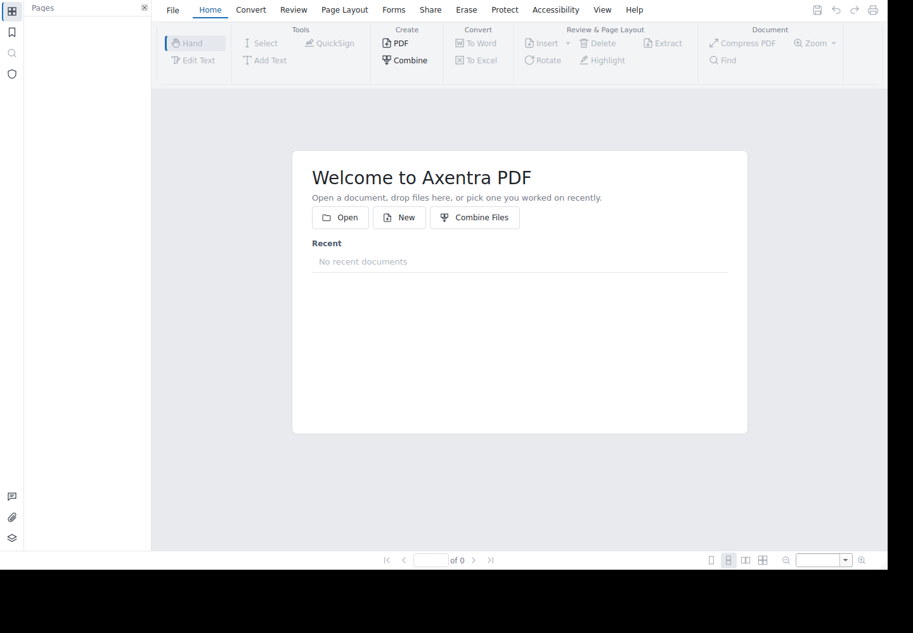

# Axentra PDF on Linux

Verified 2026-10-17 on Zorin OS 18.1 (Ubuntu 24.04), x86_64. Source version **0.3.8**; **development preview**, not a published stable Linux release.

## Run

Open **Axentra PDF** from the application menu, or run:

```bash
~/.local/share/axentra/apps/pdf/axentra
```

The preview is installed for the desktop user, with a separate folder for each app. Data and profiles live outside the application folder. Installation does not enable startup or change default applications.

## Available

Existing PySide6/PyMuPDF application built and installed natively on Linux. PDF viewing/editing workflows use the shared source. Linux Debian packaging now uses /opt/axentra/pdf; the installed preview is a per-user PyInstaller bundle.

## Verification

193 Python tests passed; 7 optional/interactive tests skipped. PyInstaller bundle self-test and native Qt startup passed on Zorin.

## Remaining work and requirements

Optional OCR, LibreOffice conversion and Ghostscript helpers were not installed or exercised. No new public .deb or AppImage release was published. Existing public 0.3.4 downloads are distinct from this 0.3.8 local build.

## Screenshot



Welcome screen; no document opened.
