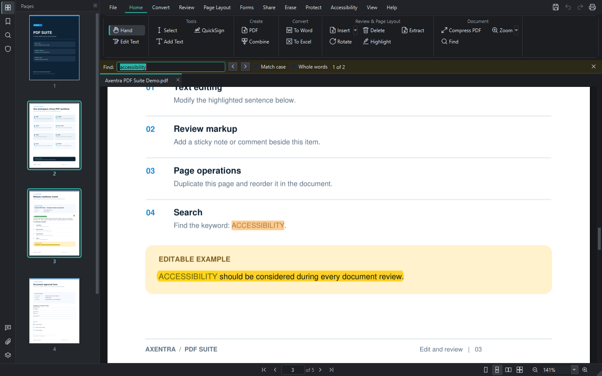
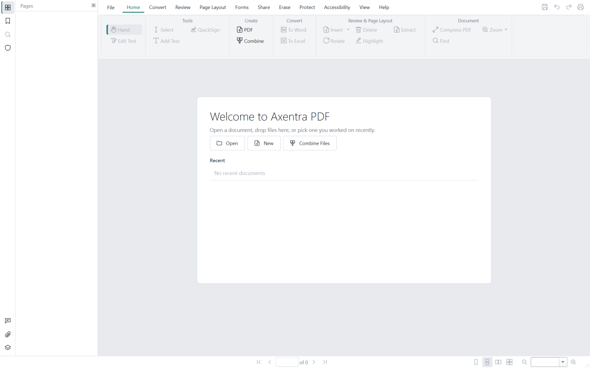
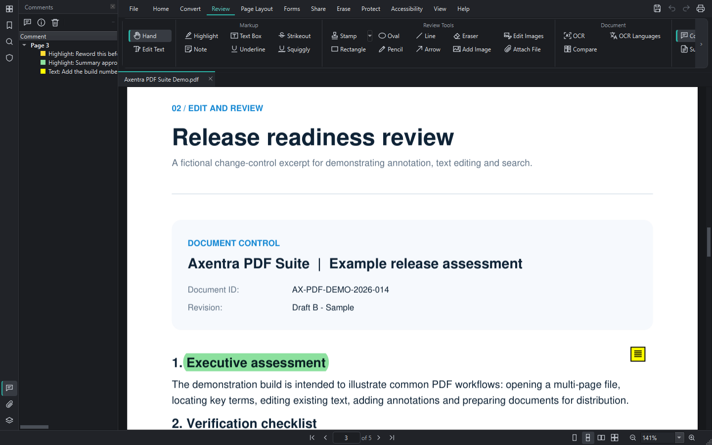
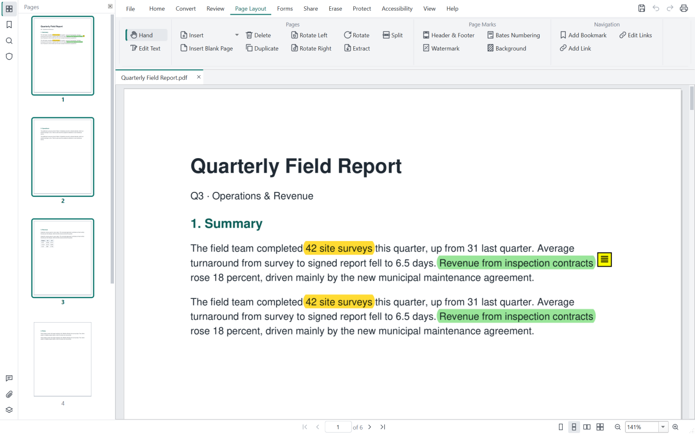
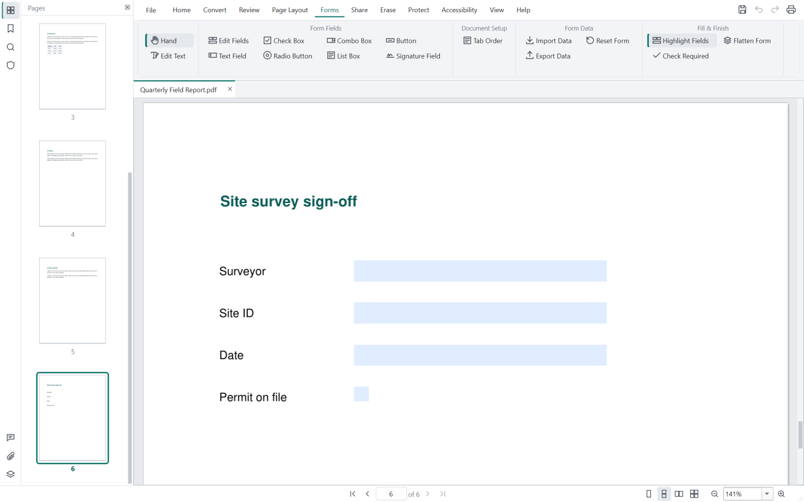
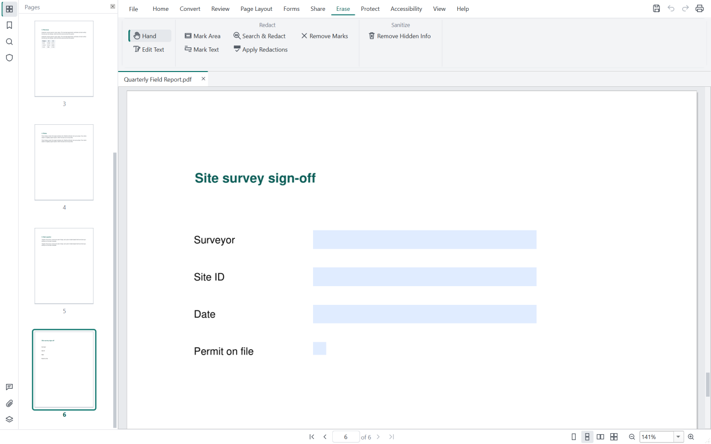
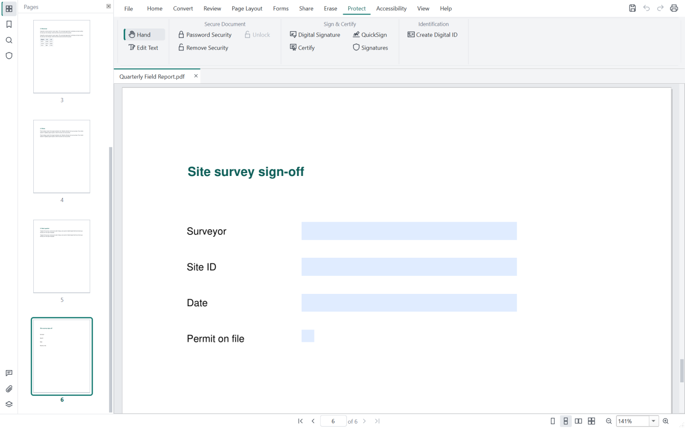
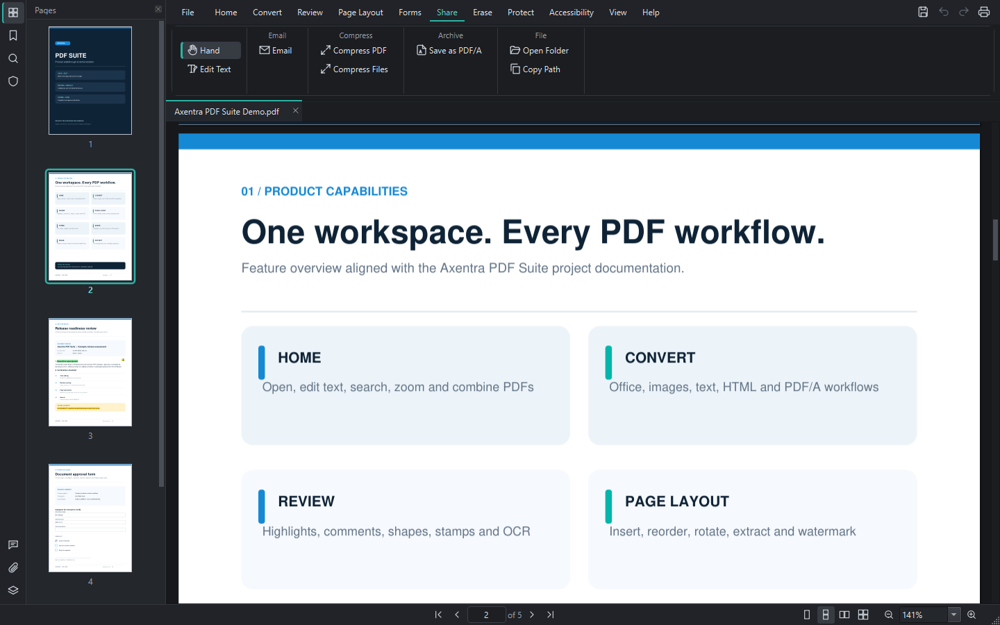

# Axentra PDF Suite

<!-- current-suite-state -->
## Current local status — 2026-10-16

0.3.8. Public release: **0.3.4**. Local PDF development and packaging are ahead of the public release. Windows MSI uses the shared suite directory and removes the older product early during major upgrades.

Updated Windows installation target: `C:\Program Files\Axentra\PDF`. Installers request administrator rights; existing user data remains in its application data directory.

This status supersedes older installation-path and preparation notes below. Historical release checksums apply only to their original artifacts.

<!-- /current-suite-state -->

<!-- local-release-preparation -->
## Prepared version: 0.3.8

This version is prepared locally and is awaiting approval to upload a GitHub Release draft.
The previously documented version was **0.3.4**.
See [release notes, build status and SHA-256 hashes](releases/0.3.8.md) and [changelog](CHANGELOG.md).

- Glass + Precision coral document app icon across the app, taskbar and installers; Glossy is now the default PDF file icon.
- System tray menu and single-instance behavior: opening another PDF adds a tab in the running window; Command can host the tray entry.
- Blue suite accent across the ribbon, thumbnails, form editor and reports.
- Installer asks before removing a different installed Axentra copy and shows removal progress; unattended installs do not remove other software.

Prepared installers: `AxentraPDF-0.3.8-Setup.exe` for interactive setup and `AxentraPDF-0.3.8.msi` for managed deployment. Existing installation instructions below describe the previously published 0.3.4 release. Check the new release's SHA-256 before running a prepared installer.

Pending: Draft release assets remain local at Shawn's request. Pushing and publishing still require approval.; Installers are unsigned; Smart App Control can block them. Code signing and fresh VirusTotal scans remain pending.
<!-- /local-release-preparation -->
A complete desktop PDF editor for Windows: view, edit, convert, compress, fill, sign and protect PDFs.
No account, activation, trial or subscription, and nothing is sent online.

**Latest published version: 0.3.4** · [Download](https://github.com/MECMwithShawn/Axentra-Software/releases/tag/pdf-suite-v0.3.4) ·
[Release notes](releases/0.3.4.md) · [Security scans](security/virustotal.md)

**VirusTotal status for 0.3.4:** installer (.exe) **1 / 68** detections (Deep Instinct only),
source archive **0 / 66** detections; both scanned on **2026-10-14**. The MSI scan is **pending**.
See the [per-file reports and review notes](security/virustotal.md) for details.

## Features

| Tab | What you can do |
|---|---|
| **Home** | The everyday commands in one place: edit text, add text, QuickSign, create and combine PDFs, convert to Word/Excel, insert/rotate/delete/extract pages, highlight, find, zoom, Compress PDF |
| **Convert** | Create PDFs from Office documents, images, text or the clipboard; export to Word, Excel, PowerPoint, images, text, HTML and PDF/A |
| **Review** | Highlights, underline, strikeout, sticky notes, text boxes, shapes, drawing, stamps, images, attachments; OCR for scanned pages; compare two versions of a document; comments pane with replies |
| **Page Layout** | Insert, delete, extract, split, duplicate, rotate and reorder pages; header and footer, watermark, Bates numbering, background; bookmarks and links |
| **Forms** | Fill forms; create text, checkbox, radio, list, button and signature fields; tab order; import and export form data; required-field check; flatten |
| **Share** | Email; **Compress PDF** (Extreme / Recommended / Less, showing each level's real size first) and **Compress Files** for many PDFs at once |
| **Erase** | Redaction by area, text, search or pattern (emails, phone numbers, SSNs…); remove hidden information |
| **Protect** | Password security and permissions (AES-256), digital signatures and certification, QuickSign handwritten signatures, digital IDs, signature validation |
| **Accessibility** | Accessibility checker with one-click fixes, read aloud |

Also: edit existing text in place like a word processor, undo/redo for every change, automatic recovery
of unsaved work, light and dark themes, and a ribbon laid out like the major commercial PDF editors.

## Screenshots

| | |
|---|---|
|  Home |  Start page |
|  Review |  Page Layout |
|  Forms |  Erase (redaction) |
|  Protect |  Share and Compress |

## System requirements

- Windows 10 or 11, 64-bit
- About 400 MB of disk space
- Optional: LibreOffice (Office → PDF conversion) and Ghostscript (PDF/A). OCR language data downloads from
  inside the app (*Convert → OCR Languages*).

## Installation

Download from the [release page](https://github.com/MECMwithShawn/Axentra-Software/releases/tag/pdf-suite-v0.3.4):

| File | Use it for |
|---|---|
| `AxentraPDF-0.3.4-Setup.exe` | Installing on your own PC (choose the folder, desktop icon, PDF association) |
| `AxentraPDF-0.3.4.msi` | Silent or managed installs, e.g. `msiexec /i AxentraPDF-0.3.4.msi /qn` (Intune, Group Policy) |

Axentra installs for all users and, by default, makes itself the default PDF app with Windows'
default-associations policy: **sign out and back in once** after installing. Untick *Force Axentra PDF as the
default PDF app* to be asked instead (Windows' Default apps page opens: click the `.pdf` row and choose Axentra
PDF). MSI: `FORCEDEFAULTPDF=0` turns the policy off. Microsoft documents the policy for Windows Pro, Enterprise
and Education.

**PDF file icon:** PDF files get their own icon, separate from the app's: Flat, Glossy, or the app icon. The
installer shows a preview of each; change it later in *File → Preferences → Windows*.

**Updating:** run the newer installer. It closes Axentra if it's open (unsaved work is kept for recovery),
upgrades in place and reopens it.

Verify the download against the SHA-256 in the [release notes](releases/0.3.4.md) before running it.

> **Windows SmartScreen:** the installers are not code-signed yet, so Windows shows "Windows protected your
> PC" the first time. Choose **More info → Run anyway** after checking the checksum. On PCs with Smart App
> Control turned on, unsigned apps are blocked. See [security](security/virustotal.md#code-signing).

## Licence and source code

Axentra PDF Suite is free software under the GNU Affero General Public License v3.0 or later (it is built on
MuPDF/PyMuPDF, which are AGPL). The complete source code for each release is attached to its release as
`AxentraPDF-<version>-source.zip`.
