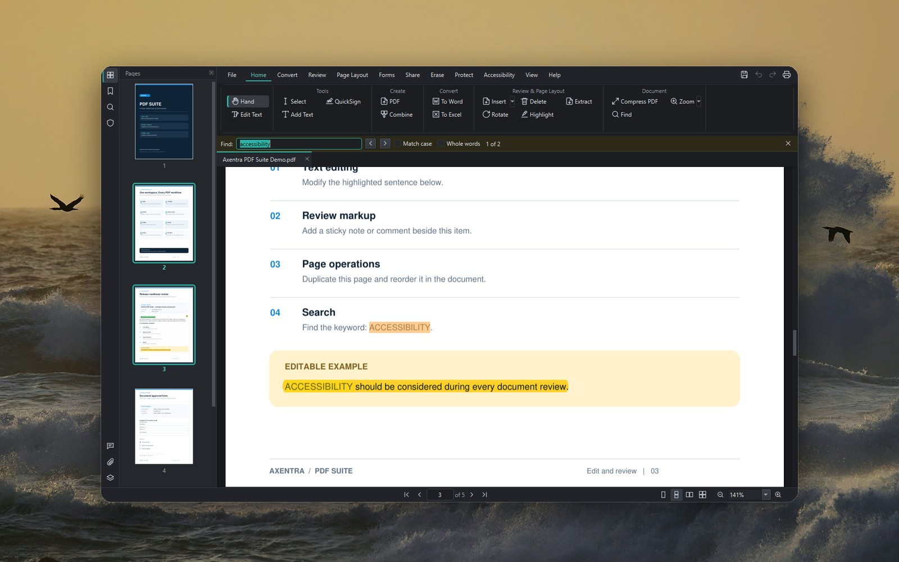
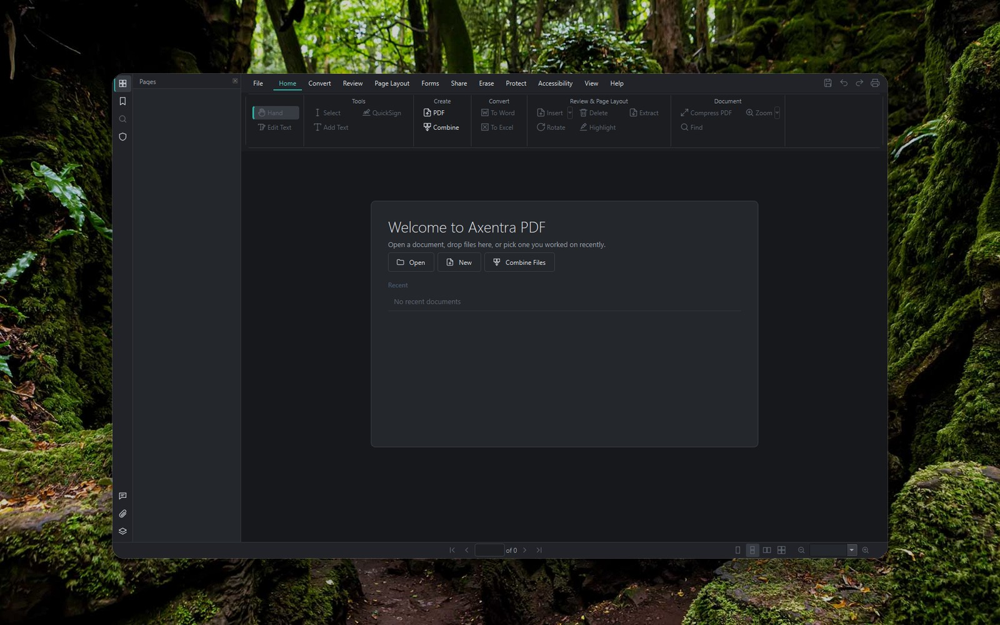
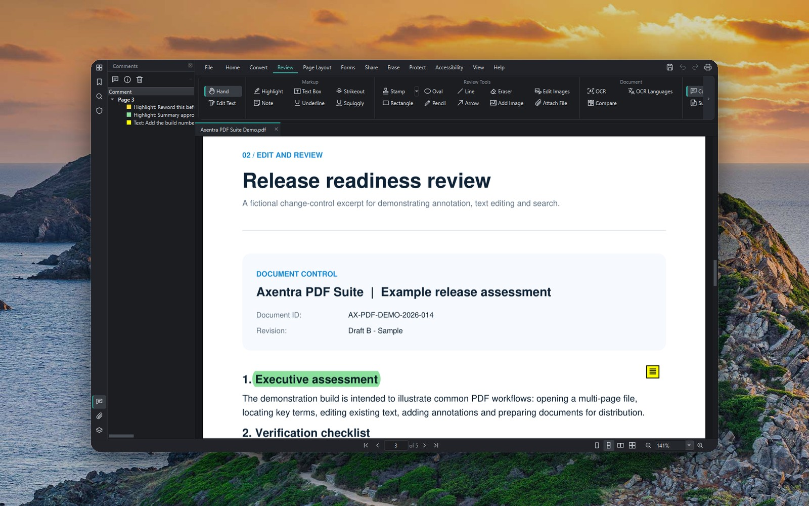
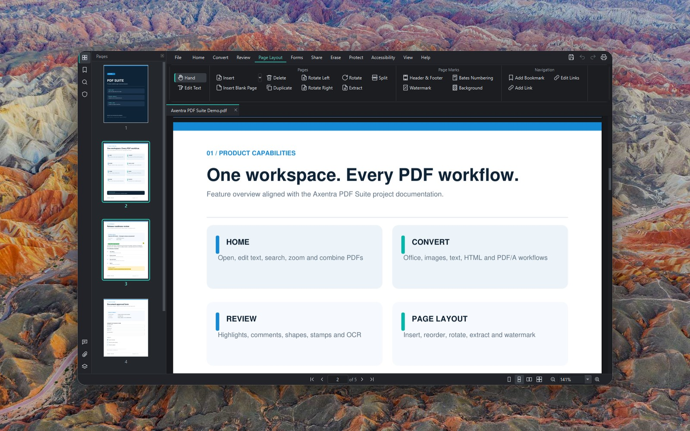
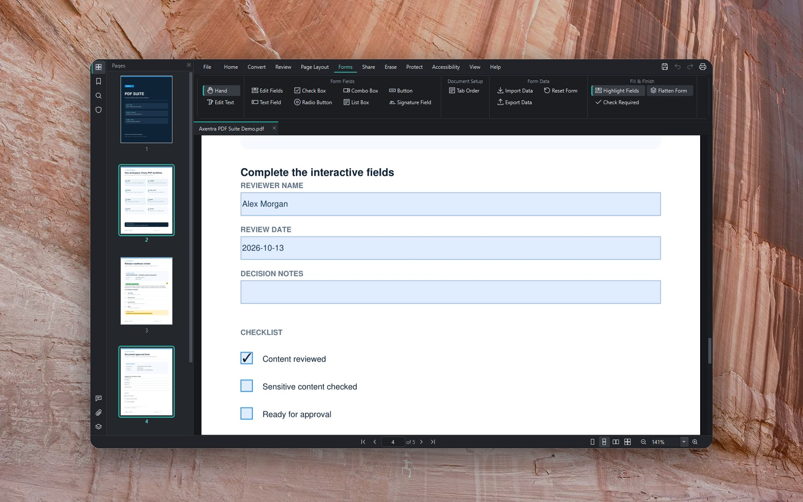
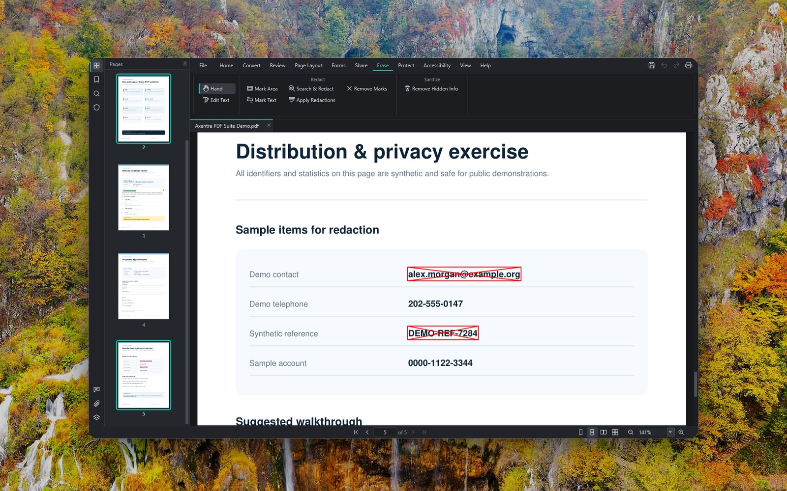
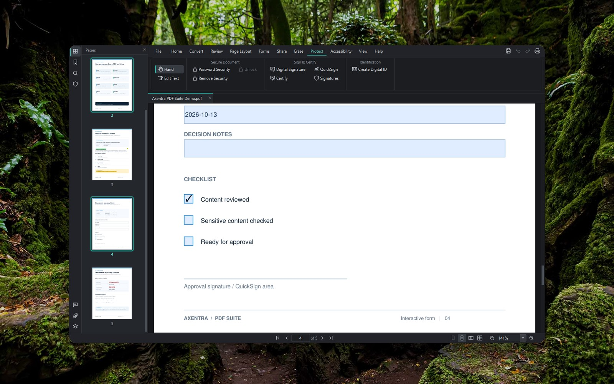
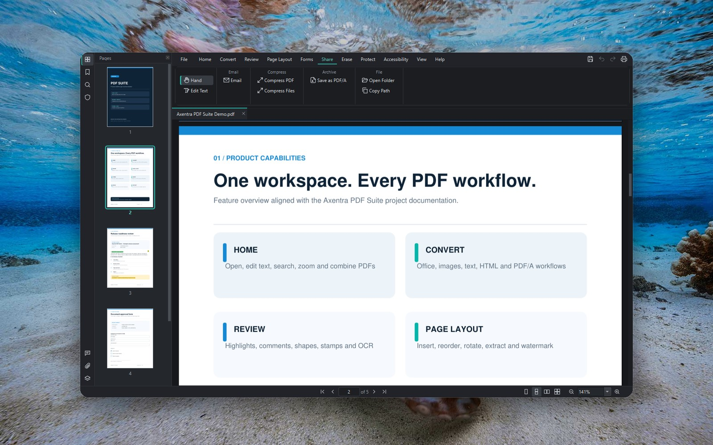

# Axentra PDF Suite

A complete desktop PDF editor for Windows: view, edit, convert, compress, fill, sign and protect PDFs.
No account, activation, trial or subscription, and nothing is sent online.

**Latest version: 0.3.3** · [Download](https://github.com/MECMwithShawn/Axentra-Software/releases/tag/pdf-suite-v0.3.3) ·
[Release notes](releases/0.3.3.md) · [Security scans](security/virustotal.md): 0 detections on VirusTotal

## Features

| Tab | What you can do |
|---|---|
| **Home** | The everyday commands in one place: edit text, add text, QuickSign, create and combine PDFs, convert to Word/Excel, insert/rotate/delete/extract pages, highlight, find, zoom, Compress PDF |
| **Convert** | Create PDFs from Office documents, images, text or the clipboard; export to Word, Excel, PowerPoint, images, text, HTML and PDF/A |
| **Review** | Highlights, underline, strikeout, sticky notes, text boxes, shapes, drawing, stamps, images, attachments; OCR for scanned pages; compare two versions of a document; comments pane with replies |
| **Page Layout** | Insert, delete, extract, split, duplicate, rotate and reorder pages; header and footer, watermark, Bates numbering, background; bookmarks and links |
| **Forms** | Fill forms; create text, checkbox, radio, list, button and signature fields; tab order; import and export form data; required-field check; flatten |
| **Share** | Email; **Compress PDF** (Extreme / Recommended / Less, showing each level's real size first) and **Compress Files** for many PDFs at once |
| **Erase** | Redaction by area, text, search or pattern (emails, phone numbers, SSNs…); remove hidden information |
| **Protect** | Password security and permissions (AES-256), digital signatures and certification, QuickSign handwritten signatures, digital IDs, signature validation |
| **Accessibility** | Accessibility checker with one-click fixes, read aloud |

Also: edit existing text in place like a word processor, undo/redo for every change, automatic recovery
of unsaved work, light and dark themes, and a ribbon laid out like the major commercial PDF editors.

## Screenshots

| | |
|---|---|
|  Home |  Start page |
|  Review |  Page Layout |
|  Forms |  Erase (redaction) |
|  Protect |  Share and Compress |

Background photos are Bing daily images, shown for illustration; all rights remain with their owners:

- Danxia landform, Zhangye National Geopark, Gansu, China (© Weiquan Lin/Getty Images)
- Double-crested cormorants over Monterey Bay, California (© Hiroya Minakuchi/Minden Pictures)
- Moss-covered rocks in Puzzlewood, Forest of Dean, Gloucestershire, England (© Fulcanelli_AOS/Getty Images)
- Octopus in defensive posture, Mayotte, Indian Ocean (© Gabriel Barathieu/Minden Pictures)
- Plitvice Lakes National Park, Croatia (© Jan Wlodarczyk/Alamy)
- View of the Sanguinaires Islands from Corsica, France (© Francesco Riccardo Iacomino/Getty Images)
- White House Ruin at Canyon de Chelly National Monument in Arizona (© Ingo Arndt/Minden Pictures)

## System requirements

- Windows 10 or 11, 64-bit
- About 400 MB of disk space
- Optional: LibreOffice (Office → PDF conversion) and Ghostscript (PDF/A). OCR language data downloads from
  inside the app (*Convert → OCR Languages*).

## Installation

Download from the [release page](https://github.com/MECMwithShawn/Axentra-Software/releases/tag/pdf-suite-v0.3.3):

| File | Use it for |
|---|---|
| `AxentraPDF-0.3.3-Setup.exe` | Installing on your own PC (choose the folder, desktop icon, PDF association) |
| `AxentraPDF-0.3.3.msi` | Silent or managed installs, e.g. `msiexec /i AxentraPDF-0.3.3.msi /qn` (Intune, Group Policy) |

Axentra installs for all users and, by default, makes itself the default PDF app with Windows'
default-associations policy: **sign out and back in once** after installing. Untick *Force Axentra PDF as the
default PDF app* to be asked instead (Windows' Default apps page opens: click the `.pdf` row and choose Axentra
PDF). MSI: `FORCEDEFAULTPDF=0` turns the policy off. Microsoft documents the policy for Windows Pro, Enterprise
and Education.

**Updating:** run the newer installer. It closes Axentra if it's open (unsaved work is kept for recovery),
upgrades in place and reopens it.

Verify the download against the SHA-256 in the [release notes](releases/0.3.3.md) before running it.

> **Windows SmartScreen:** the installers are not code-signed yet, so Windows shows "Windows protected your
> PC" the first time. Choose **More info → Run anyway** after checking the checksum. On PCs with Smart App
> Control turned on, unsigned apps are blocked. See [security](security/virustotal.md#code-signing).

## Licence and source code

Axentra PDF Suite is free software under the GNU Affero General Public License v3.0 or later (it is built on
MuPDF/PyMuPDF, which are AGPL). The complete source code for each release is attached to its release as
`AxentraPDF-<version>-source.zip`.
