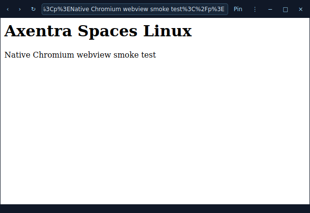

# Axentra Spaces on Linux

Verified 2026-10-17 on Zorin OS 18.1 (Ubuntu 24.04), x86_64. Source version **0.1.2**; **development preview**, not a published stable Linux release.

## Run

Open **Axentra Spaces** from the application menu, or run:

```bash
~/.local/share/axentra/apps/spaces/AxentraSpaces
```

The preview is installed for the desktop user, with a separate folder for each app. Data and profiles live outside the application folder. Installation does not enable startup or change default applications.

## Available

Native QtWebEngine floating windows, URL navigation, zoom, pin/maximize, saved layouts, tray controls, downloads with a Save dialog, permission prompts, single-instance IPC and opt-in sign-in startup.

## Verification

4 layout/storage tests passed. The installed QtWebEngine window loaded a local fixture, displayed it and saved its layout successfully.

## Remaining work and requirements

QtWebEngine replaces WebView2 on Linux. Global Windows hotkeys and Windows window-placement integrations are not reproduced. DRM/Widevine services, login-heavy sites and Wayland window positioning need separate validation. The screenshot is a local smoke-test page.

## Screenshot



Local test page in a native QtWebEngine window.
