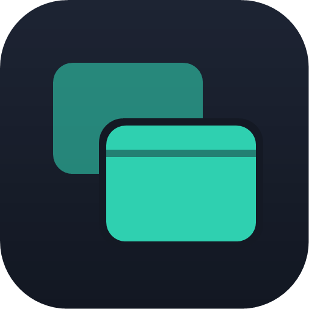
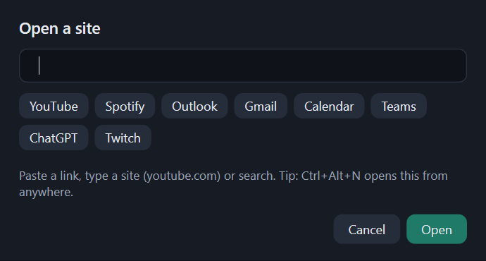

# Axentra Spaces

Real, borderless browser windows that float anywhere on your Windows desktop. Put a YouTube video in one corner,
Spotify in another and Outlook down the side. Pin any of them above everything else, and save the arrangement as a
layout you can switch back to. Every site works, because each window is a full Microsoft Edge (WebView2) browser,
not an embedded frame. Spaces pairs with the [Axentra Horizon](../Edge-Extension-Suite/Horizon/) new tab
extension. There's no account, subscription, ads or tracking.


**Latest version: 0.1.0** · [Download](https://github.com/MECMwithShawn/Axentra-Software/releases/tag/spaces-v0.1.0) ·
[Release notes](releases/0.1.0.md) · [Security scans](security/virustotal.md)

## Features

| Area | What you get |
|---|---|
| **Borderless windows** | No title bar or frame, just the site. Hover the thin strip at the top for back, forward, reload, the address box, pin on top, open in Edge, minimize, maximize and close |
| **Always on top** | Pin any window above every other app, like picture-in-picture for whole sites |
| **Spaces** | Named layouts (for example *Work* and *Chill*) that remember each window's site, position, size and pin. Create, rename, delete and switch them from the tray icon |
| **Stays signed in** | All windows share one private browser profile, so you sign in to YouTube, Spotify or Outlook once |
| **Keeps playing** | `Ctrl+Alt+Space` hides every window and brings them back; music and video keep playing while hidden |
| **Pop-ups** | Sign-in and other pop-up windows open as Spaces windows too, and full-screen video works |
| **Works with Horizon** | In Horizon, turn on *Settings → Board → Open new windows in Axentra Spaces* and its **Window** button sends sites here |
| **Starts with Windows** | Optional: waits in the tray, ready for `Ctrl+Alt+N` |

## Screenshots

| | |
|---|---|
|  A borderless window: just the site |  New window (`Ctrl+Alt+N`): paste a link or pick a favorite site |

## Shortcuts

| Keys | Action |
|---|---|
| `Ctrl+Alt+N` | New window |
| `Ctrl+Alt+Space` | Hide or show all windows |

The tray icon has the rest: New window, Show/Hide, Space (switch, new, rename, delete), Start with Windows, About,
Exit.

## System requirements

- Windows 10 (version 1809 or later) or Windows 11, 64-bit
- Microsoft Edge WebView2 Runtime. It's built into Windows 11 and current Windows 10, and the installer checks for it.
- About 75 MB of disk space, plus the browser cache for the sites you open

## Installation

Download from the [release page](https://github.com/MECMwithShawn/Axentra-Software/releases/tag/spaces-v0.1.0) and
check the SHA-256 against the [release notes](releases/0.1.0.md):

| File | Use it for |
|---|---|
| `AxentraSpaces-0.1.0-Setup.exe` | Installing on your PC. It installs for your user only, so no administrator rights are needed. It adds a Start menu shortcut, plus an optional desktop shortcut and an option to start when you sign in |
| `AxentraSpaces-0.1.0-portable.exe` | Running without installing. Horizon's *Open in Axentra Spaces* needs the installed version, or one run of the portable exe, so Windows knows the `axentra-spaces://` link |

Spaces isn't code-signed yet, so Windows SmartScreen may say *Windows protected your PC*. Click **More info → Run
anyway**, after checking the checksum.

Installed files and data:

| What | Where |
|---|---|
| Program | `%LOCALAPPDATA%\Programs\Axentra Spaces` |
| Layouts (spaces) | `%APPDATA%\Axentra\Spaces\spaces.json` |
| Browser data (sign-ins, cookies, cache) | `%LOCALAPPDATA%\Axentra\Spaces\WebView2` |

**Updating:** run the newer installer. It closes Spaces, upgrades it in place and keeps your layouts and sign-ins.

**Uninstalling:** go to *Settings → Apps → Installed apps → Axentra Spaces*. This removes the program, the link
handler and the startup entry. Your layouts and browser data stay until you delete the two folders above.

## Opening sites from other apps

Spaces registers the `axentra-spaces://` link for your user:

```
axentra-spaces://open?url=https%3A%2F%2Fwww.youtube.com%2F    open a site (http and https only)
axentra-spaces://new                                           show the New window box
```

If Spaces is already running, the link goes to it and no second copy starts.

## Privacy

Spaces has no servers, accounts, analytics or ads, and Axentra never receives any data from it. It loads only the
sites you open, and they see a normal visit from Microsoft Edge. Layouts, sign-ins and browsing data stay on your PC
in the folders above.

## Built with

C# and WPF on .NET 8 with Microsoft Edge WebView2. The installer is made with Inno Setup.
