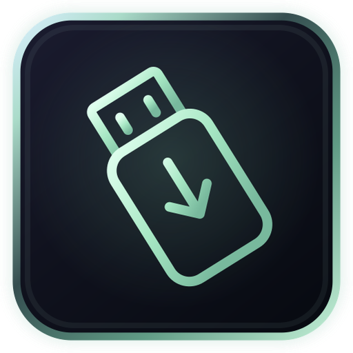
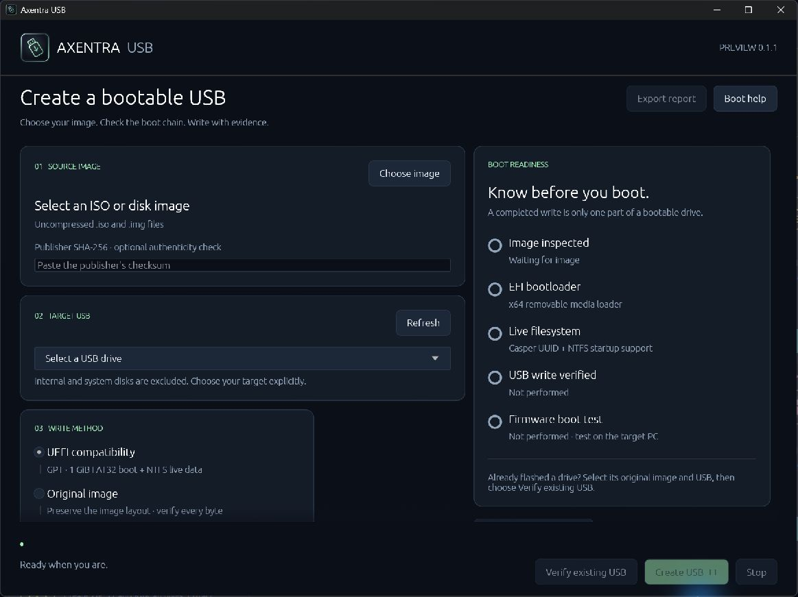

# Axentra USB



Create, inspect and verify bootable USB drives. A native Rust app for Windows and Linux, with a deliberate image → device → confirmation → verification workflow.

**0.1.1 is a preview.** The Windows app and installer have been built and installed locally. No public binary release is attached yet. Physical USB writing and actual firmware boot remain unvalidated; use spare media for hardware evaluation. No USB was erased or written during this branding update.



## Source and builds

The complete [Rust source](source/), [locked dependencies](source/Cargo.lock), [license](source/LICENSE), [dependency notices](source/THIRD-PARTY-NOTICES.txt), [validation history](source/VALIDATION.txt) and [changelog](source/CHANGELOG.md) are included.

On Windows, install Rust 1.95+, the Visual Studio C++ build tools/Windows SDK, Inno Setup 6 and Python 3.11+. From `USB/source` run:

```powershell
./build.ps1
```

The script runs the safe file-backed tests, builds the native executable, and creates the installer, portable ZIP, source ZIP and checksums under `dist/`. The app itself requires no Python or browser runtime. The installer creates `Program Files\Axentra\USB`, Start menu and optional desktop shortcuts.

For development without packaging:

```sh
cargo test --locked
cargo build --release --locked
```

Linux source and packaging are included. The earlier 0.1.0 Linux build was cross-compiled; this Windows branding update does not claim a new Linux build or Linux hardware validation. See the [full app documentation](source/README.md) for dependencies, compatibility limits and storage behavior.

## Icon and Command

The approved icon uses mint USB linework, a dark glass tile and a luminous rim. Its [editable SVG, Windows ICO and nine PNG sizes](source/assets/) include [regeneration instructions](source/assets/README.md).

The icon is embedded in the Windows executable and native window, shown in the app header, used by Setup and the uninstaller, and assigned to both Windows shortcuts. The process and shortcuts share `Axentra.USB` for taskbar grouping. The Linux launcher uses the same SVG.

Command 0.1.12 includes the matching card icon and built-in app definition. The portable [Command manifest](source/axentra.app.json) uses standard install paths and a source path under this repository. A local Command override may point to a different development checkout.

## Validation

- 30 USB tests passed; the Windows release and installer built successfully.
- All seven embedded Windows icon frames match the approved ICO byte for byte.
- Installed app and portable executable match the tested release binary.
- Installed Start menu/desktop icons and application IDs verified; the native header/window visually checked.
- Command 0.1.12: 20 tests passed, one existing test ignored; live app status reports USB 0.1.1 installed and running.
- The app and installer are unsigned. No new antivirus scan or hardware boot claim is made.

See [0.1.1 release notes and local-build checksums](releases/0.1.1.md) and [security/build status](security/README.md).
