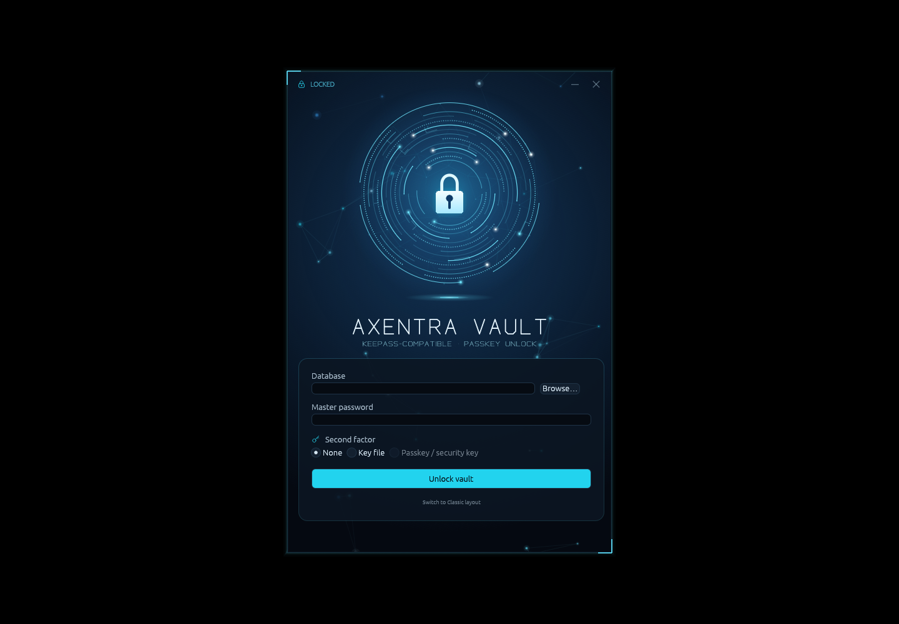

# Axentra Vault on Linux

Verified 2026-10-17 on Zorin OS 18.1 (Ubuntu 24.04), x86_64. Source version **0.1.0**; **development preview**, not a published stable Linux release.

## Run

Open **Axentra Vault** from the application menu, or run:

```bash
~/.local/share/axentra/apps/vault/axentra-vault
```

The preview is installed for the desktop user, with a separate folder for each app. Data and profiles live outside the application folder. Installation does not enable startup or change default applications.

## Available

KeePass vault operations, backup/restore, private filesystem permissions, no-follow file creation, atomic no-clobber rename, clipboard integration, Linux process hardening and a local USB FIDO2 PRF helper.

## Verification

235 Rust tests passed across the workspace; 4 interactive/UI tests skipped. Native egui startup passed. USB hardware authentication remains untested.

## Remaining work and requirements

The USB PRF provider needs a compatible security key and user verification; it has not been exercised against physical hardware. Phone/hybrid passkeys are not supported by this provider. Use an enrolled USB key or the vault backup key file. X11 screenshot exclusion is unavailable; clipboard managers may retain copied data. This port is not a security certification.

## Screenshot



Empty unlock screen; no vault opened.
