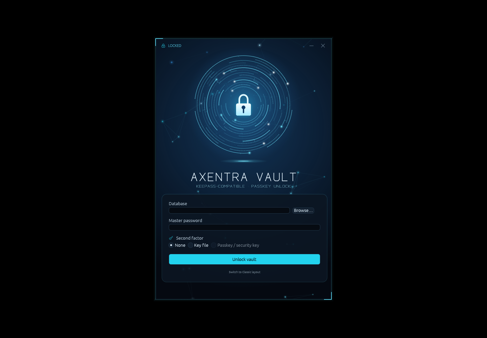

# Axentra Vault on Linux

Verified 2026-10-17 on Zorin OS 18.1 (Ubuntu 24.04), x86_64. Source version **0.1.0**; **development preview**, not a published stable Linux release.

## Run

Open **Axentra Vault** from the application menu, or run:

```bash
~/.local/share/axentra/apps/vault/axentra-vault
```

The preview is installed for the desktop user, with a separate folder for each app. Data and profiles live outside the application folder. Installation does not enable startup or change default applications.

## Available

KeePass vault operations, backup/restore, private filesystem permissions, no-follow file creation, atomic no-clobber rename, clipboard integration, Linux process hardening and a local USB FIDO2 PRF helper.

## Verification

235 Rust tests passed across the workspace; 4 interactive/UI tests skipped. Native egui startup passed. USB hardware authentication remains untested.

## Remaining work and requirements

The USB PRF provider needs a compatible security key and user verification; it has not been exercised against physical hardware. Phone/hybrid passkeys are not supported by this provider. Use an enrolled USB key or the vault backup key file. X11 screenshot exclusion is unavailable; clipboard managers may retain copied data. This port is not a security certification.

## Linux package updates

The Zorin `.deb` builds (`axentra-vault_0.1.0-N_amd64.deb`) carry these fixes. The source version is still **0.1.0**.

| Package | Date | Fix |
| --- | --- | --- |
| 0.1.0-5 | 2026-10-21 | The Floating layout no longer closes right after unlock on Wayland. |
| 0.1.0-6 | 2026-10-22 | Copy works on Wayland. The clipboard now runs through XWayland. |
| 0.1.0-7 | 2026-10-31 | File and message dialogs open as part of the Vault window. |
| 0.1.0-8 | 2026-10-31 | The desktop file picker can identify Vault, so it no longer opens as a separate app. Message dialogs still open separately. |
| 0.1.0-9 | 2026-11-07 | Pasting a copied secret is instant even while Vault is hidden or minimized. It is served from its own thread, which also clears the clipboard after 12 seconds, including while Vault is minimized. A later copy from another app is left alone. Confirmed on the desktop 2026-11-08. |
| 0.1.0-10 | 2026-11-08 | Code review fixes: a warning before saving the backup key file into ~/OneDrive, smoother unlock animation, back-to-back file pickers stay attached to Vault, backups work on NFS and FUSE drives, and the window buttons stay clickable at the top edge. |

## Source

The source is in [`source/`](source/), exported from local commit `a6b3811` (branch `audit/fixes`). Build with `cargo build --release --locked` in `source/`; the Linux build needs `libgtk-3-dev`, `libayatana-appindicator3-dev`, `libxdo-dev` and `libfido2-dev`.

## Screenshot



Empty unlock screen; no vault opened.
