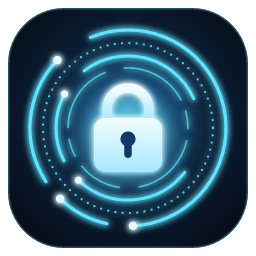
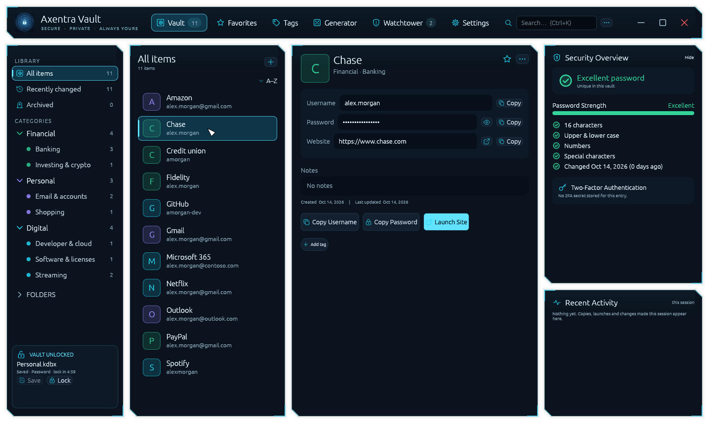
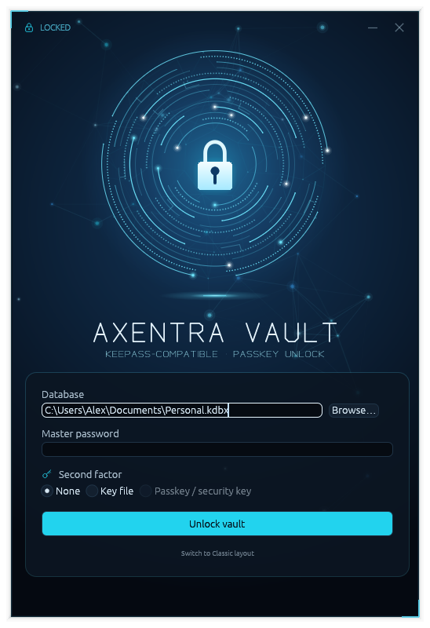
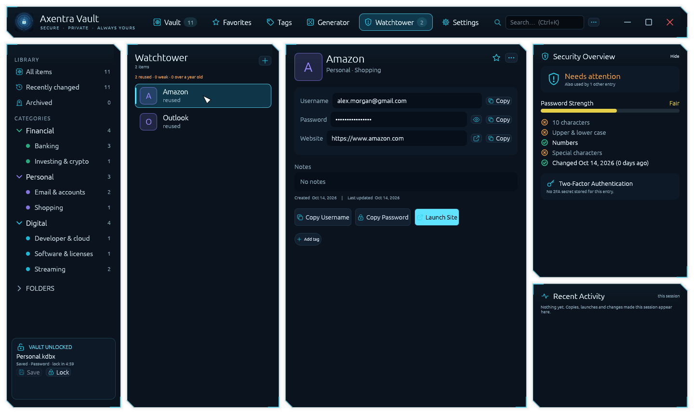
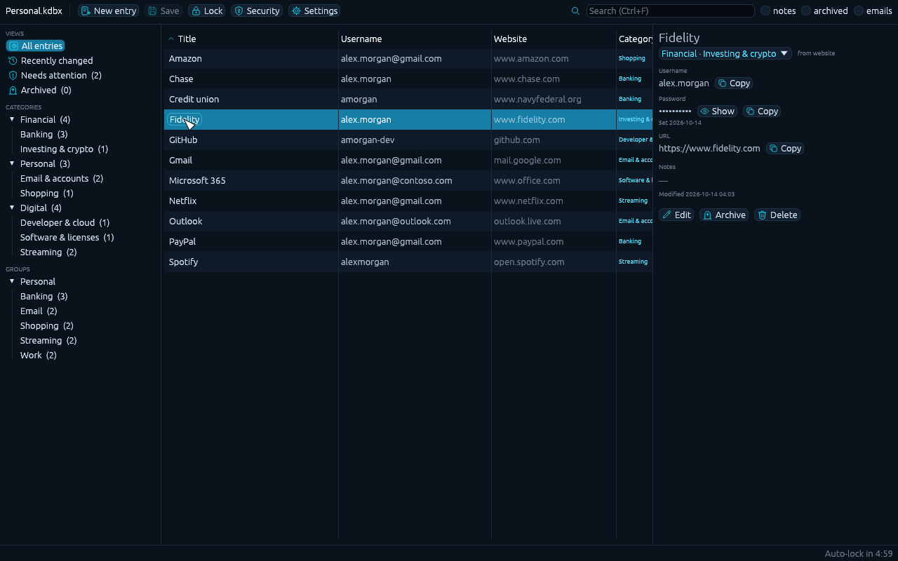

# Axentra Vault

A password manager for Windows that keeps your passwords in a standard KeePass (`.kdbx`) file on your own PC.
It can be unlocked with your master password plus your **iPhone or Android passkey**, or a **YubiKey or other FIDO2
security key**. There's no account, cloud service, subscription or tracking. Your vault stays a normal KeePass
file, so KeePass, KeePassXC and phone KeePass apps can still open it.

**Status: not released yet.** Axentra Vault is going through an independent security review before its first public
release. Installers will appear on this repository's
[Releases](https://github.com/MECMwithShawn/Axentra-Software/releases) page, with checksums and virus-scan results
here, once that review is complete.

## Features

| Area | What you get |
|---|---|
| **Passkey and security-key unlock** | Unlock with your master password plus a phone passkey (iPhone, Android) or a FIDO2 security key such as a YubiKey. Register several keys, and any one of them unlocks the vault. Removing a key changes the vault's key, so the removed one really stops working |
| **Backup key file** | Setting up passkey unlock also saves a standard KeePass key file (`.keyx`). Keep it offline: with your master password it opens the vault in any KeePass app, even without the phone or key |
| **KeePass compatible** | Reads and writes KDBX 4 with AES-256 or ChaCha20, and Argon2id or AES-KDF. History, attachments, custom fields, tags, icons, auto-type settings and protected values are kept intact |
| **Search that finds the right entry** | Ranked results, with the best match first. Results that only match an email domain (such as `@outlook.com`) are hidden until you ask for them, so searching *outlook* finds Outlook, not every account that uses an Outlook address |
| **Smart categories** | Entries are sorted into categories automatically: Banking, Credit cards, Investing, Bills, Shopping, Travel, Health, Email, Developer and more. You can override the category for any entry |
| **Archive** | Retire old accounts without deleting them. Archived entries keep their full history and stay out of everyday views and search |
| **Previous passwords** | See every earlier password for an entry and when it changed |
| **Watchtower** | Flags reused, weak and old passwords. It works entirely offline |
| **Protected fields** | Mark notes or custom fields as protected, so they stay hidden until you click Show |
| **Site icons** | Optional. Downloads each website's own logo straight from that site, with no third-party icon service, and stores it in the vault |
| **Safe clipboard** | Copied passwords are kept out of Windows clipboard history and cloud clipboard, and cleared after 12 seconds |
| **Auto-lock** | Locks after 5 minutes without input. If saving fails, it still locks and keeps your unsaved changes encrypted until you unlock |
| **Two layouts** | *Floating Modular*, with glass panels in a frameless window, or *Classic*, a familiar table view. In Classic you choose and sort the columns, including your own custom fields |

## Screenshots

| | |
|---|---|
|  Locked: a compact unlock card |  Watchtower flags reused passwords |
|  Floating Modular layout |  Classic layout |

Screenshots use made-up demo data.

## How passkey unlock works

1. **Setup.** Axentra Vault registers a passkey on your phone or security key.
2. **Wrapping the key.** The passkey's PRF extension produces a secret that only that passkey can recreate. Axentra
   Vault uses it to encrypt (wrap) the vault's 32-byte key file, using HKDF-SHA256, then AES-256 with HMAC-SHA256. The
   wrapped key is saved next to your vault as `<vault>.kdbx.axvault`. The same key is saved as your backup key file.
3. **Unlocking.** You need your master password **and** one of: an approved passkey or security key, or the backup
   key file. The `.axvault` file is useless on its own.
4. **Format.** The `.kdbx` format is unchanged, so other KeePass apps open the vault with the master password plus
   the backup key file.

## System requirements

- Windows 11, or Windows 10 for password and key-file unlock only. 64-bit.
- Passkey and security-key unlock need a current Windows 11 (Windows WebAuthn with PRF support), plus one of:
  - an iPhone or Android phone with passkeys
  - a FIDO2 security key with `hmac-secret`, such as the YubiKey 5 series or Security Key series. A FIDO2 PIN must be set.

## Your data

| What | Where |
|---|---|
| Your vault | Wherever you keep your `.kdbx` file. The app never uploads it |
| Wrapped passkey key | `<vault>.kdbx.axvault`, next to the vault |
| Previous version of the vault | `<vault>.kdbx.bak`, encrypted with the same key as the vault |
| Preferences | `%APPDATA%\Axentra Vault`: last-opened file path, layout, column choices and sort. Never passwords or entry data |

The app only goes online when you click **Download site icons**.

## License

Axentra Vault is free software under the GNU General Public License v3.0 or later. Each release will include its
source code.
