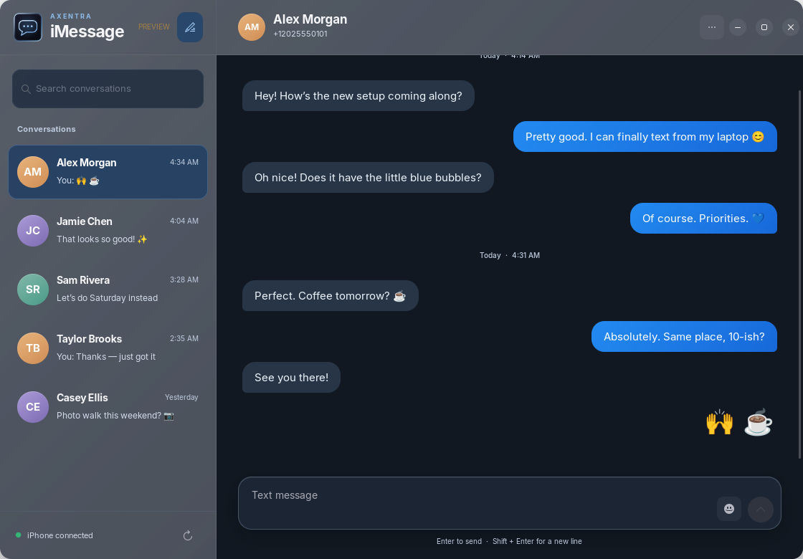

# Axentra iMessage

iPhone messaging over Bluetooth, with a native GTK interface and a Rust background service. The refreshed interface uses the Axentra conversation icon, slate incoming bubbles, blue outgoing bubbles and an opaque reading surface. Optional glass remains on the surrounding chrome.

## Preview status

Locally installed on Zorin OS. No public installer is available yet. The background service is Rust 0.1.0; the existing Python/GTK frontend still requires migration to Rust. Windows and full cross-platform support are not validated.

The service accesses recent messages through Bluetooth MAP and contact names through PBAP. Bluetooth does not expose the full iCloud archive. Attachments, reliable group sending and delivery/read receipts are unavailable. Bubble color does not identify the transport as iMessage versus SMS/RCS.

Message history and contact names remain encrypted locally using the desktop keyring. This repository contains only documentation, artwork and fictional preview data. Application source is kept in the private Axentra-iMessage repository.

## Command integration

Axentra Command's catalog includes this preview. The existing local installation is registered through a user manifest with its own icon and desktop launcher. It launches the already installed app; this listing does not download or install a package. Python-wide process detection is deliberately omitted, so Command cannot yet report frontend running status reliably.

## Validation — 2026-10-21

- 17 frontend/model tests and 9 locked Rust service tests passed.
- Restarted the installed UI; it reported iPhone connected.
- Command listed the app, loaded its PNG and launched it through the desktop entry.
- Command's existing tray icon registered as Active; closing its window retained the tray and its Open action reopened the window.
- Outbound messages were not sent during these checks. Sign-out and suspend testing remain deferred.
